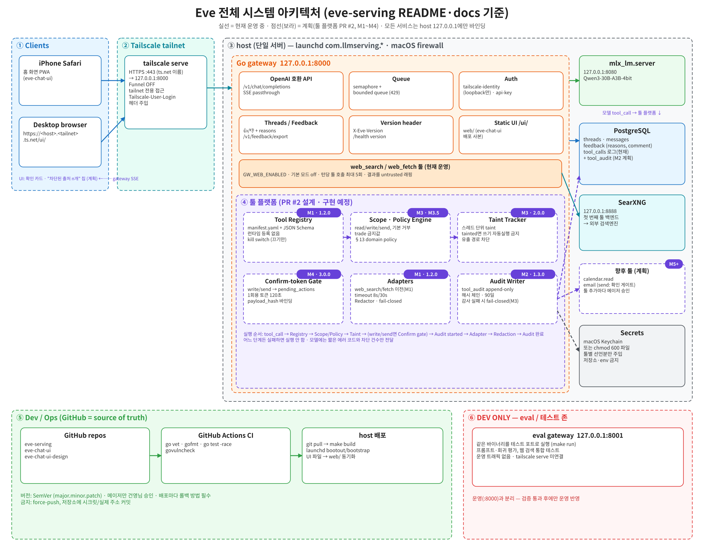
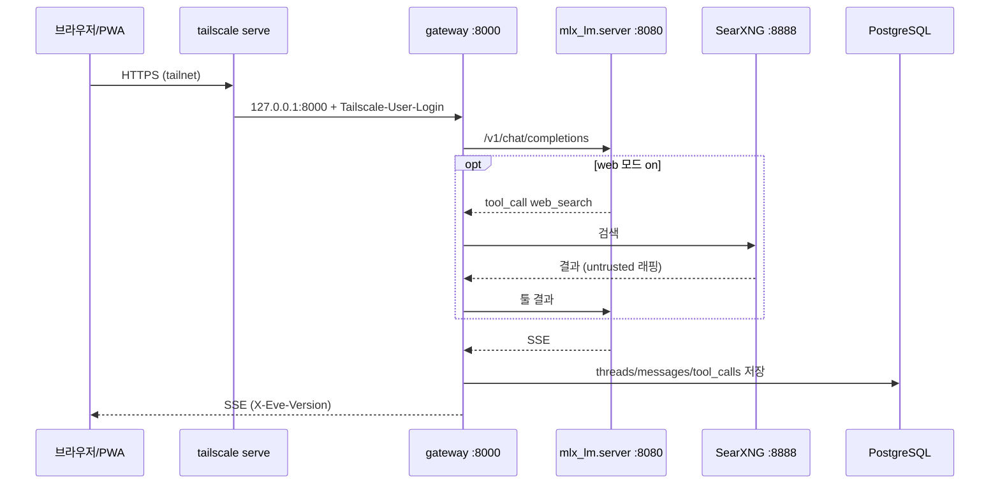

# Eve 시스템 아키텍처

> 원본: [`diagrams/eve-system-architecture.excalidraw`](diagrams/eve-system-architecture.excalidraw) (excalidraw.com에서 열어 편집 → SVG 다시 내보내기)

Eve는 단일 host(서버)에서 로컬 LLM을 서빙하는 시스템입니다. 모든 내부 서비스는 `127.0.0.1`에만 바인딩되고, 외부 접근은 tailnet 전용 `tailscale serve`(HTTPS)로만 이루어집니다.

## 구성 요소 — 현재 운영 vs 계획

| 구성 요소 | 상태 | 문서 |
|---|---|---|
| Go gateway (`cmd/gateway`, `internal/*`) | 현재 (v1.1.0) | [gateway.md](gateway.md) |
| 모델 서빙 (`mlx_lm.server`, Qwen3-30B-A3B-4bit) | 현재 | [model-serving.md](model-serving.md) |
| PostgreSQL (goose 마이그레이션 00001~00003) | 현재 | [postgresql.md](postgresql.md) |
| 웹 검색 (`web_search`/`web_fetch` + SearXNG) | 현재 (기본 off) | [searxng-web-search.md](searxng-web-search.md) |
| 웹 UI (eve-chat-ui, 별도 저장소, `/ui/`로 서빙) | 현재 | [web-ui.md](web-ui.md) |
| 네트워크 · Tailscale | 현재 | [network-tailscale.md](network-tailscale.md) |
| CI · 배포 · 버전 | 현재 | [ci-deploy.md](ci-deploy.md) |
| 평가 (eval/) | PR #1 · 미병합 | [eval.md](eval.md) |
| 툴 플랫폼 | **제안** (PR #2 · 미병합, 미구현) | [tool-platform.md](tool-platform.md) |

## 툴 플랫폼 마일스톤 (PR #2 제안 기준, 모두 계획)

| 마일스톤 | 버전 | 내용 |
|---|---|---|
| M1 | 1.2.0 (minor) | 레지스트리 · 실행 파이프라인 · 킬 스위치(0600 파일 1개) · Redactor · web 툴 이전 |
| M2 | 1.3.0 (minor) | 감사 원장 `tool_audit` (해시 체인) |
| M3 | 2.0.0 (major) | 스코프 정책 + 스레드 taint + 도메인 정책(§13, 기존 M3.5 통합), 감사 실패 시 fail-closed |
| M4 | 3.0.0 (major) | 확인 게이트 (`pending_actions`, SSE 확인 카드) |
| M5+ | TBD | 첫 신규 툴 |

MCP는 청사진만이며 M1~M4 범위 밖입니다.

## 요청 흐름 (보조 다이어그램)

## 다이어그램 규칙
- 모든 다이어그램은 `diagrams/`에 `.excalidraw` 원본 + `.svg` 내보내기를 함께 커밋합니다.
- 실선(파랑) = 저장소에 존재, 점선(보라) = 계획/미병합.
- 실제 호스트명·IP·시크릿은 쓰지 않습니다 (`<host>`, `<tailnet>` 등 placeholder 사용).
