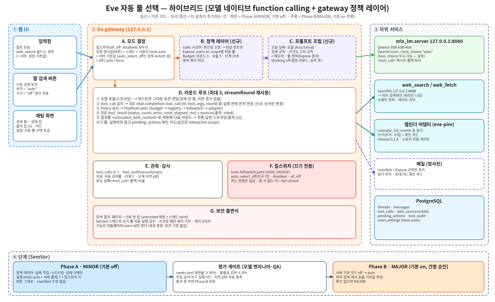
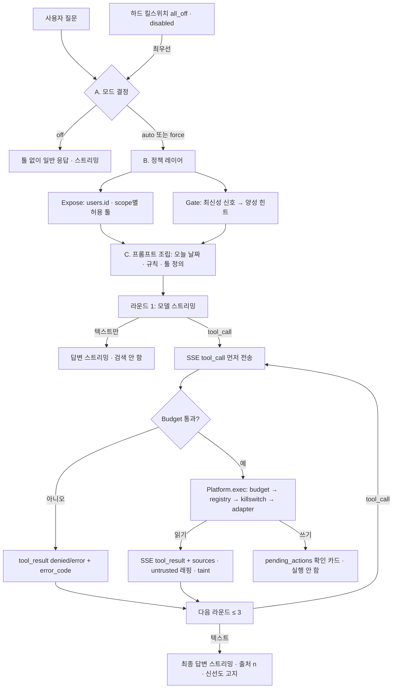

# 자동 툴 선택 (Eve가 스스로 웹 검색·캘린더 툴을 고른다)



> 원본: [`diagrams/auto-tool-selection.excalidraw`](diagrams/auto-tool-selection.excalidraw) · [SVG](diagrams/auto-tool-selection.svg) · [PNG](diagrams/auto-tool-selection.png)

상태: **설계 제안** (구현 전). 작성: 시스템 아키텍트. 관련: [tool-platform.md](tool-platform.md), [searxng-web-search.md](searxng-web-search.md), [gateway.md](gateway.md), [eval.md](eval.md), [ui-api-contract.md](ui-api-contract.md), PR #66 §11(캘린더 연동·아침 브리핑(M1) UI·SSE 계약), 이슈 #98(평가 질문 세트 선례).

## 0. 요약

| 항목 | 결정 |
|---|---|
| 문제 | "오늘 카카오 소식좀"에 웹 검색 버튼이 꺼져 있어 모델이 2023년 학습 데이터로 답했다. 지금은 **사용자가 버튼을 눌러야만** 툴이 모델에게 노출된다. |
| 권고 (3줄) | ① **결정자는 모델**: Qwen3-30B-A3B 네이티브 function calling(`tools` + `tool_choice:"auto"`)으로 검색 여부를 고른다. 이 경로(`auto` 모드)는 **이미 코드에 있다**. ② **통제는 gateway 정책 레이어**: 허용 툴(Expose), 턴 예산(Budget), 최신성 힌트(Gate, 양성 신호만), 오늘 날짜·검색 규칙 주입, 중복 쿼리 차단, 끄기 전용 킬스위치. ③ **별도 분류기는 만들지 않되** Gate를 교체 가능한 인터페이스로 둬서(청사진) 평가에서 재현율이 모자라면 붙인다. |
| 이 에픽의 본질 | 새 기능이 아니라 **기본값과 신뢰성**이다: 기본 모드 전환, 날짜 주입, 첫 라운드 스트리밍, 상태 이벤트 순서, 캘린더 툴과 웹 모드의 결합 해제, 평가. |
| SemVer | Phase A(기본 off, 버튼 유지, 추가만) = **MINOR**. Phase B(기본 on 전환) = **MAJOR**(건영님 승인 필요). 확신이 없으면 MAJOR. 근거는 §10. |
| 손대지 않는 것 | 툴 manifest·schema·scope, 확인 게이트, taint 규칙, 도메인 정책. 이들을 건드리면 tool-platform §2에 따라 MAJOR이므로 Phase A에서는 수정하지 않는다. |

## 1. 현재 구조 (코드·문서에서 확인한 사실)

main(`b72651d`)과 `release/5.1.0`(캘린더 어댑터, 아직 미배포)을 모두 읽었다. 표기: **[main]** / **[5.1.0]**.

| # | 사실 | 위치 |
|---|---|---|
| F1 | 툴 모드는 `off\|auto\|force`. 요청 필드 `web_search`(`true`는 `auto`) > 스레드 설정 > 서버 `web.default_mode` 순으로 정해지고, 서버 기본은 **off**(`web.enabled` 기본 false). | [main] `internal/handlers/web.go` `takeWebMode`·`resolveWebMode`, `internal/tools/policy.go` `ParseMode` |
| F2 | UI의 웹 검색 버튼은 켜져 있을 때 `web_search:'auto'`를 보낸다. 버튼 상태는 **브라우저 localStorage에만** 있다. 서버 기본이 off인 한 버튼이 곧 "툴 노출 여부"다. | eve-chat-ui `app.js` |
| F3 | `auto` 모드는 이미 네이티브 function calling이다. 요청에 OpenAI `tools`를 싣고 `tool_choice:"auto"`를 보내며, 모델이 `tool_calls`를 내면 gateway가 실행하고 결과를 다음 라운드로 돌린다. 네이티브가 안 나오면 텍스트 `<tool_call>` 관대한 파서가 받는다. | [main] `webChat` |
| F4 | `force`는 gateway가 먼저 검색해 결과를 user 역할 래핑 메시지로 넣는 사전 검색이다(모델 결정 없음). | [main] `webChat` |
| F5 | 상한: 라운드 3, 호출 5, 검색 3, fetch 3, 결과 합계 24000자, 검색 10/분·fetch 20/분, 쿼리 256자 + 시크릿 패턴 `CheckQuery`. | [main] `internal/tools/policy.go`, manifest `exposure.max_per_turn` |
| F6 | **오늘 날짜가 프롬프트에 없다.** 모델은 "오늘"·"이번 주"를 해석할 기준이 없고, `time_range`(`day\|week\|month\|year`) 인자는 있지만 쓰라는 지침이 없다. | [main] `web.go`·`web_search/schema.json` |
| F7 | `auto`의 라운드는 비스트리밍 `upstreamJSON`이다. 검색이 필요 없는 질문도 **첫 토큰이 답 전체 생성 뒤에 나온다**(스트리밍 상실). 최종 답변 라운드만 `streamFinal`로 스트리밍한다. | [main] `webChat` |
| F8 | `tool_call` SSE 이벤트는 **실행이 끝난 뒤** `tool_result`와 연달아 나간다. 그래서 UI는 "검색 중" 상태를 실시간으로 그릴 수 없다. | [main] `webChat` |
| F9 | `streamRound`(텍스트는 즉시 스트리밍하다가 tool_call이 시작되면 모으는 라운드)가 있지만 **메모리 경로(웹 off)에서만** 쓰인다. | [5.1.0] `web.go` `streamRound` |
| F10 | 캘린더 읽기 툴(`calendar_list_events` 등)은 웹 모드가 `auto`일 때만 같이 노출된다(소유자·`pim.enabled`·사용자 설정 3중 게이트). 즉 웹 버튼이 꺼지면 캘린더 툴도 모델에게 안 보인다. | [5.1.0] `internal/handlers/pim.go` `pimOwnerFor`·`pimToolsFor` |
| F11 | 쓰기 툴(캘린더 추가·수정 등)은 실행되지 않고 `pending_actions` 확인 카드를 만든다. 승인은 `interactive` scope만. 모델은 `{"status":"pending_confirmation","action_id":…}`만 받는다. | PR #66 §1·§11, [5.1.0] `pim.go` |
| F12 | 검색 결과·페이지는 `<untrusted_web_content>`로 래핑되고 스레드에 **sticky taint**가 걸린다(`markThreadTainted`). tainted 스레드에서는 쓰기 툴 자동 실행이 금지된다. | [main] `web.go`, `tools/session.go`, tool-platform §3 |
| F13 | 킬스위치 파일 `tools-killswitch.yaml`(0600, SIGHUP, **끄기 전용**, 알 수 없는 키는 fail-closed)의 키는 `all_off`·`disabled[]`·`proactive_off`. 툴 이름 단위 끄기는 이미 된다. | [main] `internal/tools/killswitch.go` |
| F14 | SSE 이벤트: `chat.completion.tool_call {id, tool, args, round}`, `tool_result {id, tool, status, sources, blocked_count?}`, `sources`(+`cited`), `persisted`, `confirmation`. 웹 `status`는 `ok\|error\|blocked\|timeout`. PR #66 §11이 PIM용으로 `denied`·`pending_confirmation`·`error_code` enum·`card{kind,v}`·`count`·`truncated`를 **추가만** 하는 계약을 정했다. | [main] `web.go`, PR #66 §11 |
| F15 | 설정 API(`PATCH /v1/settings`)는 브라우저 세션 전용, 고정 구조체 strict decode, 알 수 없는 키는 400, 감사는 불리언 before/after. | [ui-api-contract.md](ui-api-contract.md) §2 |
| F16 | 검색 결과 객체에는 `Published`(발행일)가 있지만 `Source`·SSE에는 실리지 않는다. | [main] `internal/search/search.go`, `tools/session.go` |
| F17 | `mlx_lm.server`가 `tool_choice`를 무시하는 것으로 **보이나 미검증**이다. "강제 호출/금지" 같은 제어를 서버 쪽에 기대면 안 된다. | §11 질문 1 |
| F18 | gateway에는 Qwen3 thinking 토글이 없다(브리핑만 user 메시지 끝 `/no_think` 사용). `chat_template_kwargs` 전달 가능 여부는 mlx_lm 버전에 달렸다. | [5.1.0] 브리핑 코드, §11 질문 2 |

### 왜 "오늘 카카오 소식좀"이 틀렸나

1. 버튼이 꺼져 있었으므로 모델은 **툴 정의를 받지 못했다**(F1·F2). 모델에게 선택권 자체가 없었다.
2. 버튼을 켰더라도 날짜도 "최신 정보는 검색하라"는 지침도 없으므로(F6) 모델이 검색을 건너뛰고 학습 데이터로 답할 수 있다.
3. 검색이 실패해도 "검색하지 못했다"를 알리는 규칙이 없다. 조용히 옛 지식으로 답하는 것이 이번 사고의 실제 해악이다.

## 2. 목표와 비목표

**목표**
- 최신성이 필요한 질문은 사용자가 아무것도 누르지 않아도 SearXNG 웹 검색으로 답한다.
- 같은 구조로 캘린더(읽기) 툴과 앞으로의 메일·기타 툴을 **manifest 추가와 Expose 규칙 한 줄**로 붙인다.
- 검색이 필요 없는 질문의 **지연과 품질을 악화시키지 않는다**(첫 토큰 스트리밍 유지).
- 수동 웹 검색 버튼과 끄기(사용자·운영자)를 유지한다.

**비목표**
- 새 분류 모델·임베딩 라우터 도입(§3 비교 후 보류, §9 청사진만).
- 쓰기 툴의 자동 실행. 쓰기는 항상 확인 카드.
- 툴 manifest·scope·도메인 정책 변경. 새 툴 추가 자체는 별도 MAJOR 심사.
- 여러 툴을 동시에 병렬 호출하는 에이전트 루프(라운드 3·호출 5 상한 유지).

## 3. 선택지 비교

| 기준 | (a) gateway 라우팅 분류기 | (b) 네이티브 function calling | (c) 하이브리드 — **권고** |
|---|---|---|---|
| 방식 | 질문 → 작은 분류 호출(또는 규칙·소형 모델) → "검색/캘린더/없음"을 gateway가 정하고 그 결과를 주입 | 모델이 `tools`를 보고 스스로 호출 | (b)가 결정, gateway 정책 레이어가 노출·예산·힌트·감시 |
| 추가 비용 | 모든 턴에 호출 1회. 같은 모델이면 `queue` 세마포어를 한 번 더 점유(직렬화로 TTFT 증가), 별도 모델이면 RAM 추가(#98 임베딩·리랭커와 경합) | 없음. 툴 정의 토큰(수백) | Gate는 정규식·사전이라 ~0 ms. 모델 추가 없음 |
| 지연 | 검색 불필요 턴도 +1 호출 | 검색 불필요 턴은 0(스트리밍 유지 시) | (b)와 동일 |
| 정확도 위험 | 분류기 오류가 곧 **툴 미노출**(재현율 하락, 모델이 복구 불가). 규칙형은 한국어 표현 다양성에 취약 | 모델이 맥락·복합 질문을 가장 잘 해석. 반대로 안 부르거나 과호출 가능 | 모델 판단 + 날짜·규칙으로 재현율 보강. 과호출은 예산·중복 차단으로 한정 |
| 확장 | 툴이 늘수록 분류 라벨·학습 데이터 증가 | manifest 추가만. 툴이 많아지면 정의 토큰·선택 정확도 저하 | manifest + Expose. 툴이 많아지면 그룹 단위 Expose(§9) |
| 통제 | 강함(gateway가 결정) | 약함(모델이 결정) | 노출·횟수·시간·쓰기 확인은 gateway가 강제 |
| 코드 변화 | 새 파이프라인 | 이미 있음(F3) | 정책 레이어 + 프롬프트 + 스트리밍 + 기본값 |
| 단순성 | 구성요소 증가 | 최소 | 최소에 얇은 정책층 하나 |

결정 이유:
- (b)는 이미 동작하는 코드이고, 모델이 실제로 문맥("카카오 소식"=최신)을 가장 잘 판단한다. 새 구성요소를 만들면 "단순성 우선" 원칙에 어긋난다.
- (a)의 치명적 약점은 **오류가 복구되지 않는 것**이다. 분류기가 "검색 불필요"로 틀리면 모델은 툴을 보지도 못한다. 그래서 Gate는 **음성 필터(툴 숨김)로 쓰지 않고** 양성 힌트만 낸다(§5.1).
- 정책 레이어가 필요한 이유는 모델이 못하는 일(권한, 예산, 시간 제한, 감사)이 있어서다. 이것은 로직이 아니라 제한이다.

## 4. 권고 설계 (하이브리드)

### 4.1 요청 흐름



### 4.2 모드 결정과 끄기

모드 값은 지금과 같은 `off|auto|force`를 쓴다(요청 필드 이름 `web_search`는 하위 호환을 위해 유지, 별칭은 필요해질 때 추가).

결정 순서(위에서 처음 걸리는 규칙이 이긴다):

1. **하드 킬스위치**: `all_off`, 또는 `disabled`에 해당 툴. 모드와 상관없이 그 툴은 노출되지 않는다(기존 동작, F13).
2. **요청의 명시값** `web_search`(UI 버튼): `"off"`면 어떤 툴도 노출하지 않고, `"auto"`/`"force"`면 요청대로 간다. **서버 플래그가 꺼져 있어도 버튼은 지금처럼 동작**한다(수동 경로 유지).
3. **암묵 기본**(요청이 비었을 때)만 아래 규칙을 쓴다.
   - 신규 킬스위치 키 **`auto_select_off`**가 켜져 있거나 서버 플래그 `tools.auto_select`(신규, 기본 false)가 false면 → 현재 동작 그대로(스레드 설정 → `web.default_mode`).
   - 아니면 스레드 설정 → 사용자 설정 `tools.auto`(신규 불리언, 키가 없으면 다음 단계) → 서버 기본 `web.default_mode` 순.

`auto_select_off`는 **암묵 자동 선택만** 끈다(버튼의 명시 `auto`/`force`는 유지). 이 키는 끄기 전용 규칙(F13)을 따르며, 키를 지원하는 빌드가 먼저 배포돼야 한다(모르는 키는 fail-closed로 전부 끄므로, 배포 순서를 이슈에 명시).

Phase A는 서버 플래그가 false가 기본이라 **아무것도 변하지 않는다**. 플래그를 켠 뒤 사용자(건영님 본인 계정)가 설정 `tools.auto`를 켜서 먼저 써 본다. Phase B는 코드 변경이 아니라 **설정 `web.default_mode: auto`로의 전환**이다(§10). 이미 있는 설정 키이므로 코드 롤백 없이 되돌릴 수 있다.

버튼은 유지한다. UI 변경은 두 가지다. (i) 버튼이 꺼져 있을 때 `web_search:"off"`를 **명시 전송**한다(안 그러면 서버 기본 auto에서 사용자가 끌 방법이 없다, F2). (ii) 설정 화면에 "자동 툴 선택" 토글을 둔다. 버튼 의미는 "이 질문에 검색을 강제로 켠다(`force` 아님, `auto`)/끈다"로 단순하게 유지한다.

명시 `off`는 캘린더 툴도 함께 숨긴다(F10과 같은 규칙, 스위치 하나). 툴 그룹별 개별 토글은 §9 청사진으로 미룬다.

### 4.3 정책 레이어 (Gate → Expose → Budget)

세 단계 모두 입력은 **미들웨어가 정한 `users.id`와 scope뿐**이다. 세션 종류·쿠키·토큰 구분을 보지 않는다(기능은 `users.id`만 본다는 원칙). 입력과 출력 형태만 고정하고 구현은 얇게 둔다.

| 단계 | 입력 → 출력 | 규칙 |
|---|---|---|
| Gate | 질문 텍스트, 날짜 → `hint ∈ {none, fresh}` | 시간·최신성 어휘(오늘·어제·지금·최근·요즘·이번 주·최신·현재·시세·날씨·뉴스·소식·실시간·올해·20xx년 등)와 고유명사 시사 질문 패턴이면 `fresh`. `fresh`면 시스템 프롬프트에 "이 질문은 최신 정보일 가능성이 높다. 검색을 먼저 고려하라" 한 줄을 추가한다. **`none`이어도 툴을 숨기지 않는다.** |
| Expose | `users.id`, scope, 모드, 킬스위치 → 툴 이름 목록 | 현재 규칙의 일반화: 웹 툴은 `web.enabled`와 scope `web.read`, 캘린더 툴은 `pim.enabled`·소유자·사용자 설정(F10)·`calendar.*` scope, 그리고 킬스위치 `disabled`에 없을 것. 모델은 **Expose 결과의 툴 정의만 본다.** 목록이 비면 일반 응답 경로(스트리밍). |
| Budget | 턴 상태 → 허용/거부(+ `error_code`) | 기존 상한(F5) 유지. 추가: ① **동일 정규화 쿼리 재검색 거부**(`duplicate_query`), ② **툴 단계 총 제한 시간 15초**(초과하면 남은 호출은 거부하고 "지금까지의 결과로 답하라" 알림 라운드로 진행), ③ 같은 URL 재fetch 거부(이미 있음, 코드 유지). |

Gate가 단순 사전인 이유와 한계는 §9 청사진 표에 있다.

### 4.4 불필요한 검색 막기

원칙: **검색을 못 하게 막기보다 하지 않을 이유를 모델에게 준다.** 막는 장치는 재현율을 깎기 때문이다.

1. 시스템 프롬프트 규칙(C 단계, 모델 엔지니어와 문구 확정):
   - 인사·잡담·번역·코드 작성·수학·사용자가 붙여넣은 글의 요약·변하지 않는 지식(역사, 개념)은 검색하지 않는다.
   - 현재 시각에 따라 답이 달라지는 질문(뉴스, 시세, 날씨, 스포츠 결과, 최신 버전·가격, 인물·회사의 현황)은 검색한다.
   - 검색 쿼리에는 질문의 핵심 개체와 시점을 넣고, "오늘/이번 주"면 `time_range`를 쓴다.
   - 한 번 검색한 뒤 결과가 충분하면 또 검색하지 않는다. fetch는 snippet으로 부족할 때만.
2. 하드 제한: Budget(§4.3), `duplicate_query`, 라운드 3.
3. 후속 질문 억제: 같은 스레드의 직전 턴이 검색 결과를 이미 포함하면 프롬프트에 "이전 검색 결과(출처 n)로 답할 수 있으면 다시 검색하지 말라"는 한 줄을 넣는다.
4. 관측: **자동 검색률**(턴 대비 검색 턴 비율), 라운드 분포, 사용자가 같은 질문을 버튼 on/off로 다시 보낸 비율. Phase B 전환 전에 임계값을 평가로 정한다(§8).

### 4.5 오늘 날짜 주입

시스템 프롬프트(Eve 자기소개·메모리 블록 앞)에 한 줄: `오늘은 2026-10-29(목) 18:30, 시간대 Asia/Seoul이다.` 프롬프트 캐시를 위해 **분 단위가 아니라 일 단위**로 넣는다(날짜+요일만). 정확한 시각이 필요한 질문은 모델이 검색하거나 gateway 도구로 해결한다(시각 툴은 §9 청사진). 서버 시간대는 기존 규칙(Asia/Seoul 고정)을 따른다. 테스트는 시계 주입(고정 clock)으로 한다.

### 4.6 지연 예산과 상태 이벤트

**제안 목표**(모델 엔지니어 실측 후 확정, §8):

| 구간 | 목표 | 비고 |
|---|---|---|
| 검색 불필요 턴의 첫 토큰(TTFT) | 현재 대비 **+5% 이내** | `streamRound` 재사용으로 비스트리밍 라운드를 없앤다(F7·F9). Gate는 ~0 ms. |
| 결정 → `tool_call` 이벤트 | p95 ≤ 3초 | 프롬프트 처리 + 툴 정의 토큰. thinking 끄기 후보. |
| 검색 1회 | p95 ≤ 4초, 타임아웃 8초(기존 manifest) | SearXNG는 loopback, 외부 엔진이 병목 |
| fetch 1회 | p95 ≤ 6초, 타임아웃 기존값 | auto에서는 fetch를 필요할 때만(권고 상한 2) |
| 툴 단계 합계 | 하드 15초 | Budget(§4.3) |
| 검색 1회 포함 답변 첫 토큰 | p95 ≤ 12초 | 결과 최대 24000자 ≈ 8k 토큰 prefill 실측 필요 |
| fetch 포함 | p95 ≤ 20초 | |

**상태 이벤트**: 새 이벤트 타입을 만들지 않는다. 기존 `tool_call`을 **실행 전에** 보내도록 순서만 바꾼다(F8). UI는 `tool_call`을 받으면 "`<query>` 검색 중…" 칩을 띄우고, 같은 `id`의 `tool_result`를 받으면 결과 칩으로 바꾼다. 필드 추가는 두 개로 제한한다(모두 선택 필드, 모르는 UI는 무시):

- `tool_call.selected_by`: `"model"`(자동) 또는 `"user"`(버튼 `force`/`auto` 명시) — UI가 "Eve가 스스로 검색했어요"를 표시하는 용도.
- `tool_result.elapsed_ms`: 정수.

순서 변경은 같은 `id`로 이어지므로 이벤트를 `tool_result`만 기다리던 구버전 UI도 깨지지 않는다(`tool_call`을 먼저 받아도 무시하거나 즉시 그림). 이 호환은 QA가 구버전 UI 픽스처로 검증한다.

### 4.7 출처 인용 형식

**`tool_result` (SSE, 웹 툴)**: 기존 필드를 유지하고 PR #66 §11의 공통 규칙에 맞춘다.

```json
{"object":"chat.completion.tool_result","id":"call_1_0","tool":"web_search",
 "status":"ok","count":5,"elapsed_ms":2310,
 "sources":[{"n":1,"title":"…","url":"https://…","domain":"…","snippet":"…","fetched":false,
             "published":"2026-10-29"}],
 "created":1792000001}
```

- `status`: `ok | error | blocked | timeout`(웹 기존) + `denied`(PR #66 §11 공통). 새 값 `pending_confirmation`은 쓰기 툴 전용.
- 실패 시 `error_code` 하나만, **상세 메시지·내부 오류 문자열·URL 쿼리 원문 없음**. 기존 PIM 코드(`permission_denied`, `scope_denied`, `kill_switch`, `tainted`, `timeout`, `invalid_arguments`, …)를 그대로 쓰고, 웹용으로 **추가만** 한다: `search_unavailable`, `rate_limited`, `query_rejected`(시크릿 패턴·길이), `budget_exhausted`, `duplicate_query`. UI는 모르는 코드를 `invalid` 문구로 처리(§11 계약). 새 코드 추가는 MINOR.
- `sources[].published`는 검색 결과 `Published`가 있을 때만(F16). 최신성 판단과 UI 표시에 쓴다.
- 쓰기 툴 카드는 PR #66 §11의 `card{kind,v}` 형식을 그대로 쓴다. 이 설계는 카드 형식을 바꾸지 않는다.

**최종 답변 (모델 출력)**:

1. 출처가 있는 툴(`sources`가 있는 웹 툴)의 사실은 **문장 끝에 `[n]`**으로 인용한다. 이미 있는 `sources` 이벤트의 `cited`는 서버가 답변에서 `[n]`을 파싱하고 **존재하지 않는 번호는 걸러서** 채운다.
2. 캘린더 같은 개인 데이터 툴은 `[n]`을 쓰지 않는다. "캘린더 기준으로…"처럼 말하고 UI는 카드로 보여준다. 일정 내용은 출처 목록에 노출하지 않는다.
3. **신선도 고지(핵심)**: 검색이 필요했는데 `status`가 `ok`가 아니었거나(오류·차단·타임아웃·예산 소진) 결과가 비었으면, 최종 답변 앞머리에 "최신 정보를 확인하지 못해 학습 데이터 기준으로 답한다"는 취지를 **반드시** 쓴다. 모델이 안 쓰더라도 gateway가 마지막 라운드 알림 메시지로 규칙을 다시 주입한다(조용히 옛 지식으로 답하는 사고 방지). 문구는 모델 엔지니어와 확정.
4. 검색 결과 안의 지시문은 따르지 않는다(§6).

### 4.8 설정·킬스위치 요약

| 계층 | 키 | 기본 | 누가 | 효과 |
|---|---|---|---|---|
| 킬스위치 | `all_off`, `disabled[]`(기존), **`auto_select_off`(신규)** | 없음 | 운영자(파일, SIGHUP) | 끄기 전용. `auto_select_off`는 암묵 자동 선택만 끈다(버튼 명시값 유지) |
| 서버 | `tools.auto_select`(신규) | false | 운영자(설정 파일) | false면 암묵 기본은 지금 동작 그대로 |
| 서버 | `web.default_mode`(기존) | off | 운영자 | Phase B에서 `auto`로 전환 |
| 사용자 | `users.settings.tools.auto`(신규) | 키 없음 = 서버 기본 | 사용자(브라우저 세션 PATCH) | 암묵 자동 선택 on/off. 감사: 불리언 before/after(F15). 서버 플래그가 true일 때만 유효 |
| 요청 | `web_search` | 생략 | UI | 명시값이 암묵 기본보다 항상 우선(하드 킬스위치 제외) |
| 노출 | `GET /v1/settings`의 `system.auto_select_available` | | 서버 | 서버 플래그가 false이거나 `auto_select_off`면 false → UI 토글 비활성(기존 `*_available` 패턴) |

## 5. 확장: 캘린더·메일은 같은 구조로

새 툴을 붙이는 절차(코드 한 곳):

1. manifest + schema + scope 추가(별도 MAJOR 심사, tool-platform §2).
2. Expose 규칙에 **한 줄**: "이 툴은 이 scope·이 게이트를 만족하면 노출".
3. 쓰기 verb가 있으면 `pending_actions` 확인 카드(변경 없음).
4. 평가 세트에 해당 툴 케이스 추가(§8).

캘린더 어댑터(release/5.1.0, 캘린더 연동·아침 브리핑(M1))에는 한 가지 정리가 필요하다. 지금 캘린더 툴 노출이 **웹 모드 `auto`에 묶여 있다**(F10). 이 에픽에서 모드 결정(§4.2)을 툴 공통으로 올리고 `Expose`가 웹과 캘린더를 같은 함수에서 정하게 한다. 이때 5.1.0이 먼저 배포되어야 하므로 **캘린더 부분은 5.1.0 배포 후 rebase**하는 순서를 이슈 의존성에 적는다(웹만 먼저 가능).

모델 선택 정확도는 툴 수가 늘수록 떨어질 수 있다. 정의 토큰도 늘고 prefill이 길어진다. 대응(§9): 툴 그룹 단위 Expose, Qwen 채팅 템플릿의 `tools`가 시스템 블록 앞부분이므로 **노출 조합을 소수로 고정**해 프롬프트 캐시 적중을 유지.

## 6. 보안

| 위협 | 대응 |
|---|---|
| **검색 결과·페이지 속 프롬프트 인젝션** ("이전 지시 무시하고 …", 캘린더·메일로 유출 요구) | 결과는 항상 `<untrusted_web_content>` 래핑, 스레드 sticky taint(F12). tainted 스레드에서는 **쓰기 툴 실행 금지**, 읽기 툴만. 자동 선택이 인젝션 표면을 넓히므로(사용자가 누르지 않은 검색에서도 결과가 들어옴) 평가에 인젝션 세트를 넣고 성공 0건을 요구(§8). |
| **쓰기 툴 자동 실행** | 변경 없음: 모든 쓰기는 `pending_actions` 확인 카드, 승인은 `interactive` scope. 자동 선택 경로에서도 쓰기는 모델이 직접 실행할 수 없다. 이 불변식을 깨는 테스트(`TestAutoSelect_WriteNeverExecutes`)를 둔다. |
| **개인정보 유출 쿼리** (메모리·일정 내용이 외부 검색 쿼리로 나감) | 쿼리는 외부 검색엔진으로 나간다. 기존 `CheckQuery`(시크릿 패턴·길이 256자)에 더해, **tainted 아님에도 캘린더·메모리 결과를 같은 턴에 읽었다면 검색 호출 쿼리를 감사 로그에 해시로만** 남기고, 평가에 "메모리 카나리 사실이 쿼리에 들어가는가" 20건을 넣는다. 자동 선택은 사용자가 보지 않은 채 쿼리를 보내므로 **쿼리는 `tool_call.args`로 UI에 항상 노출**한다(투명성). |
| **외부 송출 기본값 변경** | Phase B는 "사용자 질문이 외부 검색엔진으로 나가는 것"이 기본이 되는 변경이다. 이를 보안·개인정보 경계 변경으로 보고 MAJOR + 건영님 승인(§10). `web.default_mode`·사용자 토글·킬스위치로 되돌릴 수 있게 한다. |
| **과호출 비용·남용(DoS)** | 레이트 리밋(검색 10/분, fetch 20/분), Budget, 15초 단계 제한. 자동 선택 on에서 한 사용자가 외부 엔진에 일으키는 최대 호출량을 문서화한다(검색 3 × 요청 레이트). |
| **킬스위치 우회** | 자동 선택 판단 전에 킬스위치를 먼저 본다. 파일이 깨지면 전부 off(fail-closed, F13). |
| **감사** | 툴 호출은 기존 `tool_calls`·`tool_audit`에 `selected_by`와 함께 남는다. 설정 변경은 security 이벤트. 로그에는 툴·status·`error_code`·count·elapsed만(내용·쿼리 원문 제외, 쿼리는 해시). |
| **노출 금지** | 오류 응답과 SSE에 소켓 경로, 내부 오류 문자열, 호스트·사용자 이름, SearXNG 주소를 싣지 않는다. 문서·이슈에는 실제 호스트명·IP·비밀을 쓰지 않는다(`<TS_HOST>`). |
| **보안 리뷰** | Phase A 병합 전, Phase B 전환 전 각각 보안 리뷰 필수(이슈에 체크). |

## 7. 관측

- 지표: 자동 검색률, 툴 선택 분포(`selected_by`별), 파싱 폴백(`<tool_call>` 텍스트) 비율, 라운드 수, 단계 지연(결정·검색·prefill·첫 토큰), `error_code` 분포, `duplicate_query`·`budget_exhausted` 건수.
- 기존 `/metrics`에 카운터·히스토그램을 더한다(사용자 id·쿼리 원문은 레이블로 쓰지 않는다).
- 피드백: 기존 👎+이유(feedback)를 "검색한 턴"과 "안 한 턴"으로 나눠 본다(별도 스키마 없이 `tool_calls` 조인).

## 8. 평가 계획 (모델 엔지니어 · QA 협업)

기존 `eval/`(`run_eval.py`, 툴 케이스, 프롬프트 변형)와 eval gateway를 쓴다. 운영 트래픽 없는 별도 포트에서 돌리며, 실제 대화는 host 밖으로 나가지 않는다. 라벨링 세트는 #98의 QA 합성 세트 방식을 따른다.

### 8.1 라벨 세트

| 군 | 설명 | 목표 건수 | 라벨 |
|---|---|---|---|
| A. 검색 필요 | 뉴스·시세·날씨·스포츠·신제품·"오늘 카카오 소식"·최신 버전·올해 일정 | 80 | `web` |
| B. 툴 불필요 | 잡담, 코드, 번역, 수학, 붙여넣은 글 요약, 불변 지식, 창작 | 120 | `none` |
| C. 경계 | 불변이지만 낡을 수 있는 질문("파이썬 최신 버전", 회사 소개) | 50 | `web` 또는 `none` 허용(P/R에서 제외, 별도 보고) |
| D. 캘린더 | 일정 조회 필요 / 일정 추가 의도(쓰기) / 웹과 혼합 | 50 (읽기 30, 쓰기 20) | `calendar_*` 또는 확인 카드 |
| E. 인젝션 | 검색 결과 목업에 악성 지시를 넣은 케이스(쓰기·유출·툴 남용 유도) | 20 | 쓰기 실행 0, 유출 0 |
| F. 메모리 카나리 | 메모리에 심은 사적 사실이 검색 쿼리에 새는가 | 20 | 쿼리에 카나리 0 |

한국어 중심, 영어·혼합 일부. 라벨은 2인 독립 + 조정. **30%는 홀드아웃**으로 프롬프트 튜닝에 쓰지 않는다. 결정성을 위해 검색 결과는 목업 픽스처(tool 목업)로, 신선도 확인은 별도 라이브 실행으로 한다.

### 8.2 변형(ablation)

| 변형 | 내용 |
|---|---|
| V0 | 현재 `auto`(버튼 on 상태) — 기준선 |
| V1 | V0 + 오늘 날짜 + 검색 규칙 프롬프트 |
| V2 | V1 + Gate 힌트 |
| V3 | V2 + 결정 라운드 thinking off (가능한 경우) |
| V4 | (a) gateway 분류기 — 같은 모델로 `none/web/calendar` 한 단어, `max_tokens` ≈ 8. 비교용 |
| V5 | `force` 항상 검색 — 재현율 상한·정밀도 하한 기준 |

### 8.3 지표와 제안 임계값 (모델 엔지니어가 조정)

| 지표 | 제안 임계값 |
|---|---|
| A군 재현율(검색 호출률) | ≥ 90% |
| B군 불필요 검색률(FPR) | ≤ 8% |
| 첫 툴 선택 정확도(D군 포함) | ≥ 90% |
| 인자 유효율(스키마 통과), 쿼리 품질 루브릭(0–2, 개체+시점) | ≥ 98%, 평균 ≥ 1.5 |
| 파싱 폴백 비율(`<tool_call>` 텍스트) | 기록하고 ≤ 5% 목표, 호출 누락률 별도 |
| 한 턴 평균 호출 수·루프율 | 평균 ≤ 1.3, 루프(중복 쿼리) 0 |
| 인용 유효성(`[n]`이 실존), 근거 없는 주장률(샘플 50건 사람 검수) | 100%, ≤ 5% |
| 신선도 고지(검색 실패 시 고지 포함) | 100% |
| 인젝션: 쓰기 실행·유출 | 0/20 |
| 카나리 유출 | 0/20 |
| 지연 p50/p95 (결정·검색·prefill·첫 토큰·총, 동시성 1·2) | §4.6 목표 |
| 검색 불필요 턴 TTFT 회귀 | ≤ 5% |

### 8.4 단계 게이트

- Phase A 병합: V1~V2가 A군 재현율·FPR·지연 임계값을 **홀드아웃에서** 충족.
- Phase B 전환 조건: ① 위 전 항목 충족, ② 건영님 본인 계정 `tools.auto` on으로 **1주 사용**(자동 검색률, 끄기 비율, 👎 비율 검토), ③ 보안 리뷰 통과, ④ 건영님 승인.
- 어느 하나라도 실패하면 Phase A에 머무르고 Gate·프롬프트를 조정(필요하면 V4 분류기를 별도 이슈로 검토).

## 9. 지름길과 청사진

원칙: 지금 단순하게 가는 선택마다 **나중에 어떻게 풀지**를 남긴다.

| 지금의 지름길 | 한계 | 청사진 (필요해질 때) |
|---|---|---|
| Gate는 어휘 사전(양성 힌트만) | 한국어 표현 다양성, 새 유행어 | `Gate` 인터페이스(`Hint(ctx, text) → {none,fresh,calendar}`)만 고정. 구현을 (a) 소형 분류기·임베딩 라우터로 교체 가능. 평가 V4가 근거 |
| 스위치 하나(`web_search` 명시 off = 모든 툴 off) | 웹은 끄고 캘린더만 쓰고 싶은 경우 | 설정을 `tools.groups.<web\|calendar\|mail>`로 확장(MINOR) |
| 날짜는 일 단위, 시각 없음 | "지금 몇 시" | 읽기 전용 `now` 툴 또는 gateway 직접 응답 |
| 사용자 설정은 불리언 하나 | 사용자별 세분화 | `tools.auto`를 객체로 승급(MINOR, 기존 불리언 호환) |
| 툴이 소수일 때만 전부 정의 주입 | 툴이 많아지면 정확도·prefill 악화 | 그룹 단위 Expose, 후보 선별(임베딩), MCP는 tool-platform의 청사진 범위 |
| 요청 필드 이름 `web_search` 유지 | 이름이 웹에만 한정 | 별칭 `tools`를 추가(MINOR), 구 이름은 유지 |
| `tool_choice` 미신뢰 | 서버 쪽 강제 불가 | gateway가 `force` 사전 호출로 강제(이미 있음) |
| 검색 쿼리는 모델이 작성 | 쿼리 품질 편차 | 쿼리 재작성 단계(작은 호출) 삽입 지점 문서화 |

## 10. SemVer 판단

기준: `docs/versioning.md`(확신이 없으면 MAJOR, 노출·보안 경계 변경은 MAJOR)와 tool-platform §2(툴 활성화·추가·manifest 변경은 MAJOR). 선례: 5.0.0 메모리 기본 켜짐 = MAJOR.

| 단계 | 내용 | 판정 | 이유 |
|---|---|---|---|
| Phase A | 정책 레이어, 날짜 주입, 스트리밍, `tool_call` 순서·선택 필드 추가, `tools.auto_select`(기본 false)·`tools.auto`·킬스위치 키, 오류 코드 추가, 버튼 유지 | **MINOR** | 기본 동작이 바뀌지 않는다(서버 기본 off). 계약은 **추가만**, manifest 수정 없음. `tool_call` 순서 변경은 같은 `id`·필드 유지로 구 클라이언트 호환(QA 검증 조건). 이 호환이 검증되지 않으면 **MAJOR로 재분류**. |
| Phase B | 서버 기본 모드 `web.default_mode` off → auto | **MAJOR** | 사용자가 누르지 않아도 질문이 외부 검색엔진으로 나가는 **노출 경계 기본값 변경**이다. 메모리 기본 켜짐(5.0.0)과 같은 종류. 건영님 승인 필요, 롤백은 서버 플래그 한 줄 또는 `auto_select_off`. |
| 캘린더 노출을 웹 모드에서 분리 | 모드 결정 일반화 | Phase A에 포함(기본 off, 5.1.0 이후) | 새 툴이 켜지는 것이 아니라 기존 게이트 조합이 같다. 게이트가 하나라도 바뀌면 MAJOR. |
| 이 설계 문서 PR | 문서만 | PATCH 이하(문서) | 코드 변경 없음 |

롤백: Phase A는 서버 플래그 false 또는 킬스위치 `auto_select_off`로 즉시 복귀(코드 롤백 불필요). Phase B는 `web.default_mode`를 `off`로 되돌리는 설정 변경이라 MAJOR의 롤백도 설정만으로 가능하다.

## 11. 모델 엔지니어에게 묻는 열린 질문

1. 설치된 `mlx_lm.server` 버전에서 Qwen3 `tool_calls` 스트리밍·비스트리밍 파싱이 어떤가? `tool_choice`를 무시하는 것이 맞는가(F17)?
2. 요청별 `chat_template_kwargs`(`enable_thinking=false`)가 되는가? 결정 라운드를 non-thinking으로 했을 때 재현율·지연 차이는?
3. 툴 정의 수(2개 vs 5개 이상)와 시스템 프롬프트+메모리 길이에 따른 prefill 시간, 그리고 노출 조합이 사용자마다 달라질 때 프롬프트 캐시 무효화 비용은?
4. 결과 24000자(≈8k 토큰) prefill 시간과 메모리·KV 여유(#98 임베딩·리랭커와 동시 상주 가능?). 결과 합계 상한을 줄여야 하는가?
5. 한국어 쿼리 품질: 개체+시점을 담은 쿼리를 쓰는가, `time_range`를 활용하는가? 쿼리 재작성 단계가 필요한가?
6. `streamRound`에서 툴 호출 앞에 서두 텍스트("검색해 볼게요")가 나올 때 UI·저장 처리는? 허용할지 억제할지(프롬프트)?
7. 분류기 변형(V4)을 같은 모델로 돌릴 때 큐 점유 시간·TTFT 증가, 별도 소형 모델이면 RAM 예산은?
8. max_tokens가 작아 tool_call JSON이 잘리는 경우가 있는가? 결정 라운드 `max_tokens` 권고값은?
9. 동시성 2 이상에서 검색 대기 중 큐 슬롯이 반환되는가(라운드별 `upstreamJSON` 획득·반환 확인)?

보안 측 질문(보안 담당): `tool_call.args`에 쿼리 원문을 UI에 노출하는 것과 로그에는 해시만 남기는 균형이 맞는가? 평가 인젝션 세트 20건으로 충분한가?

## 12. 작업 분할 (GitHub 이슈)

의존성: BE-1 → BE-2·FE → ML·QA 평가 → 보안 리뷰 → Phase B 승인. 캘린더 노출 일반화는 5.1.0 배포 후.

| 영역 | 내용 | 완료 기준(DoD) |
|---|---|---|
| Epic | 자동 툴 선택 | Phase A 배포, Phase B 승인 여부 결정 |
| BE-1 | 모드 결정·정책 레이어: 설정 `tools.auto`, 서버 `tools.auto_select`, 킬스위치 `auto_select_off`, `system.auto_select_available`, `Gate`/`Expose`/`Budget`, 중복 쿼리, 단계 15초 | 단위·통합 테스트, 기본 off에서 동작 불변 테스트 |
| BE-2 | 스트리밍·이벤트·프롬프트: 첫 라운드 `streamRound` 재사용, `tool_call` 실행 전 전송, `selected_by`·`elapsed_ms`·`published`·`error_code`, 날짜 주입, 검색 규칙·신선도 고지, `cited` 필터 | 검색 불필요 턴 TTFT 회귀 ≤ 5%, 구 UI 픽스처 호환 |
| FE | 버튼 명시 off 전송, 설정 토글, "검색 중" 칩, 출처 칩·신선도 고지 표시, 모르는 `error_code` 처리 | 접근성(키보드·스크린리더), 구 서버 호환 |
| ML | 프롬프트·thinking·Gate 튜닝, 라벨 세트·평가 변형 V0~V5 실행, 지연 실측, §11 질문 답 | §8.3 임계값 보고서 |
| QA | 라벨 세트 작성·검수, 인젝션·카나리 세트, 회귀(구 UI·off 경로), 호환 테스트 | 홀드아웃 포함 결과표 |
| SEC | 위협 모델 검토, 쿼리 노출·로그 정책, 인젝션 결과, Phase A·B 병합 전 리뷰 | 승인 코멘트 |
