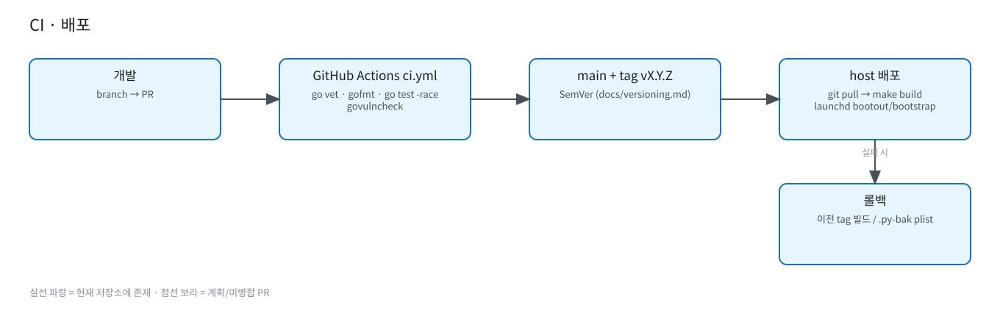

# CI · 배포 · 버전

원본: [`diagrams/ci-deploy.excalidraw`](diagrams/ci-deploy.excalidraw) · 버전 규칙: [../versioning.md](../versioning.md)

- CI `.github/workflows/ci.yml`: `go vet`, `gofmt -l`, `go test -race -count=1 ./...`, `govulncheck`. (`deploy/ci/github-ci.yml` 사본 존재)
- 빌드: `make build` → `git describe --tags`를 `-X main.version`으로 주입.
- 태그: `v1.0.0`, `v1.1.0` (annotated). major는 건영님 승인 필수, minor/patch는 배포 후 보고.
- 배포: host에서 `git pull` → `make build` → launchd `bootout`/`bootstrap` (`deploy/install-launchd*.sh`, `deploy/launchd*/`). UI 파일은 `web/`로 동기화.
- 롤백: 이전 태그 재빌드, 또는 `.py-bak` plist로 Python gateway 복귀 (루트 README).
- 금지: force-push, 시크릿/실제 주소 커밋.
