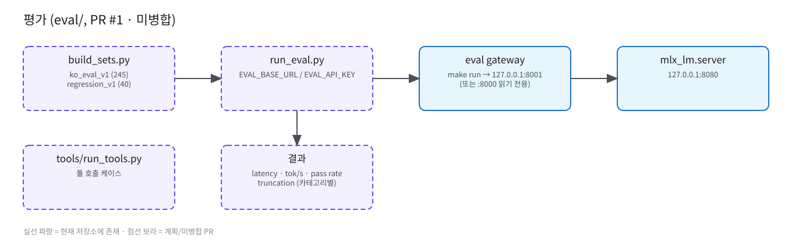

# 평가 (eval/) — PR #1, 미병합

원본: [`diagrams/eval.excalidraw`](diagrams/eval.excalidraw)

- `eval/build_sets.py`: 결정적 생성 — `ko_eval_v1.jsonl`(245), `regression_v1.jsonl`(40). 카테고리: chat, knowledge, reasoning_math, coding, writing, instruction, safety, long_context.
- `eval/run_eval.py`: 순차 OpenAI 호환 클라이언트, `EVAL_BASE_URL`/`EVAL_API_KEY`. 지표: latency, tok/s, pass rate, truncation(`finish_reason=length`).
- `eval/tools/`: 툴 호출 케이스, `eval/prompts/`: 시스템 프롬프트 변형.
- 테스트 대상: `make run`으로 띄운 `127.0.0.1:8001` 테스트 gateway (운영 트래픽 없음) 또는 운영 `:8000` 읽기 전용.
- TBD: CI 연동 여부, 결과 저장 위치.
