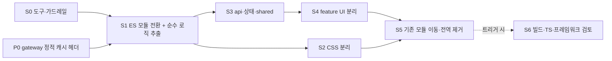

# eve-web 리팩터링 설계 메모 (스택 현대화 · 책임 분리 · 섣부른 공통화 금지)

상태: **설계 제안** (구현 없음) · **rev 2** · 작성: 시스템 아키텍트. 대상: `gun025bba/eve-web`(모바일 우선 채팅 PWA, 2.0.0 제안본) `main` `fb4fbb9`. 기준: 건영의 방향 세 가지(스택 현대화, 파일·디렉토리 책임 분리, 섣부른 공통화 금지; PM 전달). **채택 여부와 일정은 PM이 정한다. MAJOR 단계의 배포는 보안 승인과 롤백 계획이 있으면 control plane 승인으로 진행하고, 데이터 삭제·외부 공개·비용·외부 메시지만 건영에게 직접 묻는다**(§6.2). 이 문서는 구현 코드를 쓰지 않는다. 관련: [web-ui.md](web-ui.md), [ui-api-contract.md](ui-api-contract.md), [ios-shell.md](ios-shell.md), [ci-deploy.md](ci-deploy.md), `docs/deploy-signing.md`, `docs/versioning.md`.

## 0. 요약

**rev 2 변경(FE 리뷰 반영, 기준을 `ea83e56` → `fb4fbb9`로 갱신):** ① §7-1 버전 쿼리·SW 사실 오류 정정과 권장안 확정(버전 디렉터리) ② feature 간 의존 해결 규칙(§3) ③ 함수 수·`generate()` 수치 정정(§1.3, 부록 A) ④ 포맷 전용 커밋 면제·blame ignore(§4.1) ⑤ CSP 근거를 `uiCSP`로 교체(§1.1) ⑥ S1에 WebKit 스모크 테스트 ⑦ 테스트 수 정정 ⑧ 선행 단계 P0(gateway 정적 캐시 헤더) 추가 ⑨ 열린 질문 Q1~Q4 확정(§8) ⑩ 모든 줄 번호·수치를 `fb4fbb9`로 재측정.

| 항목 | 결정(제안) |
|---|---|
| 진단 한 줄 | JS 3,862줄 중 `app.js` 한 파일이 2,334줄(60%)이고, 그중 약 2,110줄(`224-2334`)이 **IIFE 하나**다. 그 안에 함수 선언 148개(직속 기준, 집계 방식은 부록 A)와 공유 가변 상태 46줄이 섞여 있다. 60줄을 넘는 함수는 사실상 `generate()`(285줄) 하나다. CSS는 덮어쓰기 층(`overrides above`)으로 쌓였다 |
| 가장 큰 제약 | **서명 릴리스가 "git이 추적하는 파일을 그대로 tar"로 만든다**(`deploy/nopasswd/make-release.sh`). 빌드 출력물은 배포 대상이 아니다. 그래서 번들러 도입은 서명 파이프라인 변경(보안 검토)을 동반한다 |
| 목표 스택 | **번들러 없는 네이티브 ES 모듈 + JSDoc 타입(`tsc --noEmit` 검사) + 네이티브 CSS(`@layer`, 파일 분리) + Biome(린트·포맷, 개발 전용)**. 프레임워크 없음, 런타임 의존성 0 유지. Vite+TypeScript·Preact는 **트리거가 걸릴 때만**(§2.4) |
| 분리 규칙 수치 | 파일 ≤ **300줄**(신규 하드 400; 포맷 전용 커밋은 면제, §4.1), 함수 ≤ **60줄**(하드 80), 줄 ≤ **120자**, 디렉토리 직속 파일 ≤ **12개**(하드 15), CSS 파일 ≤ **300줄**, `!important` 신규 **0**, 모듈 수준 가변 상태는 feature당 **1곳**. 기존 초과 파일은 **ratchet**(늘리지 못함, 단계마다 줄임) |
| 공통화 규칙 | **3곳 이상 동일**이 확인된 것만 `shared/`로 승격. 2곳은 복붙 허용(주석 표식). 승격 PR은 모든 호출처를 한 번에 바꾸고 불리언 플래그 인자를 금지한다. 지금 확인된 승격 대상은 **`el()` 헬퍼(5곳)와 시트(7개)**뿐이다 |
| 이행 | **선행 1단계(P0, eve-serving) + 6단계(S0~S5) + 조건부 1단계(S6)**. 각 단계는 독립 배포·롤백(`rollback-web`)이 가능하고, 저장 형식·API·URL을 바꾸지 않는다. SemVer 기본값은 **MAJOR**이고, §6.2의 조건을 **모두** 만족할 때만 PATCH로 낮춘다. **S1은 SW 규칙을 바꾸지 않는 권장안(버전 디렉터리, §7-1)이면 PATCH**, SW 규칙을 바꾸면 MAJOR다 |

## 1. 현재 구조 진단

측정 기준: `eve-web` `main` `fb4fbb9`(2.0.0 제안본, #37), 추적 파일 265개. `ea83e56`(1.10.2) 대비 `app.js`가 +118줄이다. 방법은 부록 A.

### 1.1 스택

| 영역 | 현재 |
|---|---|
| 언어·런타임 | 순수 JS(`'use strict'`, 클래식 `<script>` 9개, `?v=<버전>`), 빌드·패키지 매니저·린터·포매터·타입 검사 **없음** |
| 모듈 | ES 모듈 아님. 파일 간 연결은 전역 `self.EveX` 8개(`EveShell`, `EveProactiveAPI`, `EvePim`, `EveProactive`, `EveBriefing`, `EveMemoryAPI`, `EveMemory`, `EveToday`)와 `<script>` 순서. `app.js`는 노드 테스트를 위해 `module.exports`를 병기한다(`app.js:221`) |
| UI | 프레임워크 없음. 명령형 DOM: `app.js`에 `innerHTML` 대입 35곳(+ `today.js` 3곳), 나머지 모듈(`pim.js`·`briefing.js`·`memory.js`·`proactive.js`)은 보안 규칙상 `textContent`만 쓴다 |
| 스타일 | 단일 `styles.css` 1,210줄, 커스텀 프로퍼티 정의 34줄·`var(--…)` 사용 532줄, `!important` 18곳, 200자 넘는 줄 66개. 버전별 덮어쓰기 층(`REVIEW fixes`, `REVIEW-NATIVE fixes (v7)`, `1.4.0 P1 visual refresh … Overrides above`)이 쌓여 있다 |
| 오프라인·캐시 | `sw.js` 72줄. 프리캐시 목록 `ASSETS`를 손으로 관리(10개 파일, `?v=` URL로 저장), 버전은 `CACHE='llmchat-2.0.0'`. **fetch 규칙**: `/v1/` 제외 · 탐색(HTML)은 network-first · **`?v=`가 붙은 URL만 정확한 URL로 cache-first(불변)** · 그 밖의 정적 파일은 `cache:'no-cache'` network-first(오프라인일 때만 캐시) |
| 테스트 | Playwright(Python) 스위트 52개 + `sw_push.js` 1개 = **53개**(`run_all.sh`가 도는 것. `mock`·`*_common`·`*_shots`·`shots*`·`gen_splash`·`header_shot`·`review_shots`는 헬퍼·스크린샷 생성기라 제외). 브라우저는 **Chromium만**(`playwright install chromium`). CI는 `bash tests/run_all.sh`를 순차 실행(실패 시 1회 재실행) |
| 배포 | 태그 `vX.Y.Z` → `deploy-sign.yml`(eve-serving) → 서명된 번들 → `deploy-web`. 번들은 **추적 파일 중 `web-exclude`에 걸리지 않는 것**(기본 제외: `.github/`, `tests/`, `review-shots/`, `README.md`, `.gitignore`, `.gitattributes`) |
| 제약 | **gateway CSP는 `eve-serving` `internal/handlers/server.go`의 `uiCSP`**(`33ea9f3` 기준): `default-src 'self'; img-src 'self' data:; connect-src 'self'; script-src 'self'; style-src 'self'; font-src 'self'; object-src 'none'; base-uri 'self'; form-action 'self'; frame-ancestors 'none'; manifest-src 'self'; worker-src 'self'`, 응답 헤더 `X-Content-Type-Options: nosniff`. 따라서 ① 인라인 스크립트·**인라인 import map** 불가 ② HTML의 `style=` 속성 불가(CSSOM `el.style.x = …`는 가능) ③ 외부 CDN 불가 ④ **모듈 스크립트는 MIME 타입이 JS여야 로드된다**(nosniff) — 정적 서버가 확장자로 정하므로 모듈 파일은 `.js`만 쓴다.  배포 진입점은 파일 이름을 `[A-Za-z0-9._@+-]`로, **점(`.`)으로 시작하지 않는 이름**만 받는다(`make-release.sh`), 파일 수 ≤ 5,000 |

### 1.2 파일별 줄 수 (배포되는 JS·HTML·CSS, 상위)

| 순위 | 파일 | 줄 | 바이트 | 비고 |
|---|---|---|---|---|
| 1 | `app.js` | 2,334 | 188,401 | JS 전체의 60%. 160자 넘는 줄 262개(최장 550자) |
| 2 | `styles.css` | 1,210 | 109,022 | 단일 파일 |
| 3 | `proactive.js` | 547 | 47,016 | 선톡 UI + 확인 카드 + 설정 + 푸시. 160자 넘는 줄 62개 |
| 4 | `index.html` | 313 | 34,048 | 아이콘 스프라이트(`<symbol>` 38개)와 시트 마크업이 한 파일 |
| 5 | `memory.js` | 295 | 23,358 | |
| 6 | `today.js` | 160 | 14,847 | `model()`은 순수 함수라 이미 분리 가능한 모양 |
| 7 | `pim.js` | 160 | 13,074 | |
| 8 | `proactive-api.js` | 94 | 8,815 | API 계층 분리가 **이미 잘 된** 예 |
| 9 | `memory-api.js` | 80 | 5,910 | 위와 같음 |
| 10 | `briefing.js` | 69 | 5,932 | |

디렉토리: 저장소 루트의 추적 파일이 **22개**(JS 11, HTML 2, CSS 2, 아이콘·매니페스트 등)이고 하위는 `tests/`(71), `icons/`·`splash/`·`review-shots/`(170, 배포 제외), `.github/`(2) 뿐이다. 소스 디렉토리가 없다.

### 1.3 책임이 몰린 곳 (구체 경로)

`app.js`는 주석 구분선(`/* ---------- … ---------- */`)으로 이미 **28개 절**로 나뉘어 있다. 즉 경계는 코드가 스스로 말하고 있고, 파일·모듈로 옮기지 않았을 뿐이다.

| 절 | 줄 범위 | 줄 | 섞여 있는 책임 |
|---|---|---|---|
| 순수 로직(마크다운·SSE·출처·think 분리) | `app.js:5-221` | 217 | DOM 없음, 노드 테스트 대상. **파일 밖으로 나갈 준비가 된 부분** |
| 뷰포트·환경·스크롤 | `273-332` | 60 | 플랫폼 감지 + DOM 측정 |
| 서버 API(스레드) | `333-444` | 112 | `api()`(`337`), 서버→로컬 모델 변환(`360-378` 부근) |
| 아웃박스(오프라인 쓰기) | `445-497` | 53 | 재시도·백오프 상태 기계 |
| 대화 목록 + 보관함 | `498-741` | 244 | 목록 렌더, 검색, 이름 변경·삭제·복원, 서버 호출 |
| 메시지 | `742-893` | 152 | 렌더 + 출처·기억 칩 |
| 피드백(👍/👎·사유) | `894-1052` | 159 | `openFbPanel`(`941`, 53줄), 서버 저장 |
| 오류 | `1053-1093` | 41 | |
| **전송·생성·입력** | `1094-1456` | **363** | **`generate()`(`1155-1439`)가 285줄이고 그 안에 중첩 함수 선언 7개와 이름 붙은 화살표 함수 33개가 있다**: 요청 구성, SSE 읽기, 툴 이벤트(웹 검색·캘린더, `1273-1278`), 재개, 오류, 저장, DOM 갱신이 한 함수 |
| 오늘 화면 | `1457-1623` | 167 | `today.js`와 역할이 둘로 갈라져 있다(모델은 `today.js`, 입력·확인 대기·스트립은 `app.js`) |
| 내비게이션·스와이프·롱프레스 | `1624-1914` | 291 | 라우팅 상태와 제스처가 같은 클로저 변수를 공유 |
| 인증(`/whoami`)·시트·설정·A2HS·이전(migration) | `1915-2231` | 317 | 서로 다른 기능 5개가 연속 배치 |
| 토스트·복원·부팅·서비스 워커 등록 | `2232-2334` | 103 | `self.EveX.init({…})`에 콜백 묶음을 넘겨 조립 |

코드 냄새(경로 포함):

1. **거대 클로저**: `app.js:224-2334`가 한 IIFE다. 직속 함수 선언 148개가 가변 상태 46줄(`let`/`var`)을 공유하므로 어느 함수가 무엇을 바꾸는지 파일 안을 다 읽어야 안다. 단위 테스트가 닿는 곳은 `module.exports`로 내보낸 순수 함수 10개와 상수 1개(`app.js:221`)뿐이다.
2. **한 함수 여러 책임**: `generate()`(`app.js:1155`, **285줄**). 60줄을 넘는 함수는 이것 하나뿐이다. 그다음은 `fillAssistant`(`827`, 56줄), `openFbPanel`(`941`, 53줄)로 이미 기준 안이다. 그래서 **S4의 핵심은 `generate()` 분해**다.
3. **전역 이름 결합**: `self.EveX` 8개. 호출 쪽은 존재 여부를 `self.EvePim?.…`로 매번 확인한다(`app.js:308`, `365-366`, `1273`, `1463`). 모듈 경계가 타입도 의존 방향도 아니고 로드 순서(`index.html:303-311`)다. **모듈 사이 의존도 이미 있다**: `proactive.js`가 `EvePim`(4곳)·`EveBriefing`(7곳)·`EveProactiveAPI`(2곳)를, `proactive-api.js`가 `EvePim`(1곳)을, `briefing.js`가 `EveProactiveAPI`(1곳)를 참조한다(§3 의존 규칙).
4. **덮어쓰기 CSS**: `styles.css:166`(`additions for production app`), `196`(`REVIEW fixes`), `400`(`REVIEW-NATIVE fixes (v7)`), `746`(`1.4.0 … Overrides above`). 최종 모양을 알려면 파일 전체를 위에서 아래로 읽어야 하고 `!important`가 18곳이다.
5. **버전 문자열이 파일 25개에 흩어져 있다**: `index.html`의 `?v=` 10개, `sw.js`, `app.js:2318`(`APP_VERSION`), `README.md`, 그리고 21개 테스트 파일의 리터럴 `2.0.0`. 올릴 때마다 한 곳이라도 빠지면 캐시가 어긋난다.
6. **같은 헬퍼의 복붙**: DOM 생성 헬퍼 `el(tag, cls, text)`가 `briefing.js:5`, `memory.js:21`, `pim.js:5`, `proactive.js:10`, 그리고 이름만 다른 `mkEl`(`app.js:1550`)로 **5곳에 글자 그대로** 있다.
7. **파일 수 배치**: 루트 22개 파일에 소스·진입점·배포 자산이 섞여 있다. 개발용 파일(설정·린터)을 추가하면 **그대로 배포 번들에 들어간다**(§4.3).
8. **테스트가 동작에는 강하고 구조에는 약하다**: 브라우저 스위트 53개(Chromium만)가 동작 회귀를 막아 주지만(이 문서의 이행 계획이 의존하는 자산), 순수 함수 외에는 단위 테스트가 없고 스크린샷 스크립트(`shots*.py`, `*_shots.py`)는 **비교하지 않고 저장만** 한다.

## 2. 목표 스택

### 2.1 원칙

1. **단순함 우선**: 지금 겪는 고통(거대 파일, 전역 결합, 타입 없음, 덮어쓰기 CSS)을 푸는 가장 작은 도구만 쓴다. 고통이 없는 곳(렌더링 성능, 번들 크기, SEO)은 건드리지 않는다.
2. **서명 릴리스 신뢰 모델을 바꾸지 않는다**: 배포되는 바이트 = 리뷰된 추적 파일. 빌드 출력물을 배포하려면 서명 파이프라인(`deploy-sign.yml`, `make-release.sh`)을 바꿔야 하고, 이는 보안 검토 대상이며 이 리팩터링의 범위가 아니다.
3. **런타임 의존성 0**: 개발 의존성만 허용하고 정확한 버전으로 고정한다(락파일, 보안 검토).
4. **동작은 그대로**: 리팩터링 단계에서 UI 모양·API 호출·저장 형식·URL을 바꾸지 않는다(§6.1).

### 2.2 제안 (번들러 없음)

| 영역 | 선택 | 근거 |
|---|---|---|
| 모듈 | **네이티브 ES 모듈**(`<script type="module">`, 단일 진입점 `src/main.js`) | 모든 대상 브라우저(iOS WKWebView 포함)가 지원. CSP `script-src 'self'`와 호환(같은 출처, 인라인 없음 — **인라인 import map은 쓰지 않는다**, §1.1). 모듈 파일은 MIME이 JS(`.js`)여야 한다(nosniff). 번들러 없이 파일 경계가 곧 모듈 경계가 된다. 추적 파일 = 배포 파일이라 신뢰 모델이 그대로다 |
| 타입 | **JSDoc + `// @ts-check`**, 검사는 `tsc --noEmit`(CI 전용) | `.ts`는 컴파일 출력물이 있어야 브라우저가 읽는다 → 빌드 필요. JSDoc은 같은 타입 검사를 **파일 변환 없이** 준다. 새 파일부터 적용하고 기존 파일은 옮길 때 붙인다 |
| 스타일 | **네이티브 CSS**: 파일 분리 + `@layer`(tokens < base < components < features) + 기존 커스텀 프로퍼티 | 덮어쓰기 순서를 레이어 선언으로 명시해 `!important` 없이 우선순위를 고정한다. 전처리기·CSS-in-JS·유틸리티 프레임워크는 쓰지 않는다. **최저 지원 iOS는 17(셸 `deploymentTarget`), Safari PWA는 16.4**라 `@layer`(Safari 15.4)와 ES 모듈 모두 문제없다(§7-3) |
| 린트·포맷 | **Biome**(도구 1개, 개발 전용 의존성) + `tools/`의 작은 검사 스크립트 2개 | ESLint+Prettier+플러그인 여러 개보다 설정·공급망 표면이 작다. Biome가 포맷·복잡도·미사용 import·`innerHTML` 금지를 맡고, **Biome에 없는 규칙(파일·함수 줄 수, import 방향)**은 의존성 없는 스크립트(`check-size.mjs`, `check-imports.mjs`)가 맡는다 |
| 단위 테스트 | **`node --test`**(내장, 의존성 0) | CI가 이미 Node 20을 쓴다. 순수 모듈(`lib/`)과 `today.model()` 같은 함수가 대상이다 |
| 브라우저 테스트 | **현행 Playwright(Python) 스위트 52개 + `sw_push.js` 유지**, S1에서 **WebKit 스모크 테스트 1개 추가** | 동작 회귀의 유일한 안전망이다. 언어를 바꾸지 않는다. 리팩터링 중에 하나라도 지우거나 완화하지 않는다. 지금은 Chromium만 돌아 iOS 엔진(WebKit)의 모듈 로딩 차이를 CI가 못 본다 |
| 상태 관리 | feature별 `state.js` 한 곳 + 작은 이벤트 버스(`CustomEvent`) | 상태 라이브러리를 넣지 않는다. 지금의 공유 가변 상태 46줄을 **소유자가 있는 객체**로 옮기는 것이 목적이다 |
| 프레임워크 | **도입하지 않는다** | 3,862줄 명령형 DOM을 프레임워크로 다시 쓰는 것은 큰 폭 변경이고 되돌리기 어렵다. 고통의 뿌리는 렌더링 모델이 아니라 파일·상태 경계다 |

### 2.3 대안과 비교

| 대안 | 얻는 것 | 잃는 것·위험 | 판단 |
|---|---|---|---|
| **A. ESM + JSDoc + Biome (제안)** | 파일 분리, 타입 검사, 린트, 의존성 0, 서명 모델 유지 | JSX·TS 문법 없음, 번들 최적화 없음 | **채택** |
| B. Vite + TypeScript(프레임워크 없음) | `.ts`, HMR, 트리 셰이킹, npm 패키지 사용 | **서명 파이프라인 변경 필요**(빌드 출력물을 추적하거나 CI에서 빌드해 서명하는 구조 = 신뢰 모델 변경), 의존성 수백 개(공급망), 번들 해시와 `?v=`·SW 프리캐시 연동 재설계 | 트리거(§2.4)가 걸리면 S6 |
| C. Preact(+htm 또는 Vite) | 상태→DOM 선언적 렌더, `generate()` 류 함수 단순화 | 기존 DOM 코드와 이중 구조 기간, 스트리밍 렌더 성능 재측정 필요, `textContent`-only 보안 규칙을 컴포넌트로 다시 증명해야 함 | 트리거 시 feature 하나에서 시범 |
| D. React/Next·SvelteKit 재작성 | 생태계 | 전면 재작성(큰 폭 UI 변경 위험), 서버 렌더·라우터가 필요 없는 정적 PWA에 과함, 번들러 필수 | **기각** |
| E. 현상 유지 + 파일만 쪼개기(클래식 스크립트) | 가장 작은 변경 | 전역 이름 결합과 로드 순서 문제가 파일 수만큼 늘어난다 | **기각**(ESM이 같은 비용으로 경계를 강제함) |

### 2.4 B·C를 검토하는 트리거 (측정 가능)

다음 중 **둘 이상**이 사실로 확인되면 S6을 별도 설계 개정으로 연다. 하나만으로는 열지 않는다.

1. 런타임에 npm 패키지가 꼭 필요한 기능 요구가 생겼다(자체 구현 비용이 패키지의 서명·감사 비용보다 크다).
2. 첫 로드의 JS 전송량이 예산을 넘었다(예산은 FE·QA가 정함. 지금은 모듈 수 증가에 따른 요청 수 증가도 SW 프리캐시로 흡수되는지 §7 S1에서 측정).
3. 상태→DOM 동기화 버그(재렌더 누락·중복)가 최근 두 릴리스에서 반복됐다.
4. 개발자가 `.ts` 없이는 안 되는 타입 정확도를 요구한다(JSDoc 검사가 `any` 누수로 부족하다는 증거).

S6은 서명 파이프라인 변경을 포함하므로 **MAJOR이고 보안 승인이 필수**다. 배포는 §6.2의 현행 승인 규칙을 따른다.

## 3. 목표 구조

```
eve-web/
  index.html            # 진입점(스크립트 1개 + 스타일 <link> 소수). 스프라이트·시트 마크업은 feature 템플릿으로 이동 가능
  sw.js                 # 범위(/ui/) 때문에 루트에 둔다
  manifest.webmanifest
  src/                  # S1에서 권장안(§7-1)을 채택하면 `src/`의 실제 이름이 릴리스 버전 디렉터리(`<ver>/`)가 된다. 안쪽 구조는 같다
    main.js             # 부팅·조립만(≤150줄). 로직 없음
    app/                # 셸: router(스택 내비), viewport, boot, 상태 복원, sw 등록
    lib/                # 순수 로직(DOM·네트워크 없음): markdown, sse, think, sources, kst-day …  ← 단위 테스트 대상
    shared/             # 3곳 이상 확인된 것만(§5): dom.js, storage.js, ui/sheet.js, ui/toast.js …
    api/                # gateway 호출: client, threads, outbox, settings-api, proactive-api, memory-api
    features/
      conversations/    # 목록·검색·스와이프·보관함
      messages/         # 메시지 렌더·출처·기억 칩·오류
      composer/         # 입력, generate(스트림 읽기와 툴 이벤트 처리는 파일 분리)
      feedback/
      today/            # today.js + 오늘 화면 입력·확인 대기·스트립
      pim/  briefing/   # 캘린더·리마인더 카드, 아침 브리핑
      proactive/  memory/
      settings/         # 설정 시트, A2HS, 이전(migration), 인증 안내(/whoami)
  styles/
    index.css           # @layer 순서 선언만
    tokens.css  base.css
    components/*.css    # shared 컴포넌트
    features/*.css      # feature당 1파일, ≤300줄
  tools/                # 개발 전용(린트 설정, 크기 검사 스크립트). 배포 제외
  tests/                # 기존 Playwright 스위트 + unit/(node --test)
```

의존 방향은 한쪽으로만 흐른다: `lib` ← `shared` ← `api` ← `features` ← `app`. **feature끼리 서로 import하지 않는다.** 순환 import는 CI에서 실패시킨다.

**feature 간 의존 해결 규칙** (현재 `proactive`가 `pim`·`briefing`·`proactive-api`에 기대는 것이 이 금지와 충돌한다, §1.3-3):

1. **기본은 `init` 주입.** `app`이 조립하면서 필요한 기능을 인자로 넘긴다(`proactive.init({ pim, briefing, api })`). 받는 쪽은 JSDoc `@typedef`로 모양만 알고 다른 feature를 import하지 않는다. 현재의 `init({…})` 방식을 넓히는 것이다.
2. **같은 의존이 3곳 이상 실제로 반복되면 `shared/`로 승격**한다. 승격은 §5 R1~R6을 그대로 통과해야 한다(같은 책임, 둘 이상의 feature, 모든 호출처 동시 교체). "이 feature가 저 feature를 쓰니까"는 승격 사유가 아니다.
3. **순수 판별·변환은 `lib/`로 내린다.** 예: `proactive-api.js`가 `EvePim.cleanBriefing`을 부르는 것(api → feature, 방향 위반)은 해당 함수가 순수하면 `lib/`로 옮겨 해소한다(S5에서 순수 여부를 확인).
4. **이벤트 알림**(`CustomEvent`)은 "무슨 일이 일어났다"를 알릴 때만 쓰고, 결과값이 필요한 호출(요청·응답)은 쓰지 않는다. 그런 호출은 1번(주입)이다.

`app.js` → 목표 위치 매핑(줄 범위는 §1.3):

| 현재 | 목표 |
|---|---|
| `5-221` 순수 로직 | `src/lib/{markdown,sse,think,sources}.js` |
| `273-332` 뷰포트·환경·스크롤 | `src/app/viewport.js`, `src/app/env.js`, `src/app/scroll.js` |
| `333-444` 서버 API, `445-497` 아웃박스 | `src/api/threads.js`, `src/api/outbox.js` |
| `498-741` 목록·보관함 | `src/features/conversations/` |
| `742-893`, `1053-1093` 메시지·오류 | `src/features/messages/` |
| `894-1052` 피드백 | `src/features/feedback/` |
| `1094-1456` 전송·생성·입력 | `src/features/composer/`(`generate`를 스트림 읽기 / 툴 이벤트 / 확정으로 분해) |
| `1457-1623` 오늘 | `src/features/today/`(`today.js` 흡수) |
| `1624-1821` 내비·스와이프 | `src/app/router.js`, `src/features/conversations/swipe.js` |
| `1822-1914` 컨텍스트 메뉴 | `src/shared/ui/context-menu.js` |
| `1915-2231` 인증·시트·설정·A2HS·이전 | `src/features/settings/`, `src/shared/ui/sheet.js` |
| `2232-2334` 토스트·복원·부팅·SW | `src/shared/ui/toast.js`, `src/app/` |

## 4. 파일·디렉토리 책임 분리 규칙

### 4.1 수치 기준 (Biome와 `tools/check-size.mjs`가 CI에서 강제)

| 항목 | 목표 | 신규 파일 하드 상한(CI 실패) | 근거·현재값 |
|---|---|---|---|
| JS 파일 줄 수 | ≤ **300** | **400** | 한 화면 몇 번 스크롤로 한 책임을 읽는다. 현재 최대 2,334 |
| 함수 줄 수 | ≤ **60** | **80** | 현재 최대 285(`generate`) |
| 함수 복잡도 | 인지 복잡도 ≤ **15** | 같음(Biome 기본값) | |
| 줄 길이 | ≤ **120자**(포매터) | 같음 | 현재 160자 넘는 줄 `app.js`만 262개, 120자 넘는 줄 538개 |
| 디렉토리 직속 파일 | ≤ **12** | **15** | 현재 루트 22 |
| 디렉토리 깊이(`src/` 아래) | ≤ **3** | 3 | `src/features/<feature>/<file>` |
| CSS 파일 줄 수 | ≤ **300** | **400** | 현재 1,225 |
| `!important` | 신규 **0**(예외는 `@layer` 바깥 접근성 규칙 한정, 사유 주석) | 0 | 현재 18 |
| 모듈 수준 `let`/`var` | feature당 **1곳**(`state.js`)만 | 0(그 외 파일) | 현재 IIFE 수준 46줄 |
| import 방향 | §3 방향만, feature 간 import 금지, 순환 금지 | 위반 시 실패 | `tools/check-imports.mjs`(약 80줄 이하, 의존성 0) |
| 파일명 | 소문자 kebab-case, 점으로 시작하지 않음 | 위반 시 실패 | 배포 진입점 파일명 규칙과 일치 |

**포맷 전용 커밋은 크기 규칙에서 면제한다.** 120자 포매터를 처음 적용하면 `app.js`에서만 약 **502줄**이 바뀐다(FE 시험 결과. 120자 초과 줄은 538개). 이 변경은 모양만 바꾸므로 ① 로직 변경과 **같은 커밋에 섞지 않고**(§6.1-2) ② 커밋 하나로 따로 만들어 PR 크기 한도(§6.1-4)와 `check-size`의 "이동 제외 변경 줄" 계산에서 뺀다 ③ 그 커밋 SHA를 **`.git-blame-ignore-revs`에 등록**하고(`git config blame.ignoreRevsFile .git-blame-ignore-revs`를 README에 적는다) blame을 보존한다. 단 이 파일은 점으로 시작하므로 **배포 번들 생성이 거부한다**(§4.3) → S0에서 `web-exclude`에 함께 넣는다. 면제는 "내용이 포매터 출력과 동일함"을 CI가 `biome format --check`로 확인한 커밋에 한한다.

함수 줄 수는 Biome에 규칙이 없으므로 `check-size.mjs`가 `function` 선언과 화살표 함수 상수의 줄 범위를 **근사치**로 점검한다(S0는 경고, S4부터 신규·변경 함수에 실패).

**기존 초과 파일은 ratchet로 다룬다.** `tools/size-allowlist.json`에 현재 줄 수를 기록하고 CI는 "늘어나면 실패, 줄어들면 허용 값을 갱신"한다. 이행이 끝나면 허용 목록이 비어야 한다. 단계마다 목록의 합계를 PR 설명에 적는다.

### 4.2 한 파일 한 책임 (판정 규칙)

1. 파일 맨 위 주석 첫 문장이 "**무엇을 한다**" 한 문장이고 그 문장에 "그리고/및/and"가 없어야 한다. 있으면 쪼갠다.
2. **바뀌는 이유가 하나**: 서버 계약이 바뀌면 `api/`만, 디자인이 바뀌면 `features/*/ui`와 `styles/`만, 규칙이 바뀌면 `lib/`만 바뀌어야 한다. 한 변경이 세 층을 동시에 건드리면 경계가 틀린 것이다.
3. **순수와 부수효과를 섞지 않는다**: DOM·네트워크·저장소를 만지는 파일과 계산만 하는 파일을 분리한다(`lib/` = 순수). `today.js`의 `model()`·`kstDay()`가 이미 그 모양이다.
4. **API 이름과 서버 필드는 `api/`에만 둔다**(`proactive-api.js`·`memory-api.js`가 이미 지키는 규칙을 모든 서버 호출로 넓힌다).
5. **보안 규칙은 경계에서 지킨다**: 모델·툴 출력 같은 신뢰할 수 없는 텍스트는 `textContent`로만 넣는다(현재 `pim.js`·`briefing.js`·`memory.js`·`proactive.js` 규칙). 새 `innerHTML` 대입은 린트로 막고, 기존 38곳(`app.js` 35 + `today.js` 3)은 §6.3 S4에서 옮길 때 이스케이프된 문자열 구성 함수로 모으거나 `textContent`로 바꾼다.

### 4.3 feature 단위 구조 · 개발 파일의 배포 문제

- feature 폴더는 `index.js`(공개 진입점 하나, 다른 곳은 여기만 import) + `state.js`(0~1) + `ui/` + 필요 시 `*.test.js`로 구성한다. 폴더 안 파일이 12개를 넘으면 feature를 쪼갠다(파일을 `utils/`에 던지지 않는다).
- **`utils/`·`helpers/`·`common/` 같은 이름의 잡동사니 디렉토리를 만들지 않는다**(§5의 승격 규칙을 통과한 것만 `shared/`).
- **개발용 파일은 배포 번들에 들어가면 안 된다.** 서명 번들은 추적 파일 전부에서 `web-exclude`에 걸린 것만 뺀다. `package.json`, 락파일, `tsconfig.json`, `biome.json`, `tools/`가 그대로 `/ui/`로 배포된다(점으로 시작하는 파일은 번들 생성 자체가 거부한다. 그래서 `.git-blame-ignore-revs`도 제외 목록에 넣는다). 대응(S0): eve-web `release.yml`의 `with:`에 `web-exclude` 입력으로 이 파일들을 제외하고, **배포되는 파일 목록을 CI가 고정 목록과 비교하는 테스트**를 추가한다. 이 변경은 번들 구성을 바꾸므로 보안 검토를 받는다.

## 5. 공통화 기준 (섣부른 공통화 금지)

### 5.1 규칙

| # | 규칙 |
|---|---|
| R1 | **3곳 규칙**: **같은 책임·같은 변경 이유**를 가진 **동일 패턴**이 **3곳 이상** 실제로 있고 그중 **둘 이상의 feature**에 걸칠 때만 `shared/`로 승격한다. 글자가 비슷한 것과 같은 책임은 다르다 |
| R2 | **2곳은 복붙한다.** 두 번째 복사본에 `// DUP-2: <다른 경로>` 한 줄을 남긴다(검색용). 세 번째가 필요해지는 PR이 승격 PR이다 |
| R3 | **한 feature 안의 반복은 그 feature 안에서만** 푼다(`features/<f>/ui/`). 두 번째 feature가 쓰기 전에는 `shared/`로 올리지 않는다 |
| R4 | 승격 PR은 **모든 호출처를 같은 PR에서 바꾸고 중복을 삭제**한다. 호출처 일부를 남기는 승격은 금지(공통 + 변형이 영구 공존하는 최악의 상태) |
| R5 | 승격 대상은 **인자 ≤ 3개**(또는 옵션 객체 ≤ 4키)이고 **불리언 모드 인자가 없어야** 한다. 호출처가 예외를 요구해서 플래그가 생기면 **승격을 철회**하고 호출처로 되돌린다(역승격 허용, PR에 사유) |
| R6 | 승격에는 `lib/`·`shared/`의 **단위 테스트**(순수) 또는 기존 브라우저 스위트의 **해당 화면 통과**가 따라야 한다 |
| R7 | **보안 규칙이 다른 코드는 합치지 않는다.** `innerHTML` 문자열을 만드는 쪽과 `textContent`만 쓰는 쪽은 비슷해 보여도 공통 템플릿 함수로 묶지 않는다(신뢰할 수 없는 텍스트 경계가 흐려진다). 합치는 방향은 `innerHTML` 쪽을 줄이는 것이다 |
| R8 | `shared/`는 파일 ≤ 12개이고 파일마다 한 책임이다. 12개를 넘으면 새 승격 전에 기존 것을 정리한다 |
| R9 | **서버 계약·디자인 토큰은 공통화하지 않고 정본을 한 곳에 둔다**(필드 이름은 `api/`, 색·간격은 `styles/tokens.css`). 이것은 "공통화"가 아니라 "정본 지정"이다 |

### 5.2 승격 장부 (이 문서 시점의 실제 반복 조사)

| 후보 | 반복 위치 | 판정 |
|---|---|---|
| DOM 생성 헬퍼 `el(tag, cls, text)` | `briefing.js:5`, `memory.js:21`, `pim.js:5`, `proactive.js:10`, `app.js:1550`(`mkEl`) — **5곳, 본문 동일**(인자 이름만 다름) | **승격 대상 확정** → `shared/dom.js`(S3). 5곳을 한 PR에서 교체 |
| 시트(하단 시트·다이얼로그) 열기/닫기/드래그/애니메이션 | `<dialog>` 2개(`#settings`, `#srcSheet` — `openSrcSheet` `app.js:2278`) + 미니 시트 5개(`#memWipeSheet`, `#installSheet`, `#renameSheet`, `#stripSheet`, `#migrateSheet`; `openMini` `app.js:2124`, `sheetDrag` `2000`, `animateOut` `2027`) — **7곳** | **승격 대상**이지만 이미 일부가 공유 함수다. 새로 만들지 않고 **기존 `openMini`·`sheetDrag`·`animateOut`을 `shared/ui/sheet.js`로 이동**(S4) |
| `localStorage` 읽기·쓰기 래퍼 | `app.js:235-236`(`load`/`save`, JSON), `memory.js:8, 109, 210, 217`(문자열 플래그, `try/catch`), `proactive.js:432, 472` | **미확정.** JSON 래퍼와 문자열 플래그 접근은 모양이 다르다. 후보이나 3곳 동일이 확인되지 않았다. S3 첫 작업에서 호출처를 표로 만들어 동일한 것만 `shared/storage.js`로 올린다. **확인 전 승격 금지** |
| `escapeHtml`·마크다운 렌더 | `app.js`(`escapeHtml` `31`, `renderMarkdown` `202`)에만 있다 | 반복 아님. `lib/`로 **이동만** 한다(공통화 아님) |
| `addEventListener('click', …)`·`classList.toggle` 같은 짧은 관용구 | `app.js` 다수, 각 모듈 소수 | **승격 금지.** 한 줄 관용구를 감싸면 읽기만 어려워진다 |
| `fetch` 헤더(`X-Eve-Request`, `Content-Type`) | `app.js:264`(`headers`), `shell.js:17` 한 줄 | 2곳. **복붙 허용**(R2). `shell.js`는 브리지 경계라 일부러 독립이다. `api/client.js`가 정본이 되도록 두고 3번째가 생길 때 승격 |

장부는 S3부터 PR마다 갱신한다(이 문서의 표를 고치는 docs PR 또는 리팩터링 PR 설명). 장부에 없는 승격은 PR이 근거 3곳의 경로를 설명에 적어야 한다.

## 6. 이행 계획

### 6.1 공통 불변식 (모든 단계)

1. **동작을 바꾸지 않는다**: 화면 모양, API 호출(경로·메서드·헤더·본문), 저장 형식(`localStorage` 키, 아웃박스), URL·해시 라우트, 서비스 워커 캐싱 규칙, 매니페스트, `window.__app`·`window.__vv`(테스트 훅)·`self.EveShell`(iOS 브리지 계약, [ios-shell.md](ios-shell.md))을 바꾸지 않는다. 바꿔야 하면 그 변경은 리팩터링이 아니라 **별도 기능 변경**으로 분리해 따로 출시한다.
2. **이동과 변경을 한 커밋에 섞지 않는다**: `git mv`(내용 동일) 커밋 다음에 수정 커밋. 리뷰는 이동 커밋을 "내용 동일"로 확인한다.
3. **한 단계 = 한 릴리스**: 단계 안의 PR은 여러 개여도 되지만 `main`은 항상 배포 가능해야 하고, 단계마다 태그로 독립 출시한다. 두 단계를 한 릴리스로 묶지 않는다.
4. **PR 크기**: 이동 제외 변경 줄 ≤ 800. 넘으면 쪼갠다.
5. **롤백은 이전 서명 릴리스로 되돌리는 것**(`rollback-web`, `docs/deploy-signing.md`)이다. 위 1이 지켜지면 저장 데이터·서버 호환이 그대로라 되돌려도 데이터 마이그레이션이 없다. 서비스 워커 캐시 이름이 버전별이라(`llmchat-<버전>`, `sw.js` activate가 다른 캐시를 지운다) 롤백 시 이전 SW가 자기 캐시를 다시 만든다. **롤백 리허설을 S1의 게이트에 넣는다**. 롤백 시 이전 릴리스의 모듈 경로가 되살아나려면 §7-1의 URL 규칙(버전별 경로)이 필요하다.

### 6.2 단계 게이트와 SemVer 판정 규칙

모든 단계의 머지 전 게이트:

| # | 게이트 | 기준 |
|---|---|---|
| G-a | 브라우저 스위트 | 52개 + `sw_push.js` 전부 통과(현행 CI). 스위트 삭제·완화 금지. **S1부터 WebKit 스모크 테스트**(`tests/webkit_smoke.py`: 모듈 로드·콘솔 오류 0·첫 화면·메시지 1건 전송·오프라인 시작)가 추가되어 같이 통과해야 한다 |
| G-b | 단위 테스트 | 이동한 순수 모듈마다 `node --test`가 통과. 기존 `module.exports` 검증 케이스를 그대로 가져온다 |
| G-c | 크기·구조 | `check-size`(ratchet), `check-imports`, Biome, `tsc --noEmit`(해당 단계부터) 통과 |
| G-d | 업그레이드 경로 | **SW 시나리오 3개**(신규 테스트, S1에서 작성): ① 이전 릴리스로 SW가 설치된 상태에서 새 릴리스로 올림(컨트롤러 전환 1회 리로드, 모듈 버전 혼합 없음) ② 오프라인 시작 ③ 이전 릴리스로 롤백 |
| G-e | 시각 동일성 | S2 이후: 화면 스크린샷을 **기준 이미지와 비교**. 임계는 **화면별 `maxDiffPixelRatio` 0.2~0.5%**(화면별 값은 QA가 정한다). 애니메이션을 끄고, 시계를 고정(`pin_clock`, `tests/b1_common.py`)하고, 동적 영역(시각·토큰 수 등)은 마스킹한다. 기준 이미지는 S0에서 현재 `main`으로 만든다. Chromium 기준이라 **WebKit(iOS) 렌더링 차이는 실기기 체크리스트**(iOS 담당·QA)로 확인한다 |
| G-f | 보안 리뷰 | SW·릴리스 번들 구성·`web-exclude`·CSP·정적 서빙 헤더에 닿는 단계(P0, S0, S1, S6)는 필수. 나머지는 diff가 신뢰 경계(`innerHTML`, `textContent`, 토큰 처리)에 닿으면 필수. 판단은 보안 담당 |

**SemVer: 기본값은 MAJOR.** 확신이 없으면 MAJOR다. 아래 **다섯 가지를 모두** 만족하고 아키텍트가 근거를 PR에 적었을 때만 PATCH로 낮춘다. UI가 사용자에게 눈에 띄게 바뀌는 변경은 항상 MAJOR이며 이 계획에는 넣지 않는다.

1. 사용자에게 보이는 변화가 없다(G-e 통과, 문구·동작 동일).
2. API 호출·저장 형식·URL·`?v=`/SW 캐싱 규칙·매니페스트·CSP가 바뀌지 않았다(바뀌면 MAJOR).
3. G-a~G-d 전부 통과.
4. 롤백 리허설을 마쳤다.
5. 배포 번들 파일 목록의 변화가 의도한 것뿐이다(고정 목록 테스트).

**승인 규칙(현행).** MAJOR 배포는 **보안 승인과 롤백 계획이 있으면 control plane 승인으로 진행**한다. **데이터 삭제·외부 공개·비용·외부 메시지**만 건영에게 직접 묻는다. 이 리팩터링 계획의 단계에는 이 네 가지가 없다(저장 데이터·외부 노출·비용·메시지를 바꾸지 않는다, §6.1-1). PATCH 단계는 PM이 일정을 정한다. SemVer 판정과 승인 경로는 별개다: MAJOR라는 이유로 건영 직접 확인이 자동으로 필요해지지는 않는다.

### 6.3 단계



| 단계 | 내용 | 끝났을 때의 모양 | 회귀 방어 | 롤백 | SemVer(제안) |
|---|---|---|---|---|---|
| **P0** 선행 (eve-serving) | gateway 정적 서빙(`internal/handlers/static.go`, 지금은 `Cache-Control` 없이 `http.FileServer` 기본값 = `Last-Modified`만)에 **`/ui/*`는 `Cache-Control: no-cache`(재검증), `?v=` 쿼리가 있는 URL만 `immutable`**을 붙인다. 모듈 파일이 HTTP 캐시의 휴리스틱 신선도로 옛 버전을 내주는 것을 막는다(§7-1). eve-web 코드는 바뀌지 않는다 | 응답 헤더 한 곳. 정적 서빙 테스트 추가(헤더 값 2종) | 헤더 단위 테스트, 기존 정적 서빙 테스트 | eve-serving 이전 태그 | **PATCH 제안**(응답 헤더만 바뀌고 API·저장·URL 불변). 보안 확인 필수(G-f). 아키텍트가 PR에서 최종 판정하며 확신이 없으면 MAJOR |
| **S0** 도구·가드레일 | `package.json`(개발 전용), Biome, `tsconfig`(checkJs, 경고만), `tools/check-size.mjs`·`check-imports.mjs`(+ ratchet 허용 목록), `node --test` 러너, **스크린샷 기준 이미지**, `web-exclude`(`.git-blame-ignore-revs` 포함)와 **배포 파일 고정 목록 테스트**, 버전 문자열 한 곳 규칙(테스트가 리터럴 대신 `APP_VERSION`을 읽도록 21개 파일 수정)과 릴리스 시 버전 디렉터리 이름을 바꾸는 `tools/bump-version.mjs`(§7-1), 포맷 전용 커밋(§4.1) | 소스 이동 없음. CI에 린트·크기·타입 단계 추가(처음 한 주는 경고, 이후 신규 파일부터 실패) | G-a, 번들 목록 테스트. 앱 코드는 바뀌지 않음 | 이전 태그 | **PATCH**(§6.2 다섯 조건 중 5번을 보안이 확인한 경우). 번들 구성이 바뀌므로 확신이 없으면 MAJOR |
| **S1** ES 모듈 전환 + 순수 로직 추출 | `index.html`의 스크립트 9개를 모듈 진입점으로 바꾸되 **앱 코드는 거의 그대로**: `app.js:5-221`을 `src/lib/{markdown,sse,think,sources}.js`로 이동(이동 커밋 + export 추가 커밋), 나머지 JS는 임시로 `src/legacy/`(≤ 12개) 아래로 이동하고 `self.EveX` 대입 옆에 `export`를 병기(전역은 이 단계에서 유지, `legacy/`는 S5에서 비어야 한다). **소스 루트를 버전 디렉터리로 한다**(§7-1 권장안). **SW 프리캐시 목록을 모듈 파일 전체로 확장**하고 "목록 == 추적된 JS·CSS 파일" 일치 검사를 CI에 추가. **WebKit 스모크 테스트**(`playwright install webkit`, CI 단계 추가)와 G-d의 SW 시나리오 3개를 작성 | `app.js` 2,334 → 약 2,120줄, `lib/` 4개 파일(각 ≤ 100줄) | G-a~G-d(업그레이드·오프라인·롤백 리허설 필수) + WebKit 스모크. 모듈은 지연 실행되므로 부팅 순서에 의존하는 스위트가 핵심 | 이전 태그. SW 캐시는 버전별이라 되돌려도 안전 | **PATCH — SW 규칙이 그대로일 때**(권장안: 버전 디렉터리). 이때 **SW 시나리오 3개(G-d)와 보안 확인(G-f)을 거친다**. **SW 규칙을 바꾸면 MAJOR**(안 C). P0 선행 필요 |
| **S2** CSS 분리 | `styles.css`를 `styles/`로 분할: `tokens.css`, `base.css`, `components/`, `features/`. **현재 캐스케이드 순서를 `@layer`로 옮긴다**(덮어쓰기 층은 레이어 순서로, 의도된 덮어쓰기만 남기고 나머지는 병합). `index.html`의 `<link>`는 `index.css` 하나(`@import`로 파일을 늘어놓지 않고 `<link>` 여러 개 + SW 프리캐시) | CSS 파일 각 ≤ 300줄, `!important` 18 → 허용 목록에만 | **G-e 시각 동일성이 핵심**(주요 화면 × 테마 2종 × 뷰포트 3종). 기존 `*_contrast.py`·`*_overflow.py` 스위트 | 이전 태그 | **PATCH**(G-e 임계 이내이고 §6.2 전부 충족 시). 임계 초과 시 MAJOR |
| **S3** api·상태·shared | `app.js:307-470`(서버 API·아웃박스)을 `src/api/`로, 전역 상태 46줄을 feature가 소유하는 `state.js`로 옮길 **준비**(소유자 표를 먼저 문서화), 승격 장부의 `el()`을 `shared/dom.js`로(5곳 동시 교체), `localStorage` 호출처 표 작성(§5.2) | `app.js` 약 1,550줄. `api/`가 서버 필드 이름의 유일한 정본 | G-a~G-c. 아웃박스·오프라인 스위트(`offline_resume.py`, `stream_resume.py`) 통과 | 이전 태그 | **PATCH**(§6.2 전부 충족 시). 아웃박스 재시도 로직이 닿으므로 확신이 없으면 MAJOR |
| **S4** feature UI 분리 | feature를 **결합이 낮은 것부터** 하나씩 옮긴다(권장 순서): 시트·토스트 → 설정·A2HS·이전·인증 안내 → 피드백 → 보관함·목록 → 메시지 → **composer/generate(분해 포함)** → 오늘 → 내비게이션. **한 feature = 한 PR, 가능하면 한 릴리스**. `generate()`는 스트림 읽기·툴 이벤트·확정으로 분해(각 ≤ 60줄). `innerHTML` 38곳은 옮기면서 줄인다 | `app.js` → `src/main.js` ≤ 150줄 + `src/app/` | G-a~G-e 전부. 스트리밍·재개·정지·툴 카드 스위트(`stream_*`, `web_search`, `stop_csp`, `pim_*`)가 핵심 | feature 단위 PR 되돌리기 + 이전 태그 | **PATCH**(feature별). `generate()`·내비게이션처럼 핵심 흐름은 확신이 없으면 MAJOR로 올린다 |
| **S5** 기존 소형 모듈 이동·전역 제거 | `proactive.js`(547)를 3개 파일로 분해해 `features/proactive/`로, `memory.js`·`pim.js`·`briefing.js`·`today.js`를 `features/`로 이동, `self.EveX` 8개를 모두 import로 대체(전역 제거; `proactive`의 `pim`·`briefing` 의존은 §3 규칙대로 `init` 주입). `app`은 조립만 | `size-allowlist.json` 비어 있음, `src/legacy/` 삭제, 루트 파일 ≤ 12개(`index.html`, `sw.js`, `manifest…`, 아이콘, `README.md`, `src/`, `styles/`, `tools/`, `tests/` …) | G-a~G-f. iOS 브리지(`shell_bridge.py`, `ios_*.py`) 통과, 전역 제거는 보안 확인 | 이전 태그 | **PATCH 또는 MAJOR**(전역 제거로 외부(iOS 셸·테스트)가 `self.EveX`에 기대는 곳이 있으면 MAJOR. `self.EveShell`·`window.__app`은 계약이라 **유지**) |
| **S6** (조건부) 빌드·TS·프레임워크 | §2.4 트리거가 걸리면 **새 설계 개정**을 연다. 서명 파이프라인에서 빌드 출력을 어떻게 신뢰할지가 핵심 쟁점 | 이 문서 범위 밖 | 별도 | 별도 | **MAJOR**(확정) |

단계 수: **선행 1단계(P0) + 6단계(S0~S5) + 조건부 1단계(S6)**. P0는 다른 저장소(eve-serving)의 변경이며 S1 전에 배포되어야 한다(S0과는 독립이라 병행 가능). S2와 S3은 S1 이후 서로 독립이라 병행 가능하다(같은 파일을 건드리지 않는다). S4부터는 `app.js`를 줄이는 PR끼리 충돌하므로 **순차**로 한다.

## 7. 위험과 확인 항목

| # | 위험·확인 | 대응 | 담당 |
|---|---|---|---|
| 1 | **버전 쿼리와 모듈(rev 1 정정)**: ES 모듈의 상대 import(`./x.js`)에는 `?v=`가 자동으로 붙지 않는다. rev 1은 "진입점만 `?v=`, 이후 모듈은 SW가 현재 릴리스의 캐시에서 내주므로 캐시가 원자적으로 교체된다"고 썼으나 **틀렸다**. 사실: SW는 **`?v=` URL만 cache-first**이고 나머지는 **`no-cache` network-first**(오프라인일 때만 캐시, `sw.js`)다. 따라서 `?v=` 없는 모듈 import는 릴리스 캐시에서 나오지 않고 매번 네트워크에서 온다 → **원자적 캐시 교체가 성립하지 않고 버전이 섞일 수 있다**(새 진입점 + 옛 모듈, 또는 SW 비제어 첫 로드에서 HTTP 캐시가 준 옛 모듈). 오프라인에서도 프리캐시가 `?v=` URL로 저장돼 있어 `?v=` 없는 import는 정확한 URL 매칭에 실패한다 | **세 안을 비교한다(아래). 권장: 안 B(버전 디렉터리 `/ui/<ver>/`)**. 함께 P0(gateway 캐시 헤더)를 선행하고, S1에서 동적 `import()`를 쓰지 않는다(옛 탭이 사라진 경로를 늦게 요청하는 것을 막는다) | 시스템 아키텍트, 백엔드(P0), FE, 보안 |
| 2 | 프리캐시 목록 누락 = 오프라인 부팅 실패 | "목록 == 추적 파일" CI 검사(S1), 오프라인 스위트 | FE, QA |
| 3 | `@layer` 지원 최저 버전 **(확정)** | 최저 지원은 **iOS 17**(셸 `eve-ios` `project.yml`의 `deploymentTarget: 17.0`)이고 **Safari PWA는 16.4**다. `@layer`(Safari 15.4)와 ES 모듈(Safari 11)은 둘 다 안전하다. 레이어 미지원 대비책은 필요 없다 | — |
| 4 | Biome·tsc 등 개발 의존성의 공급망 | 정확 버전 고정, 락파일, CI 전용, **배포 번들에 불포함**(고정 목록 테스트), 보안 검토 | 보안 |
| 5 | `web-exclude` 변경이 번들 구성을 바꾼다 | S0에서 eve-web `release.yml`의 입력만 바꾼다(eve-serving 워크플로는 건드리지 않음). 번들 목록 테스트 + 보안 확인 | 보안, FE |
| 6 | 스크린샷 비교의 폰트·엔진 의존성 | CI가 이미 NanumGothic·Noto Sans로 고정(`test.yml`). 기준 이미지는 같은 CI 이미지(Chromium)에서 만든다. WebKit 차이는 실기기 체크리스트로 확인한다(G-e) | QA, iOS |
| 7 | `web-ui.md`가 저장소 이름을 `eve-chat-ui`로 적고 "UI 내부 구조는 UI 저장소 문서 참조"라고만 한다 | 이 문서가 병합되면 `web-ui.md`를 현재 이름(`eve-web`)과 이 문서 링크로 고치는 **후속 docs PR**을 낸다(구현 변경 아님) | 시스템 아키텍트 |
| 8 | 단계가 길어지면 기능 개발과 충돌 | 기능 변경 PR은 `app.js`를 건드리는 동안 **S4의 해당 feature 이동을 먼저** 하거나, 이동 후 rebase한다. PM이 단계 일정과 기능 일정을 함께 정한다 | PM |

### 7-1 버전 혼합 방지: 안 비교와 권장

| 안 | 방법 | 얻는 것 | 잃는 것·위험 | SemVer |
|---|---|---|---|---|
| A. 상대 import에 `?v=` 부착 | `import './x.js?v=2.0.0'`처럼 모든 specifier에 버전을 쓴다 | SW의 기존 `?v=` cache-first 규칙을 그대로 쓴다 | ① **모듈 인스턴스가 갈라진다**: `./x.js`와 `./x.js?v=…`는 서로 다른 모듈이라 한 곳이라도 빠지면 같은 모듈이 두 번 실행되어 상태가 둘이 된다 ② 버전을 모든 import 줄에 박아야 해서 릴리스마다 전 파일을 고치고(§1.3-5 악화), CSP 때문에 **인라인 import map으로 한 곳에서 매핑할 수 없다**(§1.1) ③ 누락을 잡는 린트가 추가로 필요 | PATCH 가능하나 **기각** |
| **B. 버전 디렉터리 `/ui/<ver>/` (권장)** | 모듈 트리를 릴리스 버전 이름의 디렉터리에 둔다. 진입점은 `index.html`이 `/ui/<ver>/main.js?v=<ver>`로 부르고, 안쪽 상대 import는 같은 디렉터리라 **URL에 버전이 이미 들어 있다**. 릴리스마다 `tools/bump-version.mjs`가 `git mv <이전> <새>`(내용 100% 동일 이동 커밋) + 문자열 갱신을 한다 | **URL ↔ 바이트가 고정**이라 어느 캐시 층(HTTP·SW·브라우저)이 답해도 버전이 섞이지 않는다. **SW 규칙 변경 없음**(→ S1이 PATCH). 롤백도 이전 태그의 경로가 그대로라 안전하다. 오프라인은 프리캐시가 같은 URL을 저장해 정확 매칭이 된다 | ① 릴리스마다 이동 커밋(리뷰는 §6.1-2 "내용 동일"로 확인, blame은 이동 추적에 의존) ② 디렉터리 이름이 버전이라 §4.1 파일명 규칙의 예외 ③ 이전 버전 디렉터리는 배포 후 사라지므로 **동적 `import()` 금지**(정적 import만, S1에서 린트) ④ P0 없이는 `<ver>/` URL이 HTTP 캐시 휴리스틱에 걸릴 수 있어도 **내용이 고정이라 혼합은 없다**(재검증 효율만 P0가 개선) | **PATCH**(SW 규칙·`?v=` 규칙 불변) |
| C. SW 규칙 변경 | SW가 같은 범위의 정적 GET(`.js`·`.css`)을 **현재 릴리스 캐시에서 cache-first**로 내주도록 바꾼다(프리캐시를 "목록 == 추적 파일"로 완전하게). 캐시 이름이 버전별이라 활성화 때 원자적으로 교체된다 | 소스 경로가 고정(`src/…`)이라 이동 커밋이 없다. 번들 파일 수가 늘어도 한 규칙이 처리한다 | ① **SW 캐싱 규칙 변경 = MAJOR**(§6.2-2), 보안 리뷰·롤백 계획 필요 ② **SW가 아직 제어하지 않는 첫 로드**에서는 여전히 혼합 가능(P0로만 완화) ③ 프리캐시가 하나라도 빠지면 오프라인 부팅 실패(검사 CI 필수) | **MAJOR** |

**권장: 안 B로 S1을 PATCH로 낸다.** 이유: 혼합 방지를 **캐시 정책에 기대지 않고 URL의 불변성**으로 보장하고, 신뢰 경계인 SW 규칙을 이 리팩터링에서 건드리지 않는다. 비용은 릴리스마다의 이동 커밋인데 이미 버전 문자열을 25곳 고치는 릴리스 절차(§1.3-5)를 `bump-version.mjs` 하나로 줄이는 S0 작업과 함께 해결된다. 안 C는 S6 이후 또는 정적 파일 수가 늘어 B의 이동 비용이 커질 때 별도 MAJOR 개정으로 다시 연다.

## 8. 열린 질문

rev 1의 열린 질문 5개 중 4개를 FE 리뷰로 확정했다(Q5는 FE 합의 대기).

1. **Q1 — S1의 SemVer(확정)**: **SW 규칙이 그대로면 PATCH**(권장안 B). 이때 SW 시나리오 3개(G-d)와 보안 확인(G-f)을 거친다. **SW 규칙을 바꾸면 MAJOR**(안 C). MAJOR 배포 승인은 현행 규칙(§6.2)을 따른다.
2. **Q2 — 지원 최저 iOS(확정)**: 최저 **iOS 17**(셸 `deploymentTarget`), Safari PWA **16.4**. `@layer`·ESM 문제없음(§7-3).
3. **Q3 — 정적 서빙 캐시 헤더(확정)**: S1 전에 eve-serving 패치로 `/ui/*`는 `no-cache`, `?v=` URL만 `immutable`. **선행 단계 P0**로 §6.3에 넣었다.
4. **Q4 — 시각 동일성(확정)**: 화면별 `maxDiffPixelRatio` **0.2~0.5%**. 애니메이션 끄기·시계 고정(`pin_clock`)·동적 영역 마스킹. WebKit은 실기기 체크리스트. 화면 목록과 화면별 값은 QA가 정한다.
5. **Q5 — 크기 기준(300/60/120)**: FE가 받아들일지(미확정). 합의되면 이 문서의 수치를 그대로 CI 설정으로 옮긴다. 이 측정에서 60줄 초과는 `generate()` 하나뿐이라 함수 기준의 현실 부담은 작다.

SemVer: 이 문서 자체는 docs 변경이다(버전 영향 없음). 구현 단계의 판정은 §6.2·§6.3을 따르며, 확신이 없으면 MAJOR다.

## 부록 A: 측정 방법과 근거

- 대상: `gun025bba/eve-web` `main` `fb4fbb9`(2.0.0 제안본), 2026-10-30 clone. 줄 수는 `git ls-files | xargs wc -l`, 절은 구분선 주석으로 나눈 줄 범위. **함수 수 집계**: `grep -cE '^  (async )?function ' app.js` = **IIFE 직속 선언 148개**. 같은 파일의 모든 `function` 선언은 176개(최상위 순수 함수 21 + IIFE 직속 148 + 중첩 7). 화살표 함수·메서드는 세지 않는다. 함수 길이는 선언 시작 줄부터 같은 들여쓰기의 닫는 `}`까지(`generate` = 1155-1439 = 285줄). 테스트 수는 `run_all.sh`의 필터(`mock`·`*_common`·`*_shots`·`shots*` 등 제외)를 그대로 적용한 52개 + `sw_push.js`. `innerHTML`·`!important`·`localStorage` 등은 `grep -c`. rev 1(`ea83e56`)의 수치(209·63 등)는 집계 방식이 달라 직접 비교하지 않는다. 모든 수치는 이 커밋 기준이며 이행 중에 바뀐다(ratchet 허용 목록이 기준선).
- 서명 릴리스 제약: `eve-serving` `main` `7bc6002`(rev 1에서 확인, rev 2에서 변경 없음)의 `deploy/nopasswd/make-release.sh`(web 종류: `git ls-files`만 tar, 심볼릭 링크·서브모듈 거부, 파일명 규칙, 최대 5,000개)와 `.github/workflows/deploy-sign.yml`의 `web-exclude` 기본값. `docs/deploy-signing.md`.
- CSP: `eve-serving` `main` `33ea9f3`의 `internal/handlers/server.go` `uiCSP`와 `withCSP`(`X-Content-Type-Options: nosniff`, `Referrer-Policy: no-referrer`). 정적 서빙은 `internal/handlers/static.go`(`http.FileServer`, 캐시 헤더 없음). rev 1이 인용한 `tests/mock.py`의 `CSP`는 테스트 가정값이며 근거로 쓰지 않는다.
- 최저 iOS: `eve-ios` `project.yml`의 `deploymentTarget.iOS: "17.0"`(macOS 14.0은 단위 테스트 타깃).
- 한계: 줄 수·함수 길이는 정적 근사치다(중첩 함수를 포함한 구간). 번들 크기·로드 시간은 이 문서에서 **측정하지 않았다**. S1에서 모듈 수 증가가 첫 로드에 주는 영향을 측정한다. FE 시험값(포맷 후 502줄 변경 등)은 FE 리뷰의 측정이며 이 문서가 재현한 것이 아니다.
