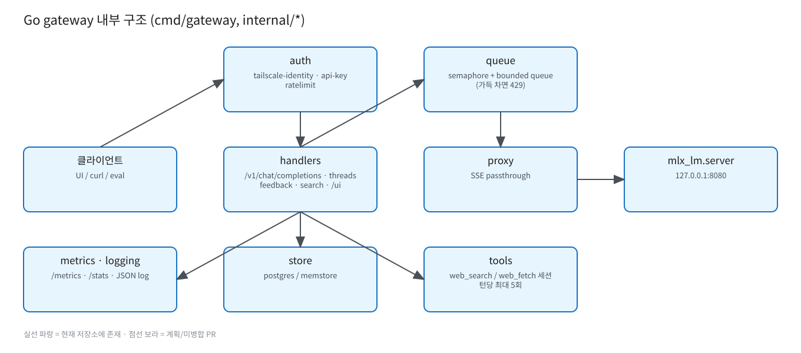

# Go gateway

원본: [`diagrams/gateway.excalidraw`](diagrams/gateway.excalidraw)

- 진입점 `cmd/gateway/main.go`, 패키지 `internal/{auth,handlers,proxy,queue,tools,search,webfetch,store,metrics,logging,config,apierr}`.
- 레거시 Python `gateway.py`는 롤백용으로 유지.
- 설정: `config.yaml`, 환경변수 `GW_<KEY>`로 덮어쓰기.
- 바인딩: `127.0.0.1:8000` (운영), `make run` 기본 `127.0.0.1:8001` (테스트/eval).

## API 라우트 (`internal/handlers/server.go`)
| method | path | 인증 |
|---|---|---|
| POST | /v1/chat/completions (SSE) | 필요 |
| GET | /v1/models, /v1/me, /whoami | 필요 |
| GET/POST | /v1/threads, POST /v1/threads/import | 필요(DB) |
| GET/PATCH/DELETE | /v1/threads/{id}, GET /v1/threads/{id}/messages | 필요(DB) |
| PUT/DELETE | /v1/messages/{id}/feedback | 필요(DB) |
| GET | /v1/feedback/export, /v1/search | 필요(DB) |
| GET | /health, /ready, /metrics, /stats | 없음 |
| GET/POST | /admin/config, /admin/log-level | 필요 |
| GET | /openapi.json, /docs, /ui/ | — |

에러는 OpenAI 형식 `{"error":{"message","type","code","request_id"}}`. 모든 응답에 `X-Request-ID`, `X-Eve-Version`.
상세 계약: [../threads-api.md](../threads-api.md), 루트 README.

## 인증
`tailscale-identity`(**unix 소켓 리스너로 들어온 요청** + `allowed_users`일 때만 `Tailscale-User-Login` 신뢰, 4.0.0; TCP에서는 `Tailscale-User-*` 헤더 제거) → `api-key`(Bearer). `internal/auth/ratelimit.go`에 rate limit.

## 큐
semaphore + bounded queue, 가득 차면 429 `queue_full`. `gateway`와 레거시 `gateway-ts`는 별도 프로세스라 큐/메트릭이 따로입니다.
