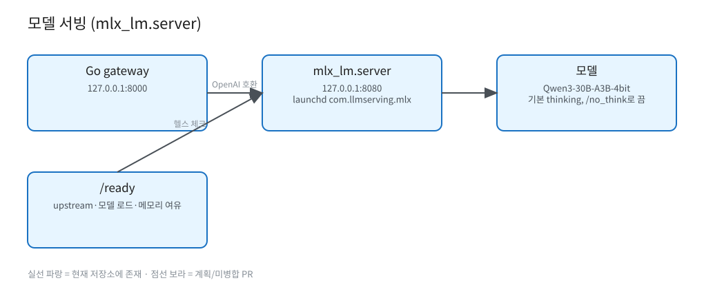

# 모델 서빙 (mlx_lm.server)

원본: [`diagrams/model-serving.excalidraw`](diagrams/model-serving.excalidraw)

- `mlx_lm.server`, 모델 `Qwen3-30B-A3B-4bit`, `127.0.0.1:8080`, launchd `com.llmserving.mlx` (`deploy/launchd/com.llmserving.mlx.plist.template`).
- gateway가 OpenAI 호환 요청을 프록시(SSE passthrough). 기본값: `max_tokens` 1024, `temperature` 0.7, `top_p` 0.9 (`config.yaml`).
- Qwen3는 기본적으로 reasoning을 하며 user 메시지 끝 `/no_think`로 끔.
- `/ready`: upstream 응답·모델 로드·메모리 여유 확인 (`internal/metrics/memory.go`가 `mlx_lm.server` 프로세스 메모리 샘플링).
- TBD: 모델 교체 절차 (versioning.md상 base model 교체 = major), 동시성 튜닝 값 근거.
