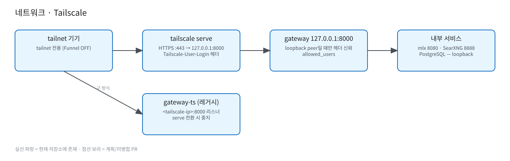

# 네트워크 · Tailscale

원본: [`diagrams/network-tailscale.excalidraw`](diagrams/network-tailscale.excalidraw)

- 외부 노출은 `tailscale serve --bg --https=443 http://127.0.0.1:8000` 하나 (tailnet 전용, **Funnel 아님**). 주소 형식: `https://<host>.<tailnet>.ts.net/ui/`.
- `tailscale serve`가 `Tailscale-User-Login` 헤더를 주입 → **4.0.0부터** gateway는 그 요청이 **unix 소켓(`GW_UNIX_SOCKET`)으로 들어왔고** `allowed_users`에 있을 때만 신뢰. TCP(127.0.0.1:8000 포함)로 온 요청은 `Tailscale-User-*` 헤더를 모두 제거하고 API 키 인증만 허용(loopback이라는 사실은 아무것도 증명하지 못함: 같은 Mac의 아무 프로세스나 접속 가능). 소켓 디렉터리 0700(게이트웨이 사용자 소유), 소켓 0660, 더 느슨하면 기동 거부. `GW_TCP_DISABLED=true`로 TCP 리스너를 끌 수 있다. 배포: `docs/runbooks/4.0.0-loopback-session.md`.
- 레거시: `com.llmserving.gateway-ts`가 `<tailscale-ip>:8000`에 직접 바인딩 — serve 전환 시 bootout (롤백 절차는 루트 README).
- mlx(8080), SearXNG(8888), PostgreSQL은 loopback 전용.
- TBD: tailnet ACL 정책 (저장소에 없음).
