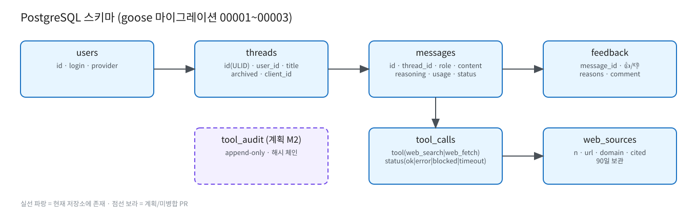

# PostgreSQL 스키마

원본: [`diagrams/postgresql.excalidraw`](diagrams/postgresql.excalidraw)

마이그레이션: `internal/store/postgres/migrations/` (goose, 바이너리에 임베드, 기동 시 자동 적용 — `GW_DB_AUTO_MIGRATE=false`로 끔, 수동 `make migrate`). 상세 모델: [../db-model.md](../db-model.md).

| 테이블 | 마이그레이션 | 주요 컬럼 |
|---|---|---|
| users | 00001 | id, login(unique), provider |
| threads | 00001 | id(ULID), user_id, title, archived, client_id — FTS + pg_trgm 인덱스 |
| messages | 00001 | id(ULID), thread_id, role(system/user/assistant/tool), content, reasoning, model, params, usage, latency_ms, status(complete/incomplete) |
| feedback | 00001, 00003 | message_id(PK), 👍/👎, reasons, comment(140자) |
| tool_calls | 00002 | message_id, round, seq, tool(web_search/web_fetch), status(ok/error/blocked/timeout), latency_ms, result_chars |
| web_sources | 00002 | message_id, tool_call_id, n(인용 번호), url, domain, cited, final_url |

- `tool_calls`/`web_sources`는 `web.retention_days`(기본 90일) 후 자동 삭제.
- 백업: `deploy/pg-backup.sh`, launchd `com.llmserving.pgbackup`.
- 계획(PR #2, M2): `tool_audit` append-only 해시 체인 테이블, M4: `pending_actions`. 스키마 세부는 TBD.
