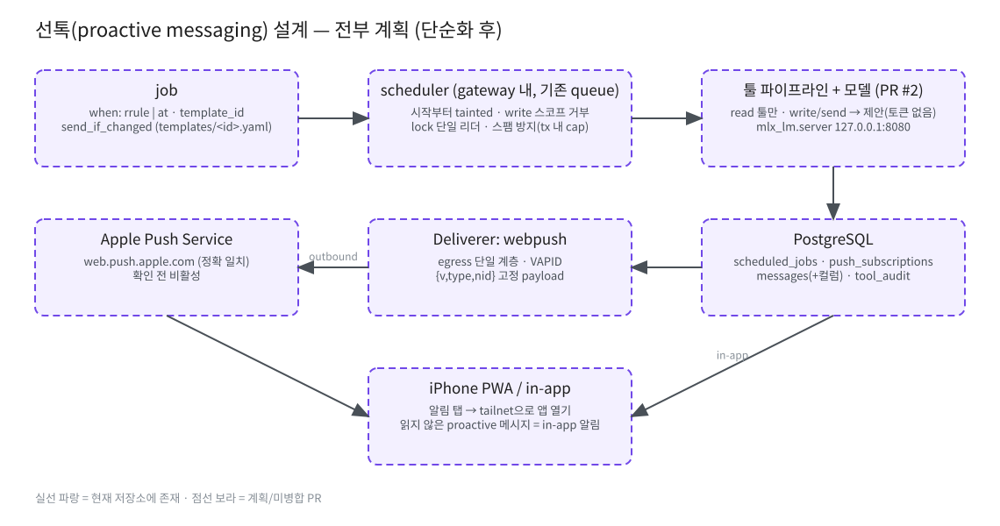
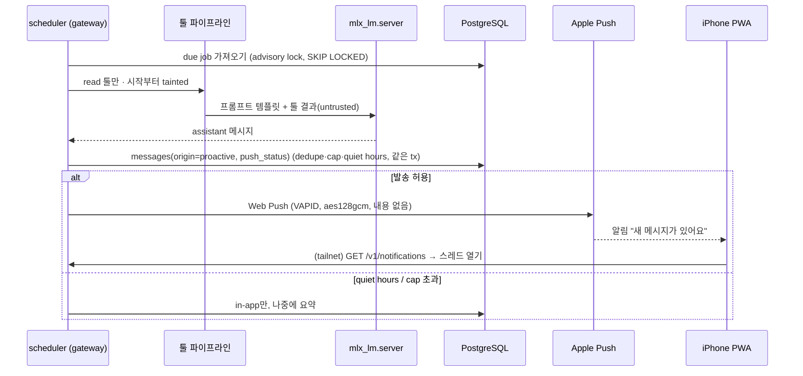

# 선톡 (Proactive Messaging) 설계 — **제안 · 미구현**

> 상태: 설계안만 있습니다 (구현 코드 없음). 현재 저장소(v1.1.0)와 PR #2(툴 플랫폼 설계, 미병합)를 기준으로 작성했습니다. 확인되지 않은 부분은 **TBD**로 표시했습니다.



원본: [`diagrams/proactive-messaging.excalidraw`](diagrams/proactive-messaging.excalidraw)

## 0. 현재 상태에서 출발점
- 현재 gateway는 **요청-응답만** 지원합니다. `POST /v1/chat/completions`(SSE)는 클라이언트가 먼저 요청해야 하고, 백그라운드 작업은 `tool_calls`/`web_sources` 보존 기간 삭제 정도입니다.
- 사용자 식별: `internal/auth`의 `Identity` (tailscale-identity = loopback peer + `allowed_users`, 또는 api-key). DB `users(id, login, provider)`.
- 메시지 저장: `messages.role IN ('system','user','assistant','tool')`, `status IN ('complete','incomplete')`. 메시지가 "누가 시작했는지"를 나타내는 필드는 없습니다.
- 툴: 현재 `web_search`/`web_fetch`만 있고(read), 결과는 `<untrusted_web_content>`로 래핑됩니다. 스코프·taint·확인 게이트는 PR #2의 M3/M4 계획입니다.

## 1. 트리거 — job 하나로 통합

트리거 종류를 따로 두지 않고 **job 하나의 모델**로 표현합니다.

```
job = { when: rrule | at, template_id, send_if_changed: bool }
```

| 용도 | 표현 | 생성 주체 | 기본값 |
|---|---|---|---|
| 아침 브리핑 | `when: rrule`(예: 매일 07:30), `send_if_changed: false` | 사용자 설정 (UI) | off |
| 툴 watch (구 event) | `when: rrule`(주기 폴링) + `send_if_changed: true` (read 템플릿 결과 해시가 바뀔 때만 발송) | 사용자 설정 | off |
| follow-up | `when: at`(1회) + 원 스레드 `thread_id` | **모델이 제안 → 사용자가 확인 카드에서 승인**해야만 생성 | off |

- 새 트리거 유형이 필요하면 **새 enum이 아니라 템플릿과 `when` 조합**으로 표현합니다. 예를 들어 "주 1회 요약"은 rrule만 바꾸면 됩니다. `when`에 새 종류(예: 외부 webhook)를 추가하는 것은 inbound 경계가 바뀌므로 MAJOR입니다.
- 모델은 직접 job을 만들 수 없습니다. 모델·툴 경로에는 job을 쓰는 함수가 없고, job 생성/수정은 사용자 세션 API(`POST /v1/jobs`, 계획)에서만 가능합니다. **job에는 템플릿 id만** 들어갑니다(자유 텍스트 프롬프트·URL·인자 불가). [H3]
- follow-up은 PR #2 확인 게이트(`pending_actions`)를 거쳐 생성하며, write 스코프로 취급합니다.
- **scheduler 실행은 시작부터 tainted**로 취급합니다. follow-up은 **원 스레드의 taint를 상속**합니다(원 스레드가 tainted면 follow-up 실행도 tainted, 반대 방향 초기화 없음). [H3] tainted 스레드에서 나온 follow-up 제안은 자동 생성하지 않습니다.

### 템플릿 (PR #2 manifest 레지스트리 재사용)
- `templates/<id>.yaml`: 사용할 read 툴 목록, 프롬프트, 필요한 스코프(`*.read`만), 기본 rrule, 결과 해시 대상 필드를 담습니다. 저장소에 선언하고 `go:embed`로 넣으며 **런타임 등록은 없습니다**(PR #2 §1.1과 같은 원칙). 
- 템플릿 추가는 툴 추가와 같은 규칙을 따릅니다. **보안 의견**: 기존 read 툴만 쓰고 새 스코프·egress·시크릿이 없으며 보안 리뷰를 통과한 템플릿은 MINOR 가능. 단 템플릿 프롬프트는 사용자 부재 실행의 입력이므로 **보안 리뷰 필수**이고, 새 rrule 하한(예: 15분 미만 폴링)·`send_if_changed` 해시 대상 변경도 리뷰 대상입니다. `when` 새 종류·새 채널은 MAJOR. **최종 분류는 건영님 결정**입니다(§9) [S4-T].

### 스케줄러 위치
- **gateway 프로세스 안의 단일 goroutine** (`internal/scheduler`, 이름 TBD). 인증·store·tools·**기존 queue(semaphore)**를 그대로 재사용하고 새 프로세스나 포트를 만들지 않습니다. 사용자 요청보다 낮은 우선순위로 실행하며, 큐가 차 있으면 다음 주기로 미룹니다.
- 전역 스위치 `GW_PROACTIVE_ENABLED`는 **기본 false**입니다(켜는 방향). 끄는 방향은 PR #2 킬스위치 파일의 `proactive_off: true`로도 할 수 있습니다. 둘이 충돌하면 **끄기가 항상 우선**합니다(`proactive_off`·사용자/job off 중 하나라도 off면 실행 안 함). env를 켜는 것은 재시작이 필요한 **배포 행위**이고 MAJOR 기능의 활성화이므로 건영님 승인 사항입니다 [S4-6]. [Med]
- **PostgreSQL advisory lock으로 단일 리더**만 실행합니다. **lock을 잃으면 진행 중인 실행을 즉시 중단**하고(발송 전이면 발송 안 함) 다시 얻을 때까지 대기합니다. [Med] 테스트용 `:8001` 인스턴스는 기본 비활성입니다.
- 폴링: `enabled AND deleted_at IS NULL AND next_run_at <= now()`인 job을 [S4-8] `FOR UPDATE SKIP LOCKED`로 가져옵니다. 시간대는 job의 `tz`(기본 `Asia/Seoul`)를 씁니다.
- `actor=scheduler`는 **write/send 스코프를 하드 거부**합니다(정책 파일 설정과 무관, 코드 상수). [H2]

### 전달 채널 — Deliverer 인터페이스 (청사진)
```go
type Deliverer interface {
    Name() string                                   // "inapp", "webpush"
    Send(ctx context.Context, u UserID, msgID string) error
}
```
- 채널은 코드 안의 **채널 등록표**(`inapp`, `webpush`)로만 추가합니다. 런타임 등록은 없습니다. **새 채널 추가(이메일, 메신저 등)는 egress·노출 경계가 바뀌므로 MAJOR**입니다.
- `inapp`은 별도 저장소 없이 `messages.read_at`만 씁니다. `webpush`는 `push_subscriptions`를 씁니다.

## 2. 전달 (Delivery)

### 2.1 in-app 알림 (1차)
- 별도 알림 테이블 없이 **읽지 않은 proactive 메시지**(`messages.origin='proactive' AND read_at IS NULL`)가 곧 in-app 알림입니다. API: `GET /v1/notifications`(위 조건의 메시지 목록 뷰), `POST /v1/messages/{id}/read` (계획).
- 구독·알림·job API 공통: **CSRF 토큰 + Origin 검사**(Origin 없음 또는 `null` → 403), 모든 조회·수정은 `user_id = 현재 Identity`로 범위 제한해 **IDOR 방지**(타 사용자 id → 404). `messages`에는 `user_id`가 없으므로 `POST /v1/messages/{id}/read`와 `GET /v1/notifications`는 **`JOIN threads ON threads.id = messages.thread_id WHERE threads.user_id = 현재 Identity`**로 범위를 제한합니다(`_IDOROtherUser404`가 이 두 경로 포함) [S4-3]. [Med]
- UI는 앱을 열 때와 포그라운드 주기적 조회로 배지와 스레드 목록을 갱신합니다. SSE 상시 연결은 TBD.

### 2.2 iPhone Web Push (2차)
- 조건: iOS/iPadOS **16.4 이상**, **홈 화면에 추가한 웹 앱**(manifest `display: standalone`)에서만 가능합니다. Safari 탭에서는 안 됩니다. 권한 요청은 사용자 탭(제스처) 안에서 해야 합니다. [WebKit][webkit-ios], [Apple][apple-webpush]
- 표준: Push API + Service Worker, **VAPID**(RFC 8292, ES256 JWT, `exp` ≤ 24h) [rfc8292], payload 암호화 **aes128gcm**(RFC 8291) [rfc8291], 전송 프로토콜 RFC 8030.
- Apple은 Web Push에 APNs를 쓰고 Apple Developer Program 가입이 필요 없습니다. 서버는 Apple push 서비스로 **outbound** 접근이 필요합니다. Apple 안내는 push.apple.com 하위 도메인 전체 허용이지만 [WebKit][webkit-ios], [Apple][apple-webpush], **Eve는 정확히 `web.push.apple.com` 하나만 허용**합니다 (§2.2.1). [N1]
- Safari는 **보이지 않는(silent) push를 지원하지 않습니다**. 받으면 바로 알림을 표시해야 하고, 그렇지 않으면 권한이 회수됩니다. [Apple][apple-webpush]

### 2.2.1 push endpoint allowlist [H1]
- **등록 시와 발송 시 모두** 검사: `https`만, 포트 443만, 호스트가 **정확히 `web.push.apple.com`**인 경우만 허용합니다(와일드카드·접미사 매칭 금지). [N1]
- **기본 거부:** 실제 iPhone 구독 endpoint가 `web.push.apple.com`임을 확인하기 전에는 **Web Push를 비활성화하고 in-app 알림만** 씁니다. [N1]
- 거부된 호스트는 메트릭(`eve_push_endpoint_rejected_total{reason}`)과 `tool_audit`에 기록합니다(전체 URL이 아닌 호스트만). [N1]
- 허용 호스트를 추가하는 것은 **별도 MAJOR 결정**입니다. Apple WWDC22 안내처럼 push.apple.com 하위 도메인 전체를 허용하는 경우도 포함합니다. [N1]
- VAPID JWT의 `aud`는 정확히 `https://web.push.apple.com`이어야 합니다. 다른 값이면 서명하지 않습니다. [N1]
- **DNS 검사:** 이름이 사설(RFC 1918)·loopback·link-local·CGNAT(100.64.0.0/10, tailnet 대역 포함)·ULA·**IPv4-mapped IPv6(`::ffff:0:0/96`, 내부 IPv4로 정규화 후 재검사)·미지정 주소(`0.0.0.0`, `::`)·멀티캐스트(`224.0.0.0/4`, `ff00::/8`)** 주소로 해석되면 거부합니다. **DNS rebinding을 막기 위해** 검사한 IP로 연결을 고정(pin)하고, 연결 시점에 다시 해석하지 않습니다. [N3]
- IP 리터럴(IPv4/IPv6, 10진·16진 표기 포함) 거부, userinfo·비표준 포트 거부, **리다이렉트 따라가지 않음**(3xx = 실패).
- 발송은 gateway의 **도메인 egress 정책(PR #2 §13, 단일 적용 계층)**을 통과해야 하며 별도 HTTP 클라이언트 우회 경로를 두지 않습니다.

### 2.3 tailnet 전용 환경에서 동작하는가 → **예 (조건부)**
| 경로 | 필요 조건 | tailnet 전용과 충돌? |
|---|---|---|
| 구독 (PWA → gateway) | secure context(HTTPS). `tailscale serve`가 `*.ts.net` 이름으로 Let's Encrypt 인증서를 자동 발급·갱신 [ts-serve], [ts-https] | 없음. 구독할 때 iPhone이 tailnet에 연결되어 있으면 됨 |
| 발송 (gateway → Apple) | host에서 `web.push.apple.com`(정확 일치)으로만 HTTPS outbound, gateway 단일 egress 계층 경유 | 없음. **새 outbound 경로**라서 보안 경계 변경 |
| 수신 (Apple → iPhone) | APNs 경유. gateway로 들어오는 inbound 필요 없음 | 없음. tailnet 연결이 꺼져 있어도 알림은 뜸 |
| 열람 (알림 탭 → 앱) | 앱이 gateway API를 호출하므로 tailnet 연결 필요 | 연결이 꺼져 있으면 "연결 필요" 화면 (아래) |

- **'연결 필요' 화면 [L3]:** 알림을 탭했는데 gateway API 요청이 실패하면(네트워크 오류·타임아웃 약 5초) SW나 앱이 캐시된 셸에 "Tailscale 연결이 필요해요" 화면을 보여줍니다. 화면에는 재시도 버튼과 Tailscale 켜기 안내가 있고, `nid`는 로컬에만 보관했다가 연결되면 해당 스레드를 엽니다. 대화 내용은 캐시하지 않습니다.
- 참고: Tailscale HTTPS 인증서는 CT 공개 로그에 머신 이름이 기록됩니다 [ts-https]. 이미 serve를 쓰고 있으므로 새 노출은 아닙니다.
- Funnel은 켜지 않습니다. inbound는 지금처럼 tailnet 전용으로 유지합니다.

### 2.4 payload 프라이버시
- **고정 구조 payload**: `{"v":1,"type":"proactive","nid":"<proactive message ULID>"}` 정확히 이 3개 키만(추가 키 있으면 발송 거부), aes128gcm 암호화. [Med]
  - 1차 통제는 **엄격한 스키마**입니다: `v`는 정확히 1, `type`은 enum(`proactive` 등 고정 목록), `nid`는 ULID 정규식 `^[0-9A-HJKMNP-TV-Z]{26}$`.
  - 보조 통제로 **암호화 전 평문 JSON 바이트 기준 256B 상한**을 둡니다. 더 엄격하게 128B로 하는 선택지도 있습니다. 알림 문구는 SW에서 고정 문구로 표시하고("Eve에게서 새 메시지가 있어요"), 실제 내용은 앱을 열 때 tailnet으로 가져옵니다.
- 이유: payload는 종단 간 암호화되지만 Apple은 메타데이터(시각·크기·endpoint)를 볼 수 있고, 잠금 화면 미리보기로 내용이 노출될 수 있습니다. 미리보기 옵션은 TBD(기본 off).
- `Topic` 헤더로 같은 종류 알림을 합치고(coalesce). **Topic에는 내용을 넣지 않습니다**: 고정 값(예: `eve-proactive`)이나 무작위 id만 씁니다. 헤더는 암호화되지 않기 때문입니다. `TTL`은 짧게(예: 브리핑 4h) 설정합니다 [apple-webpush].
- VAPID 개인키: macOS Keychain 또는 chmod 600 파일 (PR #2 시크릿 정책). 저장소·env·로그 금지. Redactor로 endpoint URL, **VAPID JWT(Authorization 헤더)**, p256dh/auth를 마스킹합니다. [N5]
- **키 로드 실패(없음·권한 600 아님·파싱 실패) 시 기능이 켜져 있으면 기동 거부.** [Med]
- `sub` claim: 운영자 연락용 `mailto:` 값을 설정 파일에서 읽고(저장소에는 placeholder), JWT `exp` ≤ 24h, 1시간 이상 재사용. [Med]
- **키 로테이션 절차**: 새 키 생성 → 새 공개키를 UI에 배포 → 기존 구독은 구 키로 계속 발송하며 앱 열 때 새 키로 재구독(`push_subscriptions.vapid_key_id`) → 구 키 구독이 0이 되거나 30일 후 구 키 폐기. 유출 의심 시 즉시 구 키 폐기하고 전 구독 비활성화(앱에서 재구독). [Med]

## 3. 데이터 모델 (계획 마이그레이션 `00004_proactive.sql`, 번호는 TBD)

```sql
-- 개념 스키마, 확정 아님
scheduled_jobs (
  id TEXT PK,                      -- ULID
  user_id BIGINT FK users ON DELETE CASCADE,
  when_kind TEXT CHECK (when_kind IN ('rrule','at')),
  when_value TEXT,                 -- RRULE 문자열 또는 ISO 시각
  tz TEXT DEFAULT 'Asia/Seoul',
  template_id TEXT NOT NULL,       -- templates/<id>.yaml, 자유 텍스트 금지
  send_if_changed BOOLEAN DEFAULT false,
  thread_id TEXT FK threads NULL,  -- follow-up은 원 스레드. NULL이면 첫 실행 때 서버가 스레드를 만들고(제목 = 템플릿 display_name) 저장, 이후 재사용 (ui-api-contract.md Q5)
  enabled BOOLEAN DEFAULT true,
  deleted_at TIMESTAMPTZ NULL,     -- 소프트 삭제(삭제 = enabled=false + deleted_at). 앱의 하드 DELETE 없음(사용자 삭제 cascade만 예외). 소프트 삭제는 `tool_audit`에 `event_class=security` 이벤트(`job_deleted`, actor, job_id)로 기록 [S4-7][S4-10]
  created_by TEXT CHECK (created_by IN ('user','model_confirmed')),
  confirm_action_id TEXT NULL,     -- PR #2 pending_actions 참조 (follow-up)
  next_run_at, last_run_at TIMESTAMPTZ,
  last_status TEXT,                -- ok|error|skipped_quiet|skipped_cap|skipped_dedupe|blocked (현재 상태만, 이력은 tool_audit)
  last_result_hash TEXT,           -- send_if_changed 비교용
  last_dedupe_key TEXT,            -- 마지막 발송 키 (job 단위 dedupe)
  created_at, updated_at
)
push_subscriptions (id, user_id FK ON DELETE CASCADE, endpoint TEXT UNIQUE, p256dh TEXT, auth TEXT, vapid_key_id TEXT, ua TEXT, created_at, last_ok_at, disabled_at)

ALTER TABLE messages
  ADD COLUMN origin TEXT NOT NULL DEFAULT 'user_turn' CHECK (origin IN ('user_turn','proactive')),
  ADD COLUMN job_id TEXT NULL REFERENCES scheduled_jobs(id) ON DELETE NO ACTION, -- proactive일 때 필수(아래 CHECK). NO ACTION은 문장 끝에 검사하므로 사용자 삭제 시 users→threads→messages, users→scheduled_jobs cascade가 같은 문장 안에서 함께 지워져 성공. job 단독 하드 삭제는 여전히 거부(앱은 소프트 삭제만) [S4-7][S4-9]
  ADD COLUMN read_at TIMESTAMPTZ NULL,  -- in-app 알림 읽음
  ADD COLUMN push_status TEXT NULL CHECK (push_status IN ('pending','sent','failed','suppressed')),
  ADD COLUMN dedupe_key TEXT NULL,      -- job_id + 기간 키
  ADD CONSTRAINT messages_proactive_keys CHECK (origin <> 'proactive' OR (job_id IS NOT NULL AND dedupe_key IS NOT NULL)); -- NULL 중복 구멍 차단 [S4-1]
CREATE UNIQUE INDEX messages_proactive_dedupe ON messages (job_id, dedupe_key) WHERE origin = 'proactive';

ALTER TABLE users ADD COLUMN settings JSONB NOT NULL DEFAULT '{}'::jsonb;
-- settings.proactive = {enabled:false, quiet_hours:{start:"22:00", end:"08:00"}, memory_read:false}
-- 키·타입·기본값의 단일 기준은 ui-api-contract.md §2. 서버 스키마 검증: 알 수 없는 키 거부, 타입·범위 검증(HH:MM, Asia/Seoul) [S4-4]
-- daily_cap은 P1에 없음: 서버 고정 하루 3건(코드 상수). 키는 예약(나중에 1–3, 낮추기만)
```

- **테이블 목록 (단순화 후):** 신규 테이블은 **2개**(`scheduled_jobs`, `push_subscriptions`)입니다. 나머지는 `messages` 컬럼 추가와 `users.settings` JSONB로 처리합니다.
  - 없앤 것: `job_runs`(→ `scheduled_jobs.last_status` + 이력은 `tool_audit`), `notifications`(→ `messages.read_at/push_status`), `notification_prefs`(→ `users.settings`).
  - 감사는 PR #2의 `tool_audit`(M2), 확인은 `pending_actions`(M4)를 재사용하며 새로 만들지 않습니다.
- **dedupe는 job 쪽 키**로 합니다(proactive 행은 CHECK로 `job_id`·`dedupe_key` NOT NULL이므로 NULL끼리 중복 통과 불가): `dedupe_key = job_id + 기간 키(예: 브리핑은 날짜, watch는 결과 해시)`이고, `UNIQUE(job_id, dedupe_key)` 부분 인덱스로 막습니다.
- role은 그대로 `assistant`입니다 (OpenAI 호환 유지). 기존 행은 기본값으로 채워져 하위 호환됩니다.
- 선톡 메시지는 job 전용 스레드("Eve 브리핑", job당 하나)에 들어가고, follow-up이면 원 스레드에 들어갑니다.
- `push_subscriptions.endpoint/p256dh/auth`는 비밀은 아니지만 민감 정보로 취급해 export·로그에서 제외합니다. 404/410 응답을 받으면 `disabled_at`을 설정합니다.
- **보존·삭제 [L1]:** 비활성 구독(`disabled_at` 설정 또는 `last_ok_at`이 90일 넘게 지남)은 30일 뒤 삭제합니다. `ON DELETE CASCADE`라서 사용자를 삭제하면 구독도 삭제됩니다. 사용자가 알림을 끄면 해당 기기의 구독을 즉시 삭제합니다.
- goose Down에서 데이터를 DROP하는 롤백은 피하고(PR #2 감사 원칙과 같음), 기능은 플래그로 끕니다.

### 툴 플랫폼과의 관계 (PR #2)
- 스케줄 실행은 **사용자가 없는 실행**이므로 PR #2 파이프라인을 똑같이 거치고, 더 엄격하게 적용합니다:
  - **read 툴만** 자동 실행합니다 (예: `web.read`). write/send 툴은 **자동 실행 금지**이며, 필요하면 `pending_actions` 확인 카드만 만들고 사용자 승인을 기다립니다 (M4).
  - 스케줄 실행은 **시작부터 tainted**입니다(외부 데이터를 읽었는지와 무관). 그래서 새 job이나 follow-up을 만들 수 없습니다 (연쇄 방지). [N2]
  - job 생성/변경·발송·실행은 **단일 감사 로그 `tool_audit`(M2)** 에 `actor=scheduler|user`, `job_id`와 함께 기록합니다. 별도 감사 테이블이나 실행 이력 테이블은 없습니다. [Med]
  - 이벤트 분류 [S4-5]: `event_class=security`(job 생성·변경, 발송, 거부, 차단)와 `event_class=ops`(run, skip). `skipped_dedupe`와 결과 변화 없음(`send_if_changed`)은 행마다 기록하지 않고 job별 일 단위 집계 1행만 남깁니다(hash chain 잠금 경합·노이즈 억제). 보존 기간은 동일합니다.
  - 확인 토큰은 **사용자 세션 POST로만 소비**됩니다(scheduler·모델 경로에서 소비 불가). [H2]
  - **scheduler 발 확인 흐름:**
    1. scheduler는 **토큰 없이 제안(proposal)**만 만듭니다. 제안은 `payload_hash`로 고정되고, 수명은 job TTL과 같되 **최대 24시간**입니다.
    2. 사용자가 카드를 열 때 **사용자 세션 POST(Origin 검사 포함)**로만 1회용 토큰이 발급되고, 토큰은 **120~300초** 뒤 만료됩니다.
    3. 재발급하면 이전 토큰은 무효가 됩니다.
    4. 카드에는 출처(actor=scheduler, job_id)와 **tainted 표시**가 나옵니다.
- 결론: watch(`send_if_changed`)와 follow-up은 **PR #2 M2~M4 이후**에 가능합니다. 브리핑(read 툴만)은 M1 이후 가능합니다.

## 4. 스팸 방지
- **기본 off.** 사용자가 명시적으로 켜야 동작합니다 (`users.settings.proactive.enabled`).
- **Quiet hours** (Asia/Seoul, 기본 22:00–08:00): 이 시간에는 push를 보내지 않고(`push_status='suppressed'`) in-app에만 남긴 뒤, 종료 시각에 1건으로 요약합니다. iOS Focus 모드와도 연동됩니다 [webkit-ios].
- **Rate cap**: 사용자별 하루 push 3건(P1은 서버 고정, 설정 키는 예약 — [ui-api-contract.md](ui-api-contract.md) §2), job별 하루 1건, 시간당 최대 1건. **cap 계산은 `messages`(origin='proactive', push_status IN ('pending','sent'))를 기준으로(발송 중도 셈 [S4-2]), 메시지 insert와 같은 트랜잭션**(사용자 행 잠금) 안에서 수행해 경쟁 조건으로 넘지 않게 합니다. [Med] cap을 넘으면 `last_status=skipped_cap`으로 두고 `tool_audit`에 기록하며, in-app에만 남깁니다.
- **Dedupe**: job 쪽 키 `UNIQUE(job_id, dedupe_key)`로 막습니다. `send_if_changed` job은 `last_result_hash`가 같으면 메시지를 만들지 않습니다.
- **Off 스위치**: job별(`scheduled_jobs.enabled`), 사용자 전체(`users.settings.proactive.enabled`), 운영 전역(`GW_PROACTIVE_ENABLED` 기본 false, 또는 PR #2 킬스위치 파일의 `proactive_off`, 끄기만 가능)이 있습니다. 어느 하나라도 off면 off입니다(끄기 우선).
- 모델 출력이 비거나 "보낼 내용 없음"이면 보내지 않습니다.

## 5. 보안 검토 항목 (보안 담당 봇용)
1. 새 **outbound** 경로는 정확히 `web.push.apple.com`만 허용합니다. 다른 호스트는 막고, 발송은 **gateway 단일 egress 적용 계층**(PR #2 §13)을 거칩니다. 사설 주소로의 DNS 해석과 rebinding도 차단합니다.
2. VAPID 개인키 보관(Keychain/600), 로테이션 절차, 로그·DB·SSE에서 redaction 확인.
3. payload에 대화 내용·제목·URL이 들어가지 않는지 테스트로 강제.
4. 구독 등록 API의 인증(기존 auth 체인 사용), endpoint allowlist(정확히 `https://web.push.apple.com`, 포트 443) 검증.
5. 사용자 부재 실행: write/send 자동 실행 0건을 보장하는지, taint 전파와 연쇄 job 생성 차단.
6. 모델이 만든 followup은 확인 게이트를 반드시 거치는지 (토큰 1회용·payload_hash).
7. 스케줄러 단일 리더(advisory lock), 장애 시 폭주(밀린 job 일괄 발송) 방지: 오래된 run은 건너뛰고 1건으로 요약.
8. rate cap·quiet hours 우회 불가 (서버 측에서 강제).
9. 감사: job 생성·변경·실행·발송을 단일 `tool_audit`에 기록 (별도 감사 로그 없음).
10. 개인정보: `push_subscriptions` 보존·삭제, feedback export 제외.

## 5.1 보안 검토 반영

| 항목 | 지적 | 문서 반영 위치 |
|---|---|---|
| H1 | endpoint allowlist (등록·발송 양쪽, https/443/정확 호스트, IP 리터럴·리다이렉트 거부, egress 정책 경유) | §2.2.1 |
| H2 | actor=scheduler write 스코프 하드 거부, 확인 토큰은 사용자 세션 POST로만 소비, 테스트 강제 | §1 스케줄러, §3 툴 플랫폼 관계, 아래 테스트 목록 |
| H3 | scheduler 실행 시작부터 tainted, followup taint 상속, 모델/툴 경로 job 쓰기 불가, spec은 템플릿 id만 | §1 트리거, 아래 테스트 목록 |
| M-CSRF | CSRF + Origin 검사(없음/null → 403), IDOR 방지 | §2.1 |
| M-VAPID | 키 로테이션, sub claim, 키 로드 실패 시 기동 거부 | §2.4 |
| M-payload | `{v,type,nid}` 고정, 크기 상한 | §2.4 |
| M-audit | 단일 `tool_audit`, 별도 감사·실행 이력 테이블 없음 (단순화로 `job_runs` 제거, 상태는 `scheduled_jobs.last_status`) | §3, §5-9 |
| M-ops | `GW_PROACTIVE_ENABLED` 기본 false, lock 상실 즉시 중단, cap 트랜잭션 내 계산(단순화 후 `messages` 기준) | §1, §4 |

**머지 차단 테스트 (구현 PR에서 필수, 이름은 제안, PR #2 규칙 `Test<대상>_<동작>`) — 대상별 4그룹:**

1. **Push egress·payload** (`internal/push`)
   - `TestPushEndpoint_RejectsNonApple` / `_RejectsHTTP` / `_RejectsPort` / `_RejectsIPLiteral`(IPv4, IPv6, 10진·16진 표기) / `_RejectsUserinfo` / `_NoRedirectFollow` / `_CheckedAtSendTime`(등록 후 DB 값 변조 시 발송 거부) / `_RejectsPrivateResolution`(사설·loopback·CGNAT·IPv4-mapped·미지정·멀티캐스트, rebinding) [N3] / `_RejectsWildcardOrSuffixMatch`
   - `TestPushVAPID_AudExactAppleHost`, `TestPushStartup_RefusesOnVAPIDKeyLoadFailure`, `TestPush_DisabledUntilHostConfirmed`, `TestPushPayload_FixedKeysAndSizeCap`, `TestPushRedaction_EndpointVAPIDJWTKeys` [N5]
2. **Scheduler 실행 경계** (`internal/scheduler`)
   - `TestActorScheduler_RejectsWriteScope` / `_RejectsSendScope` / `_IgnoresGrantsFileOverride`
   - `TestSchedulerRun_TaintedFromStart`, `TestSchedulerFollowup_InheritsOriginThreadTaint`, `TestScheduler_StopsOnLockLoss`, `TestActorScheduler_RequiresJobID`, `TestActor_NotClientSettable`
   - `TestSchedulerJob_TemplateIDOnly`(자유 텍스트·추가 키 거부), `TestSchedulerJob_NoModelOrToolPathWrites`(툴 레지스트리·모델 tool_call로 job 생성 불가)
3. **확인 게이트** (PR #2 `pending_actions`와 공유)
   - `TestSchedulerProposal_NoTokenUntilUserOpens`, `TestApprove_RejectsTokenlessProposal`, `TestProposal_ExpiresAfterTTL`(24h), `TestConfirmToken_ConsumeOnlyViaUserSessionPOST`(scheduler·모델 컨텍스트 소비 거부, GET 거부), `TestConfirmToken_ReissueInvalidatesPrevious`
4. **API·스팸 방지·감사** (`internal/handlers`)
   - `TestProactiveAPI_OriginMissingOrNull403` / `_CSRFRequired` / `_IDOROtherUser404`
   - `TestProactiveRateCap_ConcurrentInsertsWithinTx`(messages 기준, pending 포함), `TestProactiveDedupe_CheckRequiresJobAndKey`, `TestSchedulerJob_DeleteKeepsProactiveMessages`, `TestUserDelete_CascadesJobsAndProactiveMessages`, `TestScheduler_SkipsSoftDeletedJobs`, `TestUserSettings_SchemaRejectsUnknownAndOutOfRange`, `TestKillswitch_ProactiveOffWinsOverEnv`, `TestProactiveDedupe_UniqueJobKey`, `TestProactiveQuietHours_EnforcedServerSide`(Asia/Seoul 경계 포함) [N5], `TestProactiveAudit_RecordsJobCreateRunSkipSendReject` [N5], `TestProactiveAudit_EventClassAndSkipAggregated`

이름이 바뀐 것: `TestFollowup_*` → `TestSchedulerFollowup_*`, `TestJobSpec_TemplateIDOnly` → `TestSchedulerJob_TemplateIDOnly`, `TestNoModelOrToolPathWritesJobs` → `TestSchedulerJob_NoModelOrToolPathWrites`, `TestVAPID_*`/`TestStartup_*`/`TestPayload_*`/`TestRedaction_*` → `TestPush*` 접두, `TestRateCap_*`/`TestQuietHours_*`/`TestAudit_*` → `TestProactive*` 접두(감사 테스트는 스킵 사유까지 포함). 새로 생긴 것: `TestProactiveDedupe_UniqueJobKey`(dedupe 위치 변경). 보안 검토(7336e4f) 반영으로 `TestProactiveDedupe_CheckRequiresJobAndKey`, `TestUserSettings_SchemaRejectsUnknownAndOutOfRange`, `TestKillswitch_ProactiveOffWinsOverEnv`, `TestProactiveAudit_EventClassAndSkipAggregated` 추가. 확인 게이트 테스트 이름은 PR #2(`NoTokenUntilUserOpens`, `ExpiresAfterTTL`)로 통일. 빠진 보안 테스트는 없습니다.

**PR #2(툴 플랫폼)와 맞춰야 할 항목 (PR #2 §15.1d·§15.1g에 반영됨):**
1. 외부 egress는 gateway 단일 적용 계층(§13 도메인 정책)으로만 나가며, push 발송도 이 계층을 사용.
2. 감사 로그는 `tool_audit` 하나 (`actor` 값에 `scheduler` 추가). 실행 이력도 여기로.
3. follow-up taint 상속 규칙 (원 스레드 taint 상속, scheduler 실행은 시작부터 tainted).
4. scheduler 발 확인: 제안에는 토큰이 없고 `payload_hash`로 고정되며 TTL은 최대 24시간입니다. 사용자가 카드를 열 때 사용자 세션 POST(Origin 검사)로 1회용 토큰을 발급하고 120~300초 뒤 만료합니다. 재발급하면 이전 토큰은 무효입니다. 카드에는 actor, job_id, tainted를 표시합니다.
5. egress allowlist: push 호스트는 정확히 `web.push.apple.com` 하나이고, 추가는 MAJOR입니다.
6. 킬스위치는 0600 파일 하나이고, 선톡 전역 끄기 `proactive_off`도 같은 파일에 둡니다. 템플릿은 manifest 레지스트리 방식(`templates/<id>.yaml`)을 따릅니다.

## 5.2 2차 보안 재검토 반영

| 항목 | 반영 |
|---|---|
| N1 | 와일드카드 전부 제거, 정확히 `web.push.apple.com`만 허용, 확인 전 push 비활성(in-app만), 거부 기록(metrics + tool_audit), 호스트 추가 = MAJOR, VAPID `aud` 정확 일치, §5-1을 gateway 단일 egress 계층으로 수정 (§2.2, §2.2.1, §2.3, §5-1, §5-4) |
| N2 | scheduler 실행은 어디서나 시작부터 tainted (§1, §3) |
| payload | 엄격 스키마(v=1, type enum, nid ULID 정규식)가 1차 통제, 256B는 암호화 전 평문 기준, 128B 선택지, Topic에 내용 금지 (§2.4) |
| 확인 재설계 | 60초 만료 폐기 → 토큰 없는 제안(payload_hash, TTL ≤ 24h) + 사용자가 열 때 1회용 토큰(120~300s), 재발급 시 이전 토큰 무효, actor·job_id·tainted 표시 (§3, PR #2 정렬 4번) |
| N3 | 사설·loopback·CGNAT로 해석되면 거부, IP pin으로 rebinding 방지 (§2.2.1, 테스트) |
| N5 | 감사 기록·redaction·quiet hours 머지 차단 테스트, VAPID JWT redaction (§2.4, 테스트) |
| L1 | 구독 보존 기간·cascade 삭제 (§3) |
| 권고(승인 후) | DNS 거부 목록에 IPv4-mapped IPv6·미지정·멀티캐스트 추가, 테스트 이름을 PR #2 규칙(`Test<대상>_<동작>`, `TestActorScheduler_*`, `TestSchedulerProposal_*`)에 맞춤 |
| L3 | '연결 필요' 화면 처리 (§2.3) |

## 5.4 보안 검토 반영 (단순화 커밋 7336e4f 리뷰)

| ID | 지적 | 반영 |
|---|---|---|
| S4-1 | dedupe NULL 구멍 | `CHECK (origin <> 'proactive' OR (job_id, dedupe_key NOT NULL))`, `job_id` FK → `scheduled_jobs` (§3) |
| S4-2 | cap이 `sent`만 셈 | `pending`+`sent` 집계, tx·행 잠금 유지 (§4) |
| S4-3 | `messages`에 user_id 없음 → IDOR | `threads.user_id` 조인으로 범위 제한 명시 (§2.1) |
| S4-4 | `users.settings` 검증 | 알 수 없는 키 거부, 타입·범위, 서버 상한 코드 상수, 테스트 추가 (§3) |
| S4-5 | 운영 이벤트가 감사 원장에 | `event_class` security/ops 구분, 스킵·변화 없음은 일 단위 집계, 보존 동일 (§3) |
| S4-6 | 켜는 env vs 끄는 킬스위치 | 끄기 항상 우선, env 켜기 = 배포 행위·MAJOR·건영님 승인 (§1, §4) |
| S4-T | 템플릿 분류 | 보안 의견(MINOR 가능 + 보안 리뷰 필수)으로 기록, 최종은 건영님 (§1, §9) |
| 권고 Low | 테스트 이름 PR #2와 통일 | `NoTokenUntilUserOpens`, `ExpiresAfterTTL` (§5.1 테스트) |
| S4-7 | (재검토 965aec6) FK `SET NULL`과 NOT NULL CHECK 충돌 | `ON DELETE RESTRICT` + job 소프트 삭제(`enabled=false`, `deleted_at`), 스케줄러는 `deleted_at IS NULL`만 실행, `TestSchedulerJob_DeleteKeepsProactiveMessages` (§3) |
| S4-8 | (최종) 폴링 조건에 소프트 삭제 누락 | `enabled AND deleted_at IS NULL` 조건, `TestScheduler_SkipsSoftDeletedJobs` (§1) |
| S4-9 | (최종) `RESTRICT`는 사용자 삭제 cascade를 막음 | FK `ON DELETE NO ACTION`(문장 끝 검사), `TestUserDelete_CascadesJobsAndProactiveMessages` (§3) |
| S4-10 | (최종) job 소프트 삭제 감사 | `tool_audit` security 이벤트 `job_deleted` (§3) |
| S4-11 | (후속) PR #2와 테스트 목록 정렬 | `TestActorScheduler_RequiresJobID`, `TestActor_NotClientSettable`(§5.1 그룹 2), `TestApprove_RejectsTokenlessProposal`(그룹 3) 추가 |

## 5.3 설계 원칙 반영 (단순성·확장성·청사진)

**단순성**
| 변경 | 전 | 후 |
|---|---|---|
| 트리거 | `kind` 3종(schedule/event/followup) | job 1종 `{when: rrule\|at, template_id, send_if_changed}` |
| 신규 테이블 | 5개 | 2개 (`scheduled_jobs`, `push_subscriptions`) + `messages` 컬럼 + `users.settings` |
| dedupe | `notifications UNIQUE(user_id, dedupe_key)` | `messages UNIQUE(job_id, dedupe_key)` (job 쪽 키) |
| 실행 이력 | `job_runs` | `scheduled_jobs.last_status` + `tool_audit` |
| 다이어그램 | 박스 10개 | 7개 |
| 테스트 | 평면 목록 | 대상별 4그룹 (보안 테스트 전부 유지) |
| 스케줄러 큐 | — | 기존 queue 재사용 (변경 없음) |

**확장 지점**
- 새 트리거 유형 = 템플릿 + `when` 조합 (스키마 변경 없음). `when`의 새 종류(webhook 등)는 MAJOR.
- 새 전달 채널 = `Deliverer` 구현 + 채널 등록표 (MAJOR).
- 새 브리핑·watch = `templates/<id>.yaml` (PR #2 레지스트리 방식, 분류는 §9).
- 사용자 설정 = `users.settings` JSONB (서버 스키마 검증), 새 설정 항목은 마이그레이션 없이 추가 가능.

**하드코딩·임시 선택과 청사진**
| 값 | 근거 | 바꾸는 조건·절차 |
|---|---|---|
| push 호스트 `web.push.apple.com` 하나 | Apple 문서는 하위 도메인 전체 허용을 안내하지만 최소 권한 | **확인 절차**: (1) 테스트 iPhone(iOS 16.4+) PWA에서 구독 → (2) endpoint 호스트를 서버 로그(호스트만)로 확인 → (3) 보안 담당 확인 → (4) push 활성. 다른 호스트가 관찰되면 추가는 MAJOR 결정 |
| payload 평문 256B (선택 128B) | `{v,type,nid}`는 약 80B이므로 3배 여유 | 필드를 추가하면 스키마 v=2와 보안 리뷰 필요 |
| 확인 토큰 120~300s | PR #2와 같음. 카드를 연 뒤 판단할 시간 | 사용 데이터를 보고 범위 안에서 조정, 범위 확대는 보안 리뷰 |
| 제안 수명 ≤ 24h | 하루 지난 제안은 맥락 상실 | 연장 불가(보안 경계). 단축은 패치 |
| 폴링 30~60s | 분 단위 정확도면 충분, DB 부하 최소 | 정확도 요구가 생기면 `LISTEN/NOTIFY`로 전환 (MINOR) |
| cap 3/일·job 1/일·1/시간, quiet 22–08 | 보수적 기본값 | quiet hours만 `users.settings`로 조정(ui-api-contract.md §2). cap은 P1 서버 고정 3, 나중에 1–3 낮추기만(예약 키) |
| 구독 보존 90일 무응답 → 30일 뒤 삭제 | 기존 `retention_days: 90`과 정렬 | 설정값으로 이동 가능 (MINOR) |
| `gateway-ts` 레거시 리스너 | 이전 노출 방식의 잔재 | **제거 계획**: (1) `tailscale serve` 단일 경로 운영 확인 → (2) `gateway-ts` plist bootout + 삭제, README 롤백 절차 정리 → (3) advisory lock은 안전장치로 유지. 노출 경계 축소라 보안 리뷰 후 진행. 선톡 구현 전 완료 권장 |
| Asia/Seoul | 사용자 위치 | job `tz` 컬럼으로 이미 일반화 |

## 6. SemVer 판단: **MAJOR**
- `docs/versioning.md` 기준으로 major에 해당합니다: (a) **보안·노출 경계 변경**: 새 outbound 외부 전송(Apple push)과 사용자 없는 자동 실행, (b) 새 DB 스키마와 `messages`에 컬럼 추가. 컬럼 추가는 하위 호환이지만 (a) 하나만으로도 major이고, "애매하면 major" 규칙도 적용됩니다.
- 따라서 **건영님 직접 승인이 필요**합니다. PR #2 마일스톤과 맞추면 다음과 같습니다:
  - P1 in-app + `schedule`(read만): M1 이후, major (사용자 없는 실행 + 스키마)
  - P2 Web Push: major (outbound)
  - P3 watch(`send_if_changed`)/follow-up: M3/M4 이후, major (권한 경계)
  - 단계를 합쳐 한 번의 major로 낼지는 TBD.

## 7. 대략적 작업량 (봇별, 추정)
| 봇 | 작업 | 추정 |
|---|---|---|
| backend | 마이그레이션, scheduler(lock·poll·queue 우선순위), 알림 조회·읽음/push API, VAPID 발송(aes128gcm), anti-spam, 테스트 | 6~9일 |
| frontend | SW push 핸들러, 구독 UI(홈 화면 안내·권한 버튼), 알림 목록·배지, 설정(quiet hours·cap·트리거 on/off), 확인 카드 연동 | 4~6일 |
| designer | 알림 문구, 설정 화면, 브리핑 스레드 표시, "tailnet 연결 필요" 화면 | 1~2일 |
| security | 위 §5 리뷰, 위협 모델, 키 관리 확인, outbound 정책 | 1~2일 |

## 8. 요청 흐름 (보조)



## 9. 미결정 사항 (TBD)
- `when` 형식은 RRULE(rrule)·ISO 시각(at)으로 정했습니다. 템플릿은 `templates/<id>.yaml`(PR #2 레지스트리)로 정했습니다. **남은 결정: 기존 read 툴만 쓰는 템플릿 추가를 MINOR로 볼지 MAJOR로 볼지 (건영님). 보안 의견은 조건부 MINOR(§1 템플릿, S4-T).**
- 브리핑 내용 범위 (어떤 read 툴을 쓸지). 현재 저장소에는 web 툴만 있습니다.
- in-app 실시간 전달 (SSE 상시 연결 vs 폴링)
- 잠금 화면 미리보기 허용 여부
- 여러 기기·구독 관리 UI
- `gateway-ts` 제거 시점 (계획은 §5.3, 선톡 구현 전 완료 권장)

## 출처
- [webkit-ios]: WebKit, "Web Push for Web Apps on iOS and iPadOS" — https://webkit.org/blog/13878/web-push-for-web-apps-on-ios-and-ipados/
- [apple-webpush]: Apple Developer, "Sending web push notifications in web apps and browsers" — https://developer.apple.com/documentation/usernotifications/sending-web-push-notifications-in-web-apps-and-browsers
- [rfc8291]: RFC 8291 Message Encryption for Web Push — https://www.rfc-editor.org/info/rfc8291/
- [rfc8292]: RFC 8292 VAPID — https://www.rfc-editor.org/info/rfc8292/
- RFC 8030 Generic Event Delivery Using HTTP Push — https://datatracker.ietf.org/doc/rfc8030/
- [ts-serve]: Tailscale Serve — https://tailscale.com/docs/features/tailscale-serve
- [ts-https]: Tailscale, Enabling HTTPS — https://tailscale.com/docs/how-to/set-up-https-certificates

[webkit-ios]: https://webkit.org/blog/13878/web-push-for-web-apps-on-ios-and-ipados/
[apple-webpush]: https://developer.apple.com/documentation/usernotifications/sending-web-push-notifications-in-web-apps-and-browsers
[rfc8291]: https://www.rfc-editor.org/info/rfc8291/
[rfc8292]: https://www.rfc-editor.org/info/rfc8292/
[ts-serve]: https://tailscale.com/docs/features/tailscale-serve
[ts-https]: https://tailscale.com/docs/how-to/set-up-https-certificates
