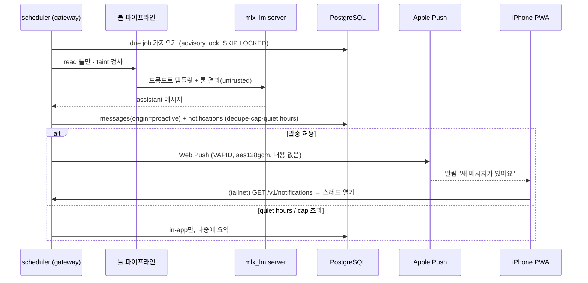

# 선톡 (Proactive Messaging) 설계 — **제안 · 미구현**

> 상태: 설계안만 있습니다 (구현 코드 없음). 현재 저장소(v1.1.0)와 PR #2(툴 플랫폼 설계, 미병합)를 기준으로 작성했습니다. 확인되지 않은 부분은 **TBD**로 표시했습니다.


원본: [`diagrams/proactive-messaging.excalidraw`](diagrams/proactive-messaging.excalidraw)

## 0. 현재 상태에서 출발점
- 현재 gateway는 **요청-응답만** 지원합니다. `POST /v1/chat/completions`(SSE)는 클라이언트가 먼저 요청해야 하고, 백그라운드 작업은 `tool_calls`/`web_sources` 보존 기간 삭제 정도입니다.
- 사용자 식별: `internal/auth`의 `Identity` (tailscale-identity = loopback peer + `allowed_users`, 또는 api-key). DB `users(id, login, provider)`.
- 메시지 저장: `messages.role IN ('system','user','assistant','tool')`, `status IN ('complete','incomplete')`. 메시지가 "누가 시작했는지"를 나타내는 필드는 없습니다.
- 툴: 현재 `web_search`/`web_fetch`만 있고(read), 결과는 `<untrusted_web_content>`로 래핑됩니다. 스코프·taint·확인 게이트는 PR #2의 M3/M4 계획입니다.

## 1. 트리거

| 종류 | 예 | 생성 주체 | 기본값 |
|---|---|---|---|
| `schedule` | 매일 07:30 아침 브리핑 | 사용자 설정 (UI) | off |
| `event` | 툴 watch 결과 (예: 검색어 신규 결과) | 사용자가 등록한 watch | off |
| `followup` | "내일 다시 물어볼게요" | **모델이 제안 → 사용자가 확인 카드에서 승인**해야만 생성 | off |

- 모델은 직접 job을 만들 수 없습니다. `followup`은 PR #2 확인 게이트(`pending_actions`, 1회용 토큰)를 거쳐 생성합니다. `scheduler.write` 같은 write 스코프로 취급합니다.
- tainted 스레드(외부 데이터 유입)에서 나온 followup 제안은 자동 생성하지 않습니다 (PR #2 taint 정책).

### 스케줄러 위치
- **제안: gateway 프로세스 안의 단일 goroutine** (`internal/scheduler`, TBD 이름). 이유: 인증·store·tools·queue를 그대로 재사용하고 새 프로세스/포트를 만들지 않습니다.
- `gateway`와 레거시 `gateway-ts`가 별도 프로세스이므로 **PostgreSQL advisory lock으로 단일 리더**만 실행합니다 (테스트용 `:8001` 인스턴스는 기본 비활성, `GW_SCHEDULER_ENABLED=false`).
- 폴링: 30~60초마다 `next_run_at <= now()`인 job을 `FOR UPDATE SKIP LOCKED`로 가져옴. 시간대는 `Asia/Seoul` 고정(설정 가능).
- 실행은 기존 queue(semaphore)를 거쳐 **사용자 요청보다 낮은 우선순위**로 진행합니다. 큐가 차 있으면 다음 주기로 미룹니다.
- 대안(비채택): launchd 별도 바이너리 — 배포·인증 중복이 생깁니다.

## 2. 전달 (Delivery)

### 2.1 in-app 알림 (1차)
- `notifications` 테이블 + `GET /v1/notifications`, `POST /v1/notifications/{id}/read` (계획).
- UI는 앱을 열 때와 포그라운드 주기적 조회로 배지와 스레드 목록을 갱신합니다. SSE 상시 연결은 TBD.

### 2.2 iPhone Web Push (2차)
- 조건: iOS/iPadOS **16.4 이상**, **홈 화면에 추가한 웹 앱**(manifest `display: standalone`)에서만 가능합니다. Safari 탭에서는 안 됩니다. 권한 요청은 사용자 탭(제스처) 안에서 해야 합니다. [WebKit][webkit-ios], [Apple][apple-webpush]
- 표준: Push API + Service Worker, **VAPID**(RFC 8292, ES256 JWT, `exp` ≤ 24h) [rfc8292], payload 암호화 **aes128gcm**(RFC 8291) [rfc8291], 전송 프로토콜 RFC 8030.
- Apple은 Web Push에 APNs를 쓰고 Apple Developer Program 가입이 필요 없습니다. 서버는 `https://*.push.apple.com`으로 **outbound** 접근이 필요합니다. [WebKit][webkit-ios], [Apple][apple-webpush]
- Safari는 **보이지 않는(silent) push를 지원하지 않습니다**. 받으면 바로 알림을 표시해야 하고, 그렇지 않으면 권한이 회수됩니다. [Apple][apple-webpush]

### 2.3 tailnet 전용 환경에서 동작하는가 → **예 (조건부)**
| 경로 | 필요 조건 | tailnet 전용과 충돌? |
|---|---|---|
| 구독 (PWA → gateway) | secure context(HTTPS). `tailscale serve`가 `*.ts.net` 이름으로 Let's Encrypt 인증서를 자동 발급·갱신 [ts-serve], [ts-https] | 없음. 구독할 때 iPhone이 tailnet에 연결되어 있으면 됨 |
| 발송 (gateway → Apple) | host에서 `*.push.apple.com`으로 HTTPS outbound | 없음. **새 outbound 경로**라서 보안 경계 변경 |
| 수신 (Apple → iPhone) | APNs 경유. gateway로 들어오는 inbound 필요 없음 | 없음. tailnet 연결이 꺼져 있어도 알림은 뜸 |
| 열람 (알림 탭 → 앱) | 앱이 gateway API를 호출하므로 tailnet 연결 필요 | 연결이 꺼져 있으면 "연결 필요" 화면 (UI TBD) |

- 참고: Tailscale HTTPS 인증서는 CT 공개 로그에 머신 이름이 기록됩니다 [ts-https]. 이미 serve를 쓰고 있으므로 새 노출은 아닙니다.
- Funnel은 켜지 않습니다. inbound는 지금처럼 tailnet 전용으로 유지합니다.

### 2.4 payload 프라이버시
- 권장: **내용 없는 최소 payload**: `{"v":1,"type":"proactive","nid":"<notification ULID>"}` (aes128gcm 암호화). 알림 문구는 SW에서 고정 문구로 표시하고("Eve에게서 새 메시지가 있어요"), 실제 내용은 앱을 열 때 tailnet으로 가져옵니다.
- 이유: payload는 종단 간 암호화되지만 Apple은 메타데이터(시각·크기·endpoint)를 볼 수 있고, 잠금 화면 미리보기로 내용이 노출될 수 있습니다. 미리보기 옵션은 TBD(기본 off).
- `Topic` 헤더로 같은 종류 알림을 합치고(coalesce), `TTL`은 짧게(예: 브리핑 4h) 설정합니다 [apple-webpush].
- VAPID 개인키: macOS Keychain 또는 chmod 600 파일 (PR #2 시크릿 정책). 저장소·env·로그 금지. Redactor로 endpoint URL을 마스킹합니다.

## 3. 데이터 모델 (계획 마이그레이션 `00004_proactive.sql`, 번호는 TBD)

```sql
-- 개념 스키마, 확정 아님
scheduled_jobs (
  id TEXT PK,                 -- ULID
  user_id BIGINT FK users,
  kind TEXT CHECK (kind IN ('schedule','event','followup')),
  thread_id TEXT FK threads NULL,  -- followup은 원 스레드, 나머지는 전용 스레드
  spec JSONB,                 -- cron/RRULE, watch 정의, 프롬프트 템플릿 id (자유 텍스트 프롬프트 X)
  tz TEXT DEFAULT 'Asia/Seoul',
  enabled BOOLEAN DEFAULT true,
  next_run_at TIMESTAMPTZ, last_run_at TIMESTAMPTZ,
  created_by TEXT CHECK (created_by IN ('user','model_confirmed')),
  confirm_action_id TEXT NULL, -- PR #2 pending_actions 참조 (followup)
  dedupe_key TEXT, created_at, updated_at
)
job_runs (id, job_id, started_at, finished_at, status ok|error|skipped_quiet|skipped_cap|skipped_dedupe|blocked, message_id NULL, error)
notifications (id ULID, user_id, message_id FK messages, channel inapp|webpush, status pending|sent|failed|read, dedupe_key UNIQUE(user_id, dedupe_key), created_at, sent_at, read_at)
push_subscriptions (id, user_id, endpoint TEXT UNIQUE, p256dh TEXT, auth TEXT, ua TEXT, created_at, last_ok_at, disabled_at)
notification_prefs (user_id PK, enabled BOOLEAN DEFAULT false, quiet_start TIME DEFAULT '22:00', quiet_end TIME DEFAULT '08:00', daily_cap SMALLINT DEFAULT 3, per_kind JSONB)
```

- `messages`에 **`origin TEXT NOT NULL DEFAULT 'user_turn' CHECK (origin IN ('user_turn','proactive'))`** 와 `job_run_id` 컬럼을 추가합니다. role은 그대로 `assistant`입니다 (OpenAI 호환 유지). 기존 행은 기본값으로 채워져 하위 호환됩니다.
- 선톡 메시지는 `schedule`/`event`이면 전용 스레드("Eve 브리핑", job당 하나)에, `followup`이면 원래 스레드에 들어갑니다.
- `push_subscriptions.endpoint/p256dh/auth`는 비밀은 아니지만 민감 정보로 취급해 export·로그에서 제외합니다. 404/410 응답을 받으면 `disabled_at`을 설정합니다.
- goose Down에서 데이터를 DROP하는 롤백은 피하고(PR #2 감사 원칙과 같음), 기능은 플래그로 끕니다.

### 툴 플랫폼과의 관계 (PR #2)
- 스케줄 실행은 **사용자가 없는 실행**이므로 PR #2 파이프라인을 똑같이 거치고, 더 엄격하게 적용합니다:
  - **read 툴만** 자동 실행합니다 (예: `web.read`). write/send 툴은 **자동 실행 금지**이며, 필요하면 `pending_actions` 확인 카드만 만들고 사용자 승인을 기다립니다 (M4).
  - 스케줄 실행 스레드는 외부 데이터를 읽으면 바로 tainted가 됩니다. 그 결과로 새 job이나 follow-up을 만들 수 없습니다 (연쇄 방지).
  - 모든 실행은 `tool_audit`(M2)에 `actor=scheduler`, `job_id`와 함께 기록됩니다.
- 결론: 선톡의 **event/followup 트리거는 PR #2 M2~M4 이후**에 가능합니다. `schedule`(read 툴만)은 M1 이후 가능합니다.

## 4. 스팸 방지
- **기본 off.** 사용자가 명시적으로 켜야 동작합니다 (`notification_prefs.enabled`).
- **Quiet hours** (Asia/Seoul, 기본 22:00–08:00): 이 시간에는 push를 보내지 않고 in-app에만 쌓은 뒤 종료 시각에 1건으로 요약합니다. iOS Focus 모드와도 연동됩니다 [webkit-ios].
- **Rate cap**: 사용자별 하루 push 3건(설정 가능), 트리거별 하루 1건, 시간당 최대 1건. cap을 넘으면 `skipped_cap`으로 기록하고 in-app에만 남깁니다.
- **Dedupe**: `dedupe_key` = `kind + job_id + 날짜` 또는 watch 결과 해시. `UNIQUE(user_id, dedupe_key)`로 막습니다. 내용이 바뀌지 않은 event는 건너뜁니다.
- **Off 스위치**: 트리거별(`scheduled_jobs.enabled`), 사용자 전체(`notification_prefs.enabled`), 운영 전역(`GW_PROACTIVE_ENABLED=false`, PR #2 kill switch와 같은 방식, 끄기만 가능)이 있습니다.
- 모델 출력이 비거나 "보낼 내용 없음"이면 보내지 않습니다.

## 5. 보안 검토 항목 (보안 담당 봇용)
1. 새 **outbound** 경로(`*.push.apple.com`)의 허용 범위 검증. 다른 호스트는 막고 SSRF 가드를 재사용합니다 (`internal/webfetch/guard.go` 수준).
2. VAPID 개인키 보관(Keychain/600), 로테이션 절차, 로그·DB·SSE에서 redaction 확인.
3. payload에 대화 내용·제목·URL이 들어가지 않는지 테스트로 강제.
4. 구독 등록 API의 인증(기존 auth 체인 사용), endpoint origin allowlist(`*.push.apple.com` 등) 검증.
5. 사용자 부재 실행: write/send 자동 실행 0건을 보장하는지, taint 전파와 연쇄 job 생성 차단.
6. 모델이 만든 followup은 확인 게이트를 반드시 거치는지 (토큰 1회용·payload_hash).
7. 스케줄러 단일 리더(advisory lock), 장애 시 폭주(밀린 job 일괄 발송) 방지: 오래된 run은 건너뛰고 1건으로 요약.
8. rate cap·quiet hours 우회 불가 (서버 측에서 강제).
9. 감사: job 생성·변경·실행·발송을 `tool_audit` 또는 별도 감사 로그에 기록.
10. 개인정보: `push_subscriptions` 보존·삭제, feedback export 제외.

## 6. SemVer 판단: **MAJOR**
- `docs/versioning.md` 기준으로 major에 해당합니다: (a) **보안·노출 경계 변경**: 새 outbound 외부 전송(Apple push)과 사용자 없는 자동 실행, (b) 새 DB 스키마와 `messages`에 컬럼 추가. 컬럼 추가는 하위 호환이지만 (a) 하나만으로도 major이고, "애매하면 major" 규칙도 적용됩니다.
- 따라서 **건영님 직접 승인이 필요**합니다. PR #2 마일스톤과 맞추면 다음과 같습니다:
  - P1 in-app + `schedule`(read만): M1 이후, major (사용자 없는 실행 + 스키마)
  - P2 Web Push: major (outbound)
  - P3 `event`/`followup`: M3/M4 이후, major (권한 경계)
  - 단계를 합쳐 한 번의 major로 낼지는 TBD.

## 7. 대략적 작업량 (봇별, 추정)
| 봇 | 작업 | 추정 |
|---|---|---|
| backend | 마이그레이션, scheduler(lock·poll·queue 우선순위), notifications/push API, VAPID 발송(aes128gcm), anti-spam, 테스트 | 6~9일 |
| frontend | SW push 핸들러, 구독 UI(홈 화면 안내·권한 버튼), 알림 목록·배지, 설정(quiet hours·cap·트리거 on/off), 확인 카드 연동 | 4~6일 |
| designer | 알림 문구, 설정 화면, 브리핑 스레드 표시, "tailnet 연결 필요" 화면 | 1~2일 |
| security | 위 §5 리뷰, 위협 모델, 키 관리 확인, outbound 정책 | 1~2일 |

## 8. 요청 흐름 (보조)



## 9. 미결정 사항 (TBD)
- 스케줄 spec 형식 (cron vs RRULE), 프롬프트 템플릿 관리 위치 (`manifest.yaml` 확장?)
- 브리핑 내용 범위 (어떤 read 툴을 쓸지). 현재 저장소에는 web 툴만 있습니다.
- in-app 실시간 전달 (SSE 상시 연결 vs 폴링)
- 잠금 화면 미리보기 허용 여부
- 여러 기기·구독 관리 UI
- `gateway-ts` 레거시 프로세스 정리 여부 (단일 리더를 단순하게 만들려면)

## 출처
- [webkit-ios]: WebKit, "Web Push for Web Apps on iOS and iPadOS" — https://webkit.org/blog/13878/web-push-for-web-apps-on-ios-and-ipados/
- [apple-webpush]: Apple Developer, "Sending web push notifications in web apps and browsers" — https://developer.apple.com/documentation/usernotifications/sending-web-push-notifications-in-web-apps-and-browsers
- [rfc8291]: RFC 8291 Message Encryption for Web Push — https://www.rfc-editor.org/info/rfc8291/
- [rfc8292]: RFC 8292 VAPID — https://www.rfc-editor.org/info/rfc8292/
- RFC 8030 Generic Event Delivery Using HTTP Push — https://datatracker.ietf.org/doc/rfc8030/
- [ts-serve]: Tailscale Serve — https://tailscale.com/docs/features/tailscale-serve
- [ts-https]: Tailscale, Enabling HTTPS — https://tailscale.com/docs/how-to/set-up-https-certificates

[webkit-ios]: https://webkit.org/blog/13878/web-push-for-web-apps-on-ios-and-ipados/
[apple-webpush]: https://developer.apple.com/documentation/usernotifications/sending-web-push-notifications-in-web-apps-and-browsers
[rfc8291]: https://www.rfc-editor.org/info/rfc8291/
[rfc8292]: https://www.rfc-editor.org/info/rfc8292/
[ts-serve]: https://tailscale.com/docs/features/tailscale-serve
[ts-https]: https://tailscale.com/docs/how-to/set-up-https-certificates
