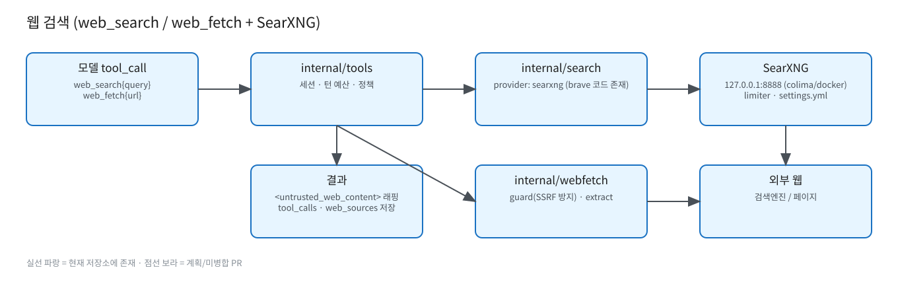

# 웹 검색 (web_search / web_fetch + SearXNG)



원본: [`diagrams/searxng-web-search.excalidraw`](diagrams/searxng-web-search.excalidraw) · 상세: [../web-search.md](../web-search.md)

- 기본 off (`web.default_mode: off|auto|force`, `GW_WEB_ENABLED`). 요청 단위 `"web_search"`로 켬.
- `internal/tools`: 세션, 턴당 툴 호출 최대 5회, 정책(`policy.go`), rate limit.
- `internal/search`: provider 추상화 — `searxng`(운영), `brave` 구현 코드 존재.
- `internal/webfetch`: `guard.go`(사설 IP/리다이렉트 방어), `extract.go`(본문 추출).
- SearXNG: `deploy/searxng/` (docker-compose, colima, `settings.yml`, `limiter.toml`), `127.0.0.1:8888`.

## 툴 결과 형식
모델에 전달되는 결과는 다음처럼 래핑됩니다 (`internal/tools/session.go`):
```
<untrusted_web_content tool="web_search" ...>
{...JSON payload...}
</untrusted_web_content>
```
실패 시 payload는 `{"error": "...", "status": "error|blocked|timeout"}`. 내용 중 태그 위조는 치환되고, 크기 초과 시 `…[truncated]`.
기록: `tool_calls`, `web_sources` 테이블.
