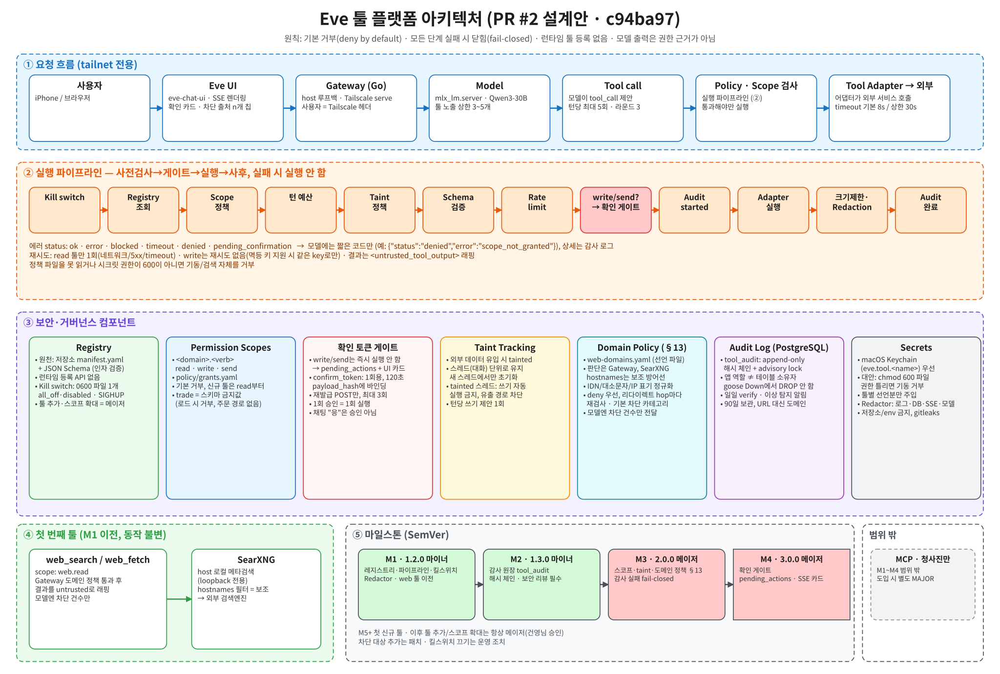
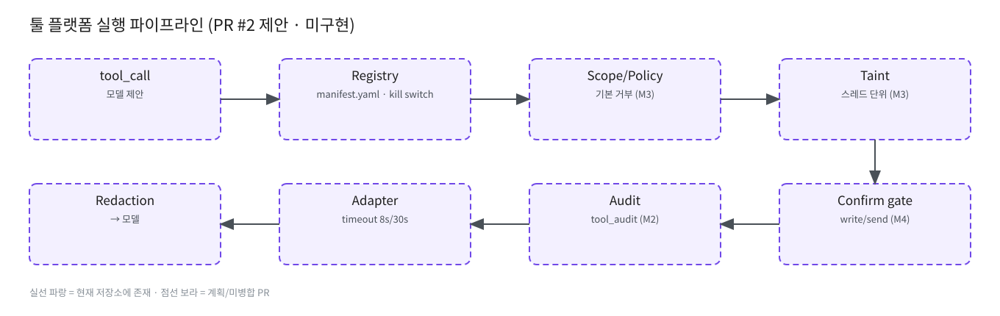

# 툴 플랫폼 — **제안 (PR #2, 미병합 · 미구현)**

> 이 문서는 PR #2 `docs/tool-platform.md` 설계안을 요약한 것입니다. 병합·구현 전이며 내용은 바뀔 수 있습니다.

원본: [`diagrams/eve-tool-platform.excalidraw`](diagrams/eve-tool-platform.excalidraw), [`diagrams/tool-platform-pipeline.excalidraw`](diagrams/tool-platform-pipeline.excalidraw)

## 원칙
기본 거부 · 모든 단계 fail-closed · 런타임 툴 등록 없음 · 모델 출력은 권한 근거가 아님.

## 구성 요소 (계획)
- **Registry**: 저장소 `manifest.yaml` + JSON Schema, kill switch(끄기만).
- **Scopes**: `<domain>.<verb>` (read/write/send), `policy/grants.yaml`, trade 금지값.
- **Taint**: 스레드 단위, tainted면 쓰기 자동 실행 금지.
- **Confirm gate**: write/send → `pending_actions`, 1회용 토큰 120초, `payload_hash` 바인딩.
- **Audit**: `tool_audit` append-only 해시 체인, 90일.
- **Secrets**: Keychain 또는 chmod 600 파일, 툴별 선언분만 주입, Redactor.
- **Domain policy (§13)**: `web-domains.yaml`, 정규화·deny 우선.

에러 status(계획): `ok · error · blocked · timeout · denied · pending_confirmation · mock_miss` (현재 `tool_calls.status`는 앞의 4개만 허용 → 마이그레이션 필요, TBD).

마일스톤은 [README](README.md#툴-플랫폼-마일스톤-pr-2-제안-기준-모두-계획) 참조. 툴 추가·스코프 확대 = major.
