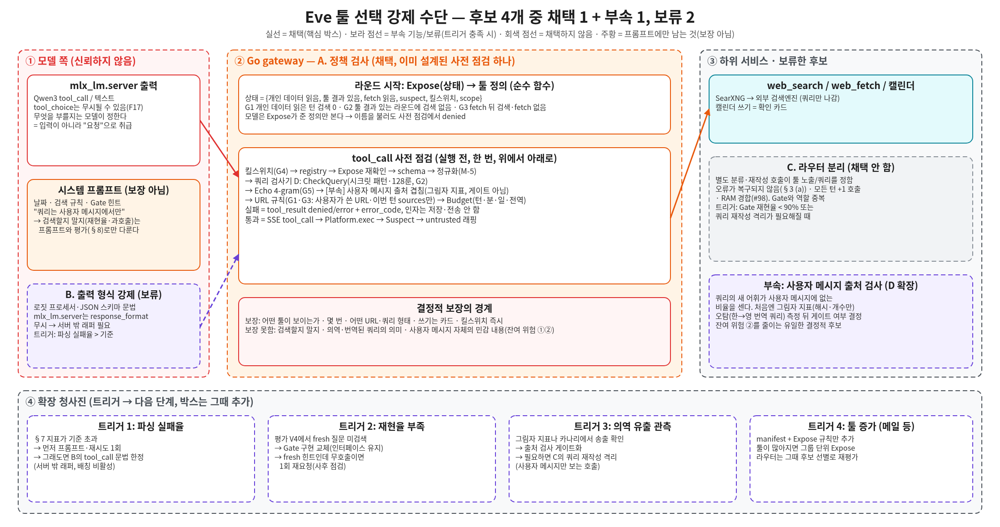

# 툴 선택 절차의 시스템적 강제 수단 검토

> 원본: [`diagrams/tool-selection-enforcement.excalidraw`](diagrams/tool-selection-enforcement.excalidraw) · [SVG](diagrams/tool-selection-enforcement.svg) · [PNG](diagrams/tool-selection-enforcement.png)

상태: **검토 메모** (구현 없음, 결정 요청 아님) · 작성: 시스템 아키텍트.
기준 문서: `auto-tool-selection.md` **개정 4**(브랜치 `docs/auto-tool-selection`, 헤드 `708e5fc`; PR #134, 대체 PR #151). 그 문서는 아직 main에 없으므로 아래 `§` 참조는 그 개정 4의 절 번호이고, 병합 전에는 링크가 열리지 않는다. 관련: [tool-platform.md](tool-platform.md), [searxng-web-search.md](searxng-web-search.md), [model-serving.md](model-serving.md), [gateway.md](gateway.md).

## 0. 요약

질문: 툴 선택 절차가 지금은 시스템 프롬프트로만 지켜진다. 프롬프트 밖에서 **시스템이** 강제할 수단이 무엇이고, 어느 것을 쓸 가치가 있는가.

| 후보 | 결정론적으로 보장하는 것 | 추천 |
|---|---|---|
| A. 게이트웨이 정책 검사 | 모델이 **볼 수 있는 툴**, 호출 **횟수·시간**, 인자의 **형태·출처 규칙**, 킬스위치 | **채택(핵심, 유일한 필수 박스).** 개정 4가 이미 담고 있다 |
| B. 출력 형식 강제 | 툴콜 JSON이 문법에 맞는 **모양**으로 나온다 | **보류.** 안전 보장이 새로 늘지 않는다. 파싱 실패율이 기준을 넘으면 그때 |
| C. 라우터 분리 | (별도 호출이 정한 노출·쿼리. 보장은 라우터 규칙 수준) | **채택하지 않음.** 현재 설계(별도 분류기 없음) 유지. 트리거 조건만 남긴다 |
| D. 검색어 검사기 | 쿼리의 **길이·시크릿 패턴·축어 겹침**(+ 사용자 메시지 출처 겹침 측정) | **A의 사전 점검 안의 함수로 채택.** 출처 겹침은 **그림자 지표로만** 먼저 |

핵심 추천 3줄:

1. **박스를 더하지 않는다.** 강제는 gateway의 사전 점검 한 군데(A)에서 한다. Expose를 상태→툴 정의의 순수 함수로, 사전 점검을 고정 순서 파이프라인으로 두고 표 기반 결정적 테스트(개정 4 §6.9)로 못 박는다.
2. **B·C는 지금 만들지 않고 트리거만 둔다.** B는 gateway가 어차피 모든 툴콜을 검증하므로 안전 이득이 없고 서버 밖 래퍼·성능 부담만 생긴다. C는 오류가 복구되지 않고 Gate와 역할이 겹친다.
3. **D에 "쿼리 새 어휘 중 사용자 메시지에 없는 비율"을 그림자 지표로 추가**해 잔여 위험 ②(우회 인젝션의 의역 유출)를 줄일 유일한 결정적 후보를 먼저 측정한다. 게이트로 올릴지는 오탐 측정 후 정한다.

## 1. "강제"가 뜻하는 것

툴 선택 절차를 네 가지로 쪼개면 시스템이 결정적으로 강제할 수 있는 범위가 분명해진다.

| # | 절차 | 시스템이 결정적으로 강제 가능? | 현재(코드·설계) |
|---|---|---|---|
| P1 | **무엇이 노출되는가**(어떤 툴 정의를 모델에게 주는가) | 가능. 모델에게 안 보여 주고, 불러도 실행하지 않는다 | main은 모드·`web.enabled`로 노출. 개정 4는 Expose(G1~G3 포함) |
| P2 | **얼마나 부르는가**(횟수·시간·전역 예산) | 가능 | main: 라운드 3·호출 5·분당 한도(F5). 개정 4: 일일·전역 예산 추가 |
| P3 | **인자가 어떤 모양·출처인가**(길이, 시크릿 패턴, 에코, URL 출처) | 형태·축어 겹침은 가능. **의미(의역·번역)는 불가** | main: 256자 + `CheckQuery` 시크릿 패턴. 개정 4: 128룬, 4-gram 에코, URL 규칙 |
| P4 | **부를지 말지**(재현율·과호출) | **불가.** 결정은 모델의 몫이다. 시스템은 측정과 힌트만 할 수 있다 | 날짜·규칙 프롬프트, Gate 힌트, 평가 §8 |

main(`b72651d`)의 `webChat`은 라운드마다 `tools`를 gateway가 만들어 보내고(`defs`), 모델이 낸 `tool_calls`는 gateway가 실행한다. 즉 P1~P3의 **집행 지점은 이미 gateway에 있다.** 프롬프트에만 기대는 부분은 (a) G2의 "쿼리는 사용자 메시지에서만"이라는 문구, (b) P4 전체다. 개정 4는 (a)를 라운드별 Expose와 사전 점검으로 옮겼다. 이 메모는 그 설계가 충분한지, 그리고 gateway 밖·모델 쪽에서 더할 만한 수단이 있는지를 따진다.

전제: **모델 출력은 요청이지 명령이 아니다.** 어떤 수단을 쓰든 gateway는 모든 툴콜을 다시 검증해야 한다(§6, 불변식은 모델·검사기에 의존하지 않는다). 아래 평가는 "gateway 검증을 대체하는가, 보태는가"를 기준으로 한다.

## 2. 후보별 검토

### 2.1 A. 게이트웨이 정책 검사

개정 4 §4.3의 Expose → 사전 점검(정규화 → CheckQuery → Echo → URL 규칙 → Budget) → Suspect 파이프라인 그 자체다. 이 메모에서의 추가 제안은 구조뿐이다: ① `Expose(상태) → 툴 정의`를 **순수 함수**로 둔다(상태 = 개인 데이터 읽음, 툴 결과 있음, fetch 읽음, suspect, 킬스위치, scope). ② 사전 점검 순서를 한 배열에 고정해 단계 추가·삭제가 코드 한 줄이고 테스트가 순서를 검증하게 한다.

| 항목 | 내용 |
|---|---|
| 결정론적 보장 | 같은 상태·같은 호출이면 같은 판정. 모델에게 보이지 않는 툴은 불러도 `denied`(P1). 횟수·시간·분당·일일·전역 한도(P2). 쿼리 128룬, 시크릿 패턴, 4-gram 에코, fetch URL은 사용자가 쓴 URL 또는 이번 턴 `sources`뿐(P3). 킬스위치는 진행 중 요청에도 다음 호출에서 차단(G4). 쓰기는 카드 |
| 한계 | **의미를 모른다.** 의역·번역된 쿼리, 사용자 메시지 자체의 민감 내용은 통과한다(잔여 위험 ①②). **호출 여부(P4)를 강제하지 못한다.** 노출을 줄이면 재현율이 깎이므로 G1~G3이 정한 라운드·상태 조건 밖에서는 숨기지 않는다. 상태 추적 버그가 곧 보장 구멍이 되므로 테스트가 필수 |
| 지연·비용 | 문자열 연산과 맵 조회뿐이라 호출당 µs~ms 규모로 **추정**(측정 아님). 지배 항은 Echo의 4-gram 집합 비교(보호 텍스트 P의 크기에 비례). 추가 모델·RAM 없음. 라운드 수는 늘지 않는다 |
| 복잡도 | 낮음. 새 서비스 없음. 이미 개정 4에 설계돼 있고 구현 이슈(#136~#141)가 있다. 코드는 `internal/tools`·`internal/handlers/web.go`에 얇게 들어간다 |
| 추천 | **채택.** 이 메모의 모든 다른 수단은 A 위에 얹는 선택이다. A만 있으면 P1~P3의 결정적 강제는 끝난다 |

### 2.2 B. 출력 형식 강제 (constrained decoding)

생성 시점에 모델이 낼 수 있는 토큰을 제한해 툴콜이 형식에 맞게 나오게 하는 수단이다. 세 갈래로 나눠 본다.

| 갈래 | 내용 | 현재 사실 |
|---|---|---|
| B1. 로짓 프로세서 문법 | `mlx_lm`의 로짓 프로세서 훅(토큰별로 허용되지 않는 토큰의 로짓을 `-inf`)에 JSON 스키마·문법 매처(Outlines, xgrammar, llguidance 등)를 붙인다 | 훅은 있으나 서버에 문법 프로세서는 없다. 서버 밖 래퍼가 필요하고, **배칭 경로에서 제약이 첫 요청 뒤 조용히 사라진다는 보고**가 있다(mlx-lm 이슈 #1007 논의, 2026-09) |
| B2. `response_format`/JSON 스키마 | OpenAI 호환 필드로 스키마를 요청에 싣는다 | `mlx_lm.server`는 이 필드를 **조용히 무시**하는 것으로 보고돼 있다(같은 이슈, 2026-07). 우리 배포 버전에서 재확인이 필요하다. `tool_choice`도 무시될 수 있다(F17) |
| B3. Qwen3 네이티브 툴콜 | 채팅 템플릿의 `<tool_call>{"name","arguments"}</tool_call>` 형식과 서버·gateway의 파서 | **이미 쓰고 있다**(F3). 형식 위반은 gateway의 텍스트 폴백 파서가 받고 개정 4 §7이 **파싱 폴백 비율**을 센다(최종 파싱 실패 건수는 같은 지표에 더하자는 제안) |

| 항목 | 내용 |
|---|---|
| 결정론적 보장 | B1을 쓰면 툴콜이 문법에 맞게 닫히는 것(유효 JSON, 툴 이름이 노출 목록 enum, 인자 필드와 `maxLength`)을 디코딩 단계에서 보장할 수 있다. B2는 현재 서버가 무시하므로 보장 없음. B3은 "파싱 가능한 형태가 나오도록 유도"일 뿐 보장은 없다 |
| 한계 | ① **안전 보장이 새로 늘지 않는다.** gateway는 어차피 이름·스키마·길이를 검증하고 거부해야 하므로, B가 없어도 위반은 막힌다. B가 줄이는 것은 "형식 불량 → 재시도·파싱 실패"의 빈도뿐이다. ② 쿼리의 **내용**은 못 정한다(의역 유출 그대로). ③ **호출할지 말지**를 강제하면 재현율에 해롭다(툴콜 접두를 강제하면 모든 턴이 호출이 된다). 자유 텍스트와 툴콜의 합집합 문법이 필요해 설계가 어렵다. ④ Qwen3는 사고 텍스트와 툴콜이 섞여 나올 수 있어 문법이 복잡해진다 |
| 지연·비용 | **미측정.** 토큰마다 어휘 전체(Qwen3는 약 15만) 마스크를 계산하므로 디코딩 속도가 떨어질 수 있다. 문법 컴파일 비용은 스키마별 캐시로 줄일 수 있다. 배칭을 끄면 동시 요청 처리량이 줄어든다. 모델 엔지니어가 `:8080` 생성 속도 영향을 실측해야 한다(#98 측정 항목과 같은 방식) |
| 복잡도 | 높음. 서버 밖 래퍼를 host의 모델 서빙 프로세스에 심어야 한다 = **새 공급망 의존성**(핀·서명·보안 검토 필요), `mlx_lm` 업그레이드마다 호환 점검, 한국어 멀티바이트 토큰 경계 정합성. 서빙 프로세스는 gateway와 별개로 배포·재시작돼 롤백 단위가 늘어난다 |
| 추천 | **보류.** 트리거 = 개정 4 §7의 **툴콜 파싱 폴백·실패 비율**이 평가에서 정한 기준을 넘고, 프롬프트 보강과 gateway 1회 재시도로도 못 내려갈 때. 그때도 범위는 "툴콜 구간의 문법 한정(이름 enum + 인자 스키마)"로 최소화한다. 도입 전에 먼저 할 일은 지금의 파싱 실패율을 **재는 것**이다 |

### 2.3 C. 라우터 분리

모델과 별도의 호출(작은 모델 또는 같은 모델의 짧은 호출)이 "검색/캘린더/없음"을 정하거나 쿼리를 쓴다. 현재 설계는 이를 선택하지 않았다(개정 4 §3 (a)·(c)). 이 메모는 그 판단을 재확인하고 트리거를 남긴다.

| 항목 | 내용 |
|---|---|
| 결정론적 보장 | 라우터가 규칙 기반이면 규칙 수준의 결정성(= 지금의 Gate 어휘 사전과 같다). 모델 기반이면 **결정론이 아니다.** 유일한 구조적 이점은 격리다: 라우터가 **사용자 메시지만** 보고 툴 결과·개인 데이터를 보지 않으면, 인젝션이 라우터의 쿼리에 닿지 않는다(G2의 더 강한 형태, "격리된 호출"). 단 G1의 상태(개인 데이터를 읽었는가)는 어차피 gateway가 알아야 하므로 A 없이는 성립하지 않는다 |
| 한계 | 개정 4 §3이 정리한 대로 **오류가 복구되지 않는다**: 라우터가 "검색 불필요"로 틀리면 모델은 툴을 보지도 못한다. Gate를 양성 힌트로만 쓰는 이유다. 라우터를 힌트로만 쓰면 Gate와 역할이 겹친다. 쿼리 재작성 호출은 사용자 메시지 속 민감 내용을 여전히 의역해 내보낸다(잔여 위험 ①은 그대로) |
| 지연·비용 | 검색이 필요 없는 턴까지 모든 턴에 호출 +1. 같은 모델이면 `queue` 세마포어를 한 번 더 점유해 TTFT가 늘고, 별도 모델이면 RAM이 추가돼 #98의 임베딩·리랭커와 경합한다(§3). **미측정**(모델 엔지니어) |
| 복잡도 | 중간~높음. 새 호출 경로, 라벨·평가 세트(V4), 분류기 버전 관리, 실패 시 폴백 정책. "박스 하나하나가 필요한가"에 가장 약하다 |
| 추천 | **채택하지 않음.** 트리거 = ① 평가 V4에서 Gate 재현율이 출시 기준(90%)에 못 미치고 어휘 사전 확장으로도 못 올릴 때(→ Gate 구현만 교체, 인터페이스 유지), ② 관측·카나리에서 의역 유출이 확인돼 쿼리 작성을 사용자 메시지만 보는 호출로 격리해야 할 때(→ 개정 4 §9의 "쿼리 재작성 단계 삽입 지점"), ③ 툴이 늘어 정의 주입이 비대해질 때(→ 후보 선별). 어느 경우든 **A 뒤에 끼우는 교체 가능한 단계**로 넣고 A를 대체하지 않는다 |

### 2.4 D. 검색어 검사기

모델이 만든 쿼리를 실행 전에 검사하는 결정적 함수 묶음이다. 별도 서비스가 아니라 A의 사전 점검 중간 단계다. 현재·설계된 것과 제안을 구분한다.

| 구분 | 검사 | 상태 |
|---|---|---|
| 기존 | `CheckQuery`: 빈 문자열, 길이, 시크릿 패턴(키·토큰·이메일·`.ts.net`·사설 IP 등) | main에 있음(길이 256자) |
| 설계됨 | 128룬 상한(G2), 정규화(NFKC·은닉문자 제거, M-5), 4-gram 에코(G5), 중복 쿼리(`duplicate_query`) | 개정 4 §4.3.1·§4.3.3 |
| **제안(이 메모)** | **사용자 메시지 출처 겹침**: 정규화한 쿼리의 토큰(또는 2-gram) 중 현재 사용자 메시지 U에 **없는 새 어휘**의 개수·비율을 센다. 임계를 넘으면(게이트로 올린 뒤) 거부 | 신규, **그림자 지표**로 먼저 |

| 항목 | 내용 |
|---|---|
| 결정론적 보장 | 기존·설계분: 시크릿 패턴, 길이, 사적 텍스트의 **축어·난독화·분할** 복사. 제안분: 쿼리가 **사용자 메시지에서 오지 않은 정보를 얼마나 싣는가**의 상한. 의역된 사적 정보는 보통 새 어휘를 만들므로, 사적 텍스트가 U 밖에서 올 때(= 인젝션 경로, 잔여 위험 ②) 일부를 결정적으로 잡는다 |
| 한계 | 사용자 메시지 **안**의 민감 내용은 면제된다(U가 기준이므로, 잔여 위험 ①). **정상 재작성도 새 어휘를 만든다**: 한국어 질문을 영어로 검색하기, 시점("2026")·`time_range` 추가, 고유명사 표기 변환. 임계가 낮으면 재현율이 깎이고, 높으면 의미가 없다. 어휘 단위 비교는 한국어 조사·활용 변형에 약하다(4-gram 문자 단위로 보완 가능). 의역이 U의 어휘만 재배열하면 통과한다 |
| 지연·비용 | Echo와 같은 정규화·집합 연산 재사용. 호출당 µs~ms 규모 **추정**. 추가 모델·RAM 없음 |
| 복잡도 | 낮음. 기존 정규화 함수를 재사용하는 함수 하나와 지표 하나(그림자 모드는 개수·비율만 기록하고 쿼리 원문은 남기지 않는다. 개정 4 §6.4의 HMAC·해시 규칙 준수) |
| 추천 | 기존·설계분은 **채택(이미 A에 포함).** 제안분은 **그림자 지표로 먼저 도입**: 평가의 정상 쿼리 세트(QA의 한국어 질문 세트, 합성)에서 새 어휘 비율 분포를 재고, 인젝션 mock에서의 분리도를 본다. **게이트 승격 여부는 측정 뒤** 정하며 그 시점에 SemVer를 다시 판단한다(거부 동작 변경이므로 확신이 없으면 MAJOR) |

## 3. 비교 한눈에

| | A 정책 검사 | B 출력 형식 강제 | C 라우터 분리 | D 검색어 검사기 |
|---|---|---|---|---|
| P1 노출 | ● | ○(이름 enum 이중화) | ◐(노출을 정하는 대안) | – |
| P2 횟수·시간 | ● | – | – | ◐(길이·중복) |
| P3 인자 형태·출처 | ● | ◐(형식·길이) | ◐(쿼리 격리 시) | ● |
| P4 호출 여부 | – (힌트·측정만) | ✕(강제하면 재현율 훼손) | ◐(Gate 대체, 복구 불가 위험) | – |
| 새 모델·RAM | 없음 | 없음(서빙 프로세스 변경) | 있음 또는 호출 +1 | 없음 |
| 지연 영향 | 무시 가능(추정) | 미측정, 디코딩 오버헤드 | 모든 턴 +1 호출(미측정) | 무시 가능(추정) |
| 새 박스 | 0 (이미 설계됨) | 서빙 래퍼 1 | 라우터 1 | 0 (A 안의 함수) |
| 안전 이득 | 필수 | 없음(gateway가 재검증) | 격리 시 소량 | 소량(그림자 → 측정) |
| 추천 | **채택** | 보류 | 채택 안 함 | **채택(+ 그림자)** |

범례: ● 결정적 보장의 본체 · ◐ 부분적·조건부 · ○ 보조·이중화 · – 해당 없음 · ✕ 해로움.

## 4. 개정 4 게이트와의 매핑

대상은 정책 계층(Expose/Budget/Gate)과 G1~G5(개정 4 §4.3.4)다. 칸은 "그 후보가 이 항목의 강제에 기여하는 정도"다.

| 개정 4 항목 | 요지 | A 정책 검사 | B 출력 형식 | C 라우터 | D 검색어 검사기 |
|---|---|---|---|---|---|
| **Expose** | 상태·scope·킬스위치로 툴 정의 결정 | ● 본체(순수 함수화 제안) | ○ 툴 이름 enum을 문법에 넣으면 이중화. 안전 이득 없음 | ◐ 노출 결정을 별도 호출로 옮기는 대안. 비권장 | – |
| **Budget** | 턴·분·일일·전역 한도, 15초 | ● 본체 | – 문법은 호출 수를 못 센다 | – | ◐ 128룬, 중복 쿼리 |
| **Gate** | 최신성 양성 힌트 | ○ 어휘 사전이 gateway 안에 있다 | – | ● **교체 후보**(소형 분류기, 트리거 ①). 음성 필터로는 쓰지 않는다 | – |
| **G1** 개인 데이터를 읽은 턴은 검색 0, fetch는 사용자 URL만 | 상태 기반 노출·거부 | ● 본체(상태 추적 + Expose + URL 규칙) | – | – 상태는 gateway만 안다 | – |
| **G2** 쿼리는 현재 사용자 메시지만, 128룬, 턴당 2회 | 라운드 1에서만 노출 | ● 노출 제한·횟수 | ◐ `query.maxLength`를 문법에 | ◐ 쿼리 작성을 사용자 메시지만 보는 호출로 격리(트리거 ②) | ● 길이·패턴 + **출처 겹침(그림자)** |
| **G3** fetch 연쇄 금지 | fetch 뒤 검색·fetch 노출 안 함, URL 허용 집합 | ● 본체 | – | – | ○ fetch URL 에코 규칙 |
| **G4** "웹 검색함 + 쿼리" 표시, 킬스위치 즉시 | 사전 점검 첫 단계 킬스위치, 표시는 UI 계약 | ● 킬스위치 재확인(진행 중 요청 포함) | – | – | – |
| **G5** 4-gram 에코 유지 | 축어·난독화 차단 | ◐ 사전 점검 순서 안에서 실행 | – | – | ● 본체(Echo는 검사기의 한 종류) |
| (참고) Suspect | 주입 의심 결과 처리 | ● 본체 | – | – | – |

읽는 법: 열 A는 **모든 행에서 본체이거나 실행 환경**이다. B·C는 어떤 게이트도 새로 보장하지 않고, 같은 게이트를 이중화하거나(B) 다른 구현으로 바꿀 수 있게(C) 한다. D는 G2·G5의 구현 방식이다. 즉 **G1~G5를 닫는 데 A·D 외에 필요한 후보가 없다.**

## 5. 단순함 점검: 박스 하나하나가 필요한가

| 박스 | 필요한가 | 근거 | 없애면 |
|---|---|---|---|
| gateway 사전 점검(A) | **필수** | 모델 출력을 신뢰하지 않는다는 불변식이 사는 유일한 곳. 다른 모든 수단이 있어도 이것은 남는다 | 불변식이 프롬프트·모델 준수에 의존하게 된다 |
| Expose를 순수 함수로 | 필수(이미 있는 단계의 형태 제안) | 테스트로 G1~G3을 표 기반으로 못 박는 수단. 코드 크기 증가 거의 없음 | 노출 규칙이 흩어져 검증이 어렵다 |
| 쿼리 검사기(D) | A의 함수로 필수 | 쿼리가 외부로 나가는 유일한 지점이다. 별도 서비스는 불필요 | 에코·시크릿 패턴 보호가 없다 |
| 출처 겹침 그림자 지표 | **조건부**(측정용) | 잔여 위험 ②를 줄일 결정적 후보가 이것뿐이라 값이 있는지부터 잰다. 코드는 함수 하나 | 승격 판단 근거가 없다 |
| 출력 형식 강제(B) | **불필요(지금)** | gateway 재검증이 있으므로 안전 보장이 겹친다. 서빙 프로세스에 새 의존성·롤백 단위를 더한다 | 형식 불량이 파싱 실패로 보이고 gateway가 폴백 파서·1회 재시도로 처리(지금 설계) |
| 라우터(C) | **불필요(지금)** | 모델이 이미 결정자이고, Gate가 양성 힌트를 낸다. 분류기 오류는 복구되지 않는다 | 평가가 재현율 부족을 보일 때만 Gate 구현을 교체 |
| 별도 분류기 일반 | 현재 설계: **추가 안 함** | 개정 4 §3 결정 유지 | — |

결론: **새 박스 0개, 새 함수 최대 1개**(출처 겹침 그림자). 현재 설계가 이미 필요 최소를 갖췄다.

## 6. 프롬프트에만 남는 것과 다루는 법 (P4)

"호출할지 말지"는 시스템이 강제할 수 없다. 대신 다음 순서로 다룬다. 어느 단계도 새 박스가 아니다.

1. **측정**: 자동 검색률, 불필요 검색 비율, 재현율을 평가 V4와 관측 지표로 본다(§7, §8). 기준 미달이 곧 아래 단계의 트리거다.
2. **힌트 보강**: Gate 어휘 사전 확장, 프롬프트 문구 조정(모델 엔지니어).
3. **사후 점검과 1회 재요청(청사진)**: Gate가 `fresh`인데 모델이 툴 없이 답한 경우, gateway가 한 번 "이 질문은 최신 정보가 필요하다. 검색 여부를 다시 판단하라"로 재요청한다. 결정적이지만 **스트리밍을 되돌릴 수 없다**: 툴이 있는 라운드는 비스트리밍(F7)이므로 가능하나, 라운드 스트리밍(`streamRound`) 도입(§4.6) 뒤에는 토큰이 이미 나간 뒤라 쓸 수 없다. 이 단계를 쓰려면 스트리밍 설계와 함께 정한다.
4. **정직한 고지**: 검색이 실패하거나 하지 않은 최신성 질문에서는 `fresh:"unverified"`로 나가 UI가 알린다(개정 4 §13 Q3). 이것은 gateway가 규칙으로 정하므로 프롬프트에 의존하지 않는다.

## 7. 확장 청사진

| 트리거(측정 가능) | 다음 단계 | 추가되는 것 | 되돌리기 |
|---|---|---|---|
| 툴콜 파싱 폴백·실패 비율 > 기준(§7 지표, 기준은 모델 엔지니어가 정함) | ① 프롬프트·툴 정의 조정 → ② gateway 1회 재시도 → ③ **B**: 툴콜 구간 문법(이름 enum + 인자 스키마), 서버 밖 래퍼, 배칭 비활성 | 서빙 래퍼(핀·서명·보안 검토), `mlx_lm` 호환 점검 | 래퍼를 빼면 B3 + gateway 폴백으로 복귀 |
| 평가 V4 재현율 < 90%가 사전 확장·프롬프트로도 안 오름 | **C 일부**: Gate 구현을 교체(`Hint(ctx, text)` 인터페이스 유지). 음성 필터로는 쓰지 않는다 | 소형 분류기 또는 임베딩 라우터(RAM은 #98과 합산 검토) | 구현을 사전으로 되돌린다 |
| 카나리·그림자 지표에서 의역 유출 징후 | **D 승격**: 출처 겹침을 게이트로(임계는 오탐 측정 후). 그래도 부족하면 **C 일부**: 쿼리 작성을 사용자 메시지만 보는 격리 호출로 | 거부 임계 설정, 또는 쿼리 재작성 호출 +1 | 게이트를 그림자로 낮춘다 |
| 툴 종류 증가(메일 등) | manifest + Expose 규칙 추가, 그룹 단위 Expose, 후보 선별(임베딩) | 후보 선별 단계 | 그룹 규칙 제거 |
| `mlx_lm.server`가 `response_format`·`tool_choice`를 지원 | B2를 서버 기능으로 사용(래퍼 불필요) | 서버 업그레이드 | 요청 필드 제거 |
| 사후 점검 필요(P4, 위 3단계) | 비스트리밍 라운드에서 1회 재요청 | 라운드 1회 증가 케이스 | 단계 제거 |

## 8. 구현 전에 확인할 것

이 메모는 구현을 제안하지 않는다. 결정을 바꿀 수 있는 사실 몇 가지만 측정·확인 대상으로 남긴다.

| 확인 | 담당 | 결과가 바꾸는 것 |
|---|---|---|
| 배포 중인 `mlx_lm` 버전에서 `response_format`·`tool_choice`·`logits_processors`가 동작하는지(요청 한 번씩 보내 본다) | 모델 엔지니어 | B2의 실현 가능성, F17 해소 |
| 현재 평가 세트에서 툴콜 **파싱 폴백 비율과 최종 파싱 실패율** | 모델 엔지니어, QA | B의 트리거 기준 |
| (B를 한다면) `:8080` 생성 속도 저하, 배칭 비활성화의 동시 처리량 영향 | 모델 엔지니어 | B의 비용 판단 |
| 정상 한국어 쿼리의 새 어휘 비율 분포, 인젝션 mock에서의 분리도 | QA, 백엔드 | D 승격 여부와 임계 |
| 상태 추적(G1~G3)의 표 기반 결정적 테스트 통과(개정 4 §6.9) | 백엔드, 보안 | A의 보장 자체 |

## 9. 열린 질문

1. **출처 겹침 그림자 지표를 개정 4 구현 이슈 범위에 넣을지**(#137 등 어느 이슈에 둘지는 PM이 결정). 코드는 작지만 지표 정의·저장 규칙(원문 없음)이 필요하다. 보안 담당: 그림자 모드가 "개수·비율만" 남기는 방식이 §6.4 규칙에 맞는지 확인 요청.
2. **사후 점검 재요청(§6 3단계)을 청사진에 둘지, 스트리밍 설계(§4.6)와 함께 정할지.** 지금은 청사진으로 두고 스트리밍 결정 때 같이 보자는 안이다.
3. **B의 트리거 수치**(파싱 실패율 몇 %)는 모델 엔지니어가 평가 후 정한다. 이 메모는 숫자를 제안하지 않는다.

SemVer: 이 문서 자체는 docs 변경이다(버전 영향 없음). 문서가 말하는 A·D 기존분은 개정 4의 MAJOR 출시 범위 안이다. 그림자 지표는 추가만 하는 관측이라 MINOR로 보되, **출처 겹침을 거부 게이트로 승격하는 것은 그 시점에 다시 판단한다**(확신이 없으면 MAJOR).

## 부록: 근거

- 개정 4: §3(분류기 선택지 비교), §4.3(정책 레이어), §4.3.1(에코), §4.3.4(G1~G5), §6.1·§6.9(결정적 테스트), §7(관측), §9(청사진), F3·F7·F17(현재 구조 사실).
- main(`b72651d`): `internal/handlers/web.go`의 `webChat`(라운드마다 `tools` 구성, `tool_choice:"auto"`), `internal/tools/policy.go`의 `CheckQuery`·상한.
- 외부: mlx-lm 이슈 #1007 "Allow structured generation through response_format in mlx_server"(2026-07 시작, 서버가 `response_format`을 무시한다는 보고와 서버 밖 Outlines 래퍼의 배칭 문제 보고 포함), mlx-lm v0.30.1 릴리스 노트(배치 생성의 `logits_processors` 지원, 서버 툴콜 파싱 개선). 이 외부 정보는 2차 출처이며 **우리 배포 버전에서 확인한 것이 아니다**(§8 첫 항목).
