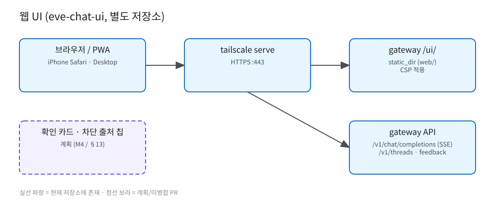

# 웹 UI (eve-chat-ui)

원본: [`diagrams/web-ui.excalidraw`](diagrams/web-ui.excalidraw)

- 별도 저장소 `eve-chat-ui` (디자인: `eve-chat-ui-design`). 이 저장소에는 UI 코드가 없습니다.
- gateway가 `static_dir`(기본 `~/llm-serving/web`)이 존재하면 `/ui/`로 정적 서빙(CSP 적용). `/`는 예약.
- CORS 기본 off (`cors_origins`).
- 버전 표시: `sw.js` 캐시 이름, 설정 화면, manifest (UI 저장소 소유).
- 계획(PR #2): 확인 카드(M4), "차단된 출처 n개" 칩(§13).
- TBD: UI 내부 구조는 eve-chat-ui 저장소 문서 참조.
