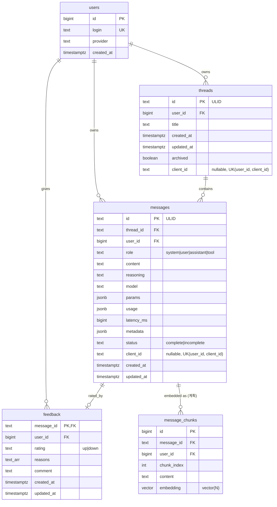

# Eve: 대화 저장소 DB 모델 (PostgreSQL)

> 상태: **검토용 초안**. 스키마는 `internal/store/postgres/migrations/00001_init.sql`(구현 완료, API: [threads-api.md](threads-api.md))과 일치하도록 작성했습니다. 아직 구현되지 않은 부분은 "(계획)"으로 표시합니다.

## 1. 개요

| 항목 | 선택 |
|---|---|
| DB | PostgreSQL 최신 안정판 (Homebrew 설치, `brew services`/launchd 관리) |
| 바인딩 | `127.0.0.1` 전용 (외부 노출 없음) |
| 드라이버 | `pgx` (v5) |
| 마이그레이션 | `goose`, SQL 파일을 바이너리에 embed, 시작 시 자동 적용 |
| 확장 | `pg_trgm` (한국어 부분 검색), `vector` (pgvector, 향후 RAG용으로 설치만) |
| 저장소 계층 | `internal/store` 인터페이스 → `postgres` 구현 / 테스트용 `memstore` |
| 접속 정보 | 서버 로컬 환경변수/설정에만 둠 (커밋 금지) |

## 2. ERD



## 3. 테이블 상세

### 3.1 `users`
인증된 `Identity.User`(로그인)를 내부 정수 id로 매핑합니다. 첫 요청 시 upsert.

| 컬럼 | 타입 | 제약 | 설명 |
|---|---|---|---|
| id | BIGSERIAL | PK | 내부 키 (외부에 노출하지 않음) |
| login | TEXT | NOT NULL, UNIQUE | Identity.User (예: Tailscale 로그인) |
| provider | TEXT | NOT NULL DEFAULT '' | 최초 인증 provider (`tailscale-identity`, `api-key` …) |
| created_at | TIMESTAMPTZ | NOT NULL DEFAULT now() | |

### 3.2 `threads`

| 컬럼 | 타입 | 제약 | 설명 |
|---|---|---|---|
| id | TEXT | PK | ULID |
| user_id | BIGINT | NOT NULL, FK users ON DELETE CASCADE | 소유자 |
| title | TEXT | NOT NULL DEFAULT '' | `"new"` 생성 시 첫 메시지에서 자동 생성 |
| created_at | TIMESTAMPTZ | NOT NULL DEFAULT now() | import 시 클라이언트 값 유지 |
| updated_at | TIMESTAMPTZ | NOT NULL DEFAULT now() | 메시지 추가/이름 변경 시 갱신, 목록 정렬 키 |
| archived | BOOLEAN | NOT NULL DEFAULT false | soft delete |
| client_id | TEXT | NULL, UNIQUE(user_id, client_id) | import 멱등성 키 |

인덱스
- `threads_list_idx (user_id, archived, updated_at DESC, id DESC)` — 목록 keyset 페이지네이션
- `threads_title_fts GIN (to_tsvector('simple', title))` — 전문검색
- `threads_title_trgm GIN (title gin_trgm_ops)` — 한국어 부분 일치

### 3.3 `messages`

| 컬럼 | 타입 | 제약 | 설명 |
|---|---|---|---|
| id | TEXT | PK | ULID |
| thread_id | TEXT | NOT NULL, FK threads ON DELETE CASCADE | |
| user_id | BIGINT | NOT NULL, FK users ON DELETE CASCADE | 비정규화: 사용자 분리·검색을 조인 없이 |
| role | TEXT | CHECK IN ('system','user','assistant','tool') | |
| content | TEXT | NOT NULL DEFAULT '' | |
| reasoning | TEXT | NULL | 모델 사고 과정 텍스트 |
| model | TEXT | NULL | 응답 모델명 |
| params | JSONB | NULL | 생성 파라미터 |
| usage | JSONB | NULL | 토큰 수 |
| latency_ms | BIGINT | NULL | 요청→완료 지연 |
| metadata | JSONB | NULL | 확장용 자유 필드 |
| status | TEXT | NOT NULL DEFAULT 'complete', CHECK IN ('complete','incomplete') | 스트림 중단 시 `incomplete` |
| client_id | TEXT | NULL, UNIQUE(user_id, client_id) | import 멱등성 키 |
| created_at | TIMESTAMPTZ | NOT NULL DEFAULT now() | |
| updated_at | TIMESTAMPTZ | NULL | 재생성(replace) 시 설정 |

인덱스
- `messages_thread_idx (thread_id, created_at, id)` — 스레드 내 메시지 페이지네이션
- `messages_user_idx (user_id, created_at DESC)` — 사용자별 최근 메시지/추출
- `messages_content_fts GIN (to_tsvector('simple', content))`
- `messages_content_trgm GIN (content gin_trgm_ops)`

> 설계안의 "generated tsvector 컬럼" 대신 현재 구현은 **표현식 인덱스**를 씁니다. 쿼리에서 `to_tsvector('simple', content) @@ …` 형태를 정확히 써야 인덱스가 사용됩니다. 저장 공간은 적게 들지만 랭킹 시 재계산 비용이 있습니다(검토 필요 참고).

#### JSONB 구조

```jsonc
// params
{ "temperature": 0.7, "top_p": 0.95, "max_tokens": 2048 }
// usage
{ "prompt_tokens": 123, "completion_tokens": 456 }
// metadata (예시, 고정 스키마 아님)
{ "finish_reason": "stop", "regenerated_from": "01J…", "imported": true, "client": "web" }
```
JSONB GIN 인덱스는 현재 없음. 메타데이터 조건 검색이 생기면 `GIN (metadata jsonb_path_ops)` 추가.

### 3.4 `feedback`

| 컬럼 | 타입 | 제약 | 설명 |
|---|---|---|---|
| message_id | TEXT | PK, FK messages ON DELETE CASCADE | 메시지당 1건 |
| user_id | BIGINT | NOT NULL, FK users | |
| rating | TEXT | CHECK IN ('up','down') | |
| reasons | TEXT[] | NOT NULL DEFAULT '{}', CHECK 극성별 코드 목록 | 00003. down: wrong_info, too_long, misunderstood, over_refusal, bad_source, other / up: accurate, concise, helpful, good_source |
| comment | TEXT | NULL, CHECK char_length ≤ 140 (00003) | |
| created_at / updated_at | TIMESTAMPTZ | NOT NULL DEFAULT now() | |

- 토글: up/down은 upsert, 취소는 행 삭제.
- 재생성(`replace_message_id`): assistant 메시지를 **같은 id로 제자리 교체**하고 해당 feedback 행을 삭제.

## 4. 설계 결정과 이유

### 4.1 사용자 분리
- 모든 쿼리는 인증 미들웨어가 넣은 `Identity.User` → `users.id`로 `WHERE user_id = $1` 범위를 강제합니다. 핸들러는 인증 방식과 무관하게 Identity만 사용합니다.
- 다른 사용자의 리소스 접근은 존재 여부를 숨기기 위해 **404**(`{"error":{"code":"not_found"}}`)로 응답합니다.
- `messages.user_id`는 비정규화되어 스레드 조인 없이 검색·추출을 범위 제한할 수 있습니다.
- 향후: Postgres **Row Level Security**(`SET app.user_id` + `USING (user_id = current_setting('app.user_id')::bigint)`)를 2차 방어선으로 검토. 단일 사용자인 지금은 앱 레벨 강제만 사용.

### 4.2 Soft delete
- 삭제 API는 `archived = true`만 설정. 피드백·파인튜닝 데이터 손실 방지, 실수 복구 가능.
- hard delete API는 아직 없음 (보존 정책은 검토 필요).

### 4.3 ID 방식: ULID
- 시간 순 정렬 가능 → keyset 페이지네이션 tie-breaker, B-tree 삽입 지역성 양호.
- 26자 Crockford base32, URL/클라이언트에 안전, 추측 어려움.
- UUIDv7도 같은 장점에 네이티브 `uuid` 타입(16바이트)이라 저장 효율이 좋지만, 프론트 계약과 기존 코드가 ULID 문자열을 쓰므로 TEXT ULID 채택. `users.id`는 외부 노출이 없어 BIGSERIAL.

### 4.4 페이지네이션
커서 = `(updated_at, id)` 인코딩. 예:
```sql
SELECT id, title, updated_at FROM threads
WHERE user_id = $1 AND archived = false
  AND (updated_at, id) < ($2, $3)
ORDER BY updated_at DESC, id DESC
LIMIT $4;
```

### 4.5 검색
- `'simple'` tsvector는 공백 단위 토큰이라 영어·한국어 어절 일치에 사용, 한국어 부분 일치(조사 붙은 단어 등)는 `pg_trgm`(`ILIKE '%검색어%'`, `similarity`)로 보완.
- snippet은 HTML 이스케이프 후 `<mark>`만 남겨 반환.
```sql
SELECT m.id, m.thread_id
FROM messages m JOIN threads t ON t.id = m.thread_id
WHERE m.user_id = $1 AND t.archived = false
  AND (to_tsvector('simple', m.content) @@ plainto_tsquery('simple', $2)
       OR m.content ILIKE '%' || $2 || '%')
ORDER BY m.created_at DESC LIMIT 20;
```

### 4.6 Import 멱등성
- `POST /v1/threads/import`의 thread/message `client_id`를 `UNIQUE(user_id, client_id)`로 보장. 같은 값 재전송 시 `status: "exists"`.
- `created_at`은 클라이언트 값 그대로 저장.

### 4.7 스트리밍과 저장
- user 메시지는 요청 수신 즉시 저장 (첫 청크에 `user_message_id`).
- assistant 메시지는 완료 시 `complete`, 끊김/중단 시 받은 데까지 `incomplete`로 저장.

## 5. 파인튜닝 데이터 추출 예시

### 5.1 👍 받은 (prompt, reply) → chat JSONL
```sql
COPY (
  SELECT json_build_object('messages', json_build_array(
           json_build_object('role','user','content', u.content),
           json_build_object('role','assistant','content', a.content)))
  FROM messages a
  JOIN feedback f ON f.message_id = a.id AND f.rating = 'up'
  JOIN LATERAL (
    SELECT content FROM messages u
    WHERE u.thread_id = a.thread_id AND u.role = 'user'
      AND (u.created_at, u.id) < (a.created_at, a.id)
    ORDER BY u.created_at DESC, u.id DESC LIMIT 1) u ON true
  WHERE a.role = 'assistant' AND a.status = 'complete'
) TO STDOUT;
```
`psql -At -c "…" > sft.jsonl`로 내보냅니다. 전체 맥락이 필요하면 LATERAL에서 해당 시점까지 모든 메시지를 `json_agg`.

### 5.2 DPO 쌍 (같은 프롬프트의 up vs down)
```sql
WITH rated AS (
  SELECT a.id, a.content, f.rating,
         (SELECT u.id FROM messages u WHERE u.thread_id = a.thread_id AND u.role='user'
            AND (u.created_at,u.id) < (a.created_at,a.id)
          ORDER BY u.created_at DESC, u.id DESC LIMIT 1) AS prompt_id
  FROM messages a JOIN feedback f ON f.message_id = a.id
  WHERE a.role = 'assistant')
SELECT p.content AS prompt, c.content AS chosen, r.content AS rejected
FROM rated c JOIN rated r ON r.prompt_id = c.prompt_id AND r.rating = 'down'
JOIN messages p ON p.id = c.prompt_id
WHERE c.rating = 'up';
```
> 현재 재생성은 제자리 교체라 이전 답변이 남지 않습니다. DPO용 rejected 샘플을 모으려면 교체 전 내용을 `metadata.previous`에 보관하거나 별도 테이블에 남기는 방식이 필요합니다(검토 필요).

## 6. 확장 계획

### 6.1 pgvector RAG (계획)
```sql
CREATE TABLE message_chunks (
  id          BIGSERIAL PRIMARY KEY,
  message_id  TEXT NOT NULL REFERENCES messages(id) ON DELETE CASCADE,
  user_id     BIGINT NOT NULL REFERENCES users(id) ON DELETE CASCADE,
  chunk_index INT NOT NULL,
  content     TEXT NOT NULL,
  embedding   vector(1024) NOT NULL,   -- 차원은 임베딩 모델에 따라 결정
  model       TEXT NOT NULL,
  created_at  TIMESTAMPTZ NOT NULL DEFAULT now(),
  UNIQUE (message_id, chunk_index, model)
);
CREATE INDEX ON message_chunks USING hnsw (embedding vector_cosine_ops);
```
검색 시에도 `user_id` 필터 필수.

### 6.2 다중 사용자 / OIDC
- 새 auth provider(session-cookie, OIDC)는 같은 `Identity`를 반환 → `users`에 upsert.
- 한 사람이 여러 provider로 들어오는 경우 `user_identities(user_id, provider, subject, UNIQUE(provider, subject))` 분리 검토.
- 사용자별 rate limit은 이미 있는 rate-limit hook에서 `Identity.User` 키로 구현.

## 7. 마이그레이션 정책
- `goose` SQL 파일(`internal/store/postgres/migrations/NNNNN_*.sql`), 바이너리에 embed, 서버 시작 시 자동 적용.
- **forward-only**: 배포된 마이그레이션은 수정하지 않고 새 파일로 변경. `Down` 블록은 로컬 개발용.
- 확장 생성(`vector`)은 superuser가 필요해 설치 스크립트에서 처리, 앱 계정은 최소 권한.

## 8. 백업 정책
- 개인화 메모리 파일(`memory.data_dir`)은 DB 밖에 있으므로 이 백업에 **포함되지 않는다**. data_dir은 백업 경로 밖에 둔다(architecture/memory.md §13).
- `pg_dump -Fc` 매일 04:00 (launchd), 보관 14일, 서버 로컬 백업 디렉터리.
- 복원:
```sh
createdb -h 127.0.0.1 -U <admin> <db>_restore
pg_restore -h 127.0.0.1 -U <admin> -d <db>_restore --no-owner <backup>.dump
# 검증 후 앱 설정의 DB 이름을 바꾸거나 기존 DB를 교체
```
- DB 파일·덤프·접속 정보는 저장소에 커밋하지 않습니다.

## 9. 검토 필요
1. **Hard delete / 보존 기간**: 아카이브된 스레드를 영구 삭제할 API나 자동 정리 기간이 필요한가?
2. **맥락 저장 범위**: 요청마다 전체 컨텍스트를 저장할지, 마지막 턴만 저장하고 스레드에서 재구성할지? (현재: 턴 단위 저장)
3. **재생성 이력**: 제자리 교체 시 이전 답변을 DPO용으로 보존할지?
4. **임베딩 모델과 차원**: RAG에 쓸 모델(로컬 vs 외부)과 `vector(N)` 차원.
5. **RLS 도입 시점**: 다중 사용자 전환 시 Row Level Security를 켤지.
6. **ULID vs UUIDv7**: TEXT ULID 유지 vs 네이티브 `uuid`(v7) 전환.
7. **시스템 프롬프트 저장**: system 메시지를 매 스레드에 저장할지, 프리셋 테이블로 분리할지.
8. **PII 처리**: 파인튜닝 추출 전 개인정보 마스킹, 백업 암호화 여부.
9. **검색 인덱스 방식**: 표현식 인덱스 유지 vs generated tsvector 컬럼(랭킹·하이라이트 성능).
10. **reasoning 보관**: 사고 과정 텍스트를 학습 데이터에 포함할지.

## users.settings (migration 00007)

- `ALTER TABLE users ADD COLUMN settings JSONB NOT NULL DEFAULT '{}'` — additive; existing rows get `{}`.
- Down: `DROP COLUMN settings` (per-user settings are lost; memory falls back to off).
- 런북: down 실행 **전에** 백업한다. `pg_dump --data-only -t users -f users_settings_backup.sql <DB>` 또는 `COPY (SELECT id, settings FROM users WHERE settings <> '{}') TO STDOUT` 결과를 보관하고, 행 수를 기록한다. 백업 파일은 `umask 077`로 만들어 **0600**(소유자만 읽기)으로 두고, 사용자 설정(메모리 on/off 등)이 들어 있으므로 공유 경로·동기화 폴더에 두지 않는다. 복구는 up 재적용 후 `UPDATE users SET settings = b.settings FROM backup b WHERE users.id = b.id`. 백업 없이 down을 실행하지 않는다. 복구를 확인한 뒤(또는 down이 필요 없어진 뒤) 백업 파일을 **바로 삭제**하고, 삭제했다는 사실만 기록한다.
- One object with namespaced keys (`{"memory":{"enabled":true}}`). A missing key reads as its default (off).
  PATCH merges only the named key into its namespace; other namespaces and unknown keys are preserved.
- Blueprint: future per-user settings go in as new namespaced keys here; split into a table if they grow
  (many keys, per-key history or indexing needs).
