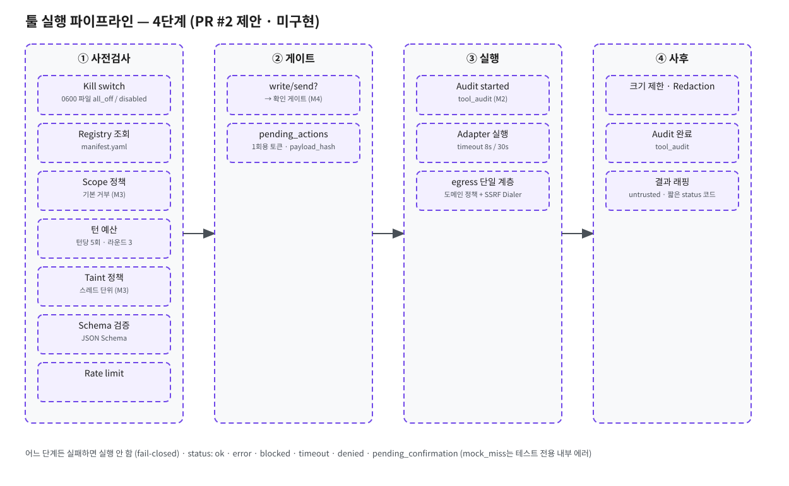

# Eve 툴 플랫폼 아키텍처 (설계 제안)

- 상태: **설계 제안만**. 구현·배포·서버 설정 변경 없음. 건영님 결정(t121u)으로 툴별 로드맵/top-3는 취소하고, 앞으로 계속 추가·변경·제거될 툴의 공통 기반을 먼저 설계합니다.
- 기준 코드: main `507eab7` (1.1.0). 현재 툴 코드: `internal/tools/{session,parse,policy}.go`, `internal/handlers/web.go`, `internal/search`, `internal/webfetch`, 마이그레이션 `00002_web_search.sql`.
- 보안 기준: `tool-platform-security-checklist.md`(보안 담당, v1) 전 항목을 §11에 매핑하고 §12에서 '특히 볼 점' 5개에 답합니다.
- 원칙: **기본 거부, 서버 측 강제, 실패 시 닫힘(fail-closed)**.

## 0. 현재 구조 요약 (사실)

| 항목 | 현재 |
|---|---|
| 툴 정의 | `toolJSON` 상수 2개(web_search, web_fetch), `ToolDefs()` |
| 실행 | `Session.Exec`의 `switch name` 하드코딩, 순차 실행 |
| 파싱 | 업스트림 `message.tool_calls` 우선, 없으면 `<tool_call>` 정규식 lenient 파서 |
| 한도 | MaxRounds 3, MaxCalls 5, MaxSearch 3, MaxFetch 3, 결과 총 24000자 |
| 방어 | `WrapUntrusted` 구분자, fetch URL allowlist(검색 결과/사용자 URL만), SSRF Dialer, 레이트리밋 |
| 기록 | `tool_calls`(tool CHECK IN web_search/web_fetch), `web_sources`, 90일 purge |
| 관측 | `llm_tool_calls_total{tool,provider,status}`, `ToolParseFail`, `ToolRounds` |
| UI | SSE `chat.completion.tool_call` / `tool_result` / `sources` |

목표는 이 구조를 **레지스트리 + 정책 엔진 + 실행기 + 감사 로그 + 확인 게이트**로 일반화하는 것입니다.

## 1. 레지스트리

### 1.1 원천: 저장소의 선언 파일 (런타임 등록 없음)
- `tools/<name>/manifest.yaml` + `tools/<name>/schema.json`이 원천. 바이너리에 `go:embed`로 포함하고 기동 시 검증. **런타임 등록 API는 만들지 않는다**(엔드포인트 부재를 테스트로 고정: `POST/PUT/DELETE /v1/tools*` → 404/405).
- Go 쪽은 `tools.Register(Adapter)`를 `init()`에서 호출(현재 `search.Register` 패턴과 동일). 매니페스트와 어댑터가 1:1로 맞지 않으면 **기동 실패**.

```yaml
# tools/web_search/manifest.yaml (예)
name: web_search
version: 1.0.0                # 툴 semver (§2)
kind: builtin                 # builtin | mcp_stdio
source: github.com/gun025bba/eve-serving   # 허용 목록 repo만
digest: ""                    # mcp_stdio일 때 필수 (@sha256 / --require-hashes)
license: MIT
scopes: [web.read]            # 선언된 스코프 밖 호출은 거부
side_effect: read             # read | write | send | trade
taint_output: true            # 결과가 외부 데이터인가
egress: [127.0.0.1:8888]      # 외부 접속 allowlist (SSRF guard와 결합)
secrets: []                   # 이 툴에만 주입할 시크릿 이름
timeout: 8s
max_result_chars: 6000
rate_per_min: 10
exposure: {modes: [auto, force], max_per_turn: 3}
```
- `egress`: 루프백은 레지스트리에 등록된 내부 엔드포인트(검색 엔진) 하나만 허용, 사설·링크로컬·tailnet 대역과 IP 리터럴은 스키마에서 거부(§13 정규화 재사용).
- 매니페스트는 JSON Schema로 검증, **미지정 필드 거부**(`additionalProperties:false`). 잘못된/누락 매니페스트 거부 단위 테스트.

### 1.2 툴 인자 스키마
- JSON Schema(draft 2020-12 부분집합: type/enum/min/max/maxLength/required/`additionalProperties:false`). 모델에 노출할 OpenAI `function.parameters`와 **서버 검증**에 같은 파일을 쓴다(`santhosh-tekuri/jsonschema` 등, go.sum 고정).
- 작은 모델용 규칙: 인자 ≤4개, 중첩 객체 금지, 자유 문자열 대신 enum 우선, 날짜는 `YYYY-MM-DD` 문자열.

### 1.3 enable/disable와 킬스위치
- **disable(끄는 방향)은 재배포 없이 즉시**: **킬스위치는 0600 파일 하나**(`tools-killswitch.yaml`: `all_off: bool`, `disabled: [<tool>…]`)뿐이며 SIGHUP으로 재로드합니다(이전 안의 `GW_TOOLS_DISABLED`·`GW_TOOLS_ALL_OFF` env는 폐기). 같은 파일에 선톡 전역 끄기 `proactive_off: true`도 둘 수 있습니다(PR #4, 끄기 전용). **기동 시** 파일이 없으면 아무것도 끄지 않습니다(기본 상태). 파일이 있는데 권한이 0600이 아니거나 파싱에 실패하거나 알 수 없는 키가 있으면 **전부 끈 상태**로 둡니다(fail-closed).
  - **재로드(SIGHUP) 시 파일이 사라졌으면 직전 상태를 유지**하고 경고 로그를 남깁니다(파일 삭제로 켜져 있던 끄기가 풀리는 fail-open 차단). 끄기를 풀려면 파일을 고쳐서(`all_off: false`, 목록에서 제거) 재로드해야 합니다 [S2-K1].
  - 파일 열기는 `O_NOFOLLOW`(symlink 거부)이고, 소유자 uid가 gateway 서비스 계정이 아니면 전부 끔(fail-closed) [S2-K2].
  - 재로드 결과(성공·실패, 파일 해시, 적용된 끄기 목록)는 `tool_audit`의 `killswitch` 이벤트로 기록합니다 [S2-K3].
  - 테스트: `TestKillswitch_PermOrParseErrorAllOff`, `TestKillswitch_UnknownKeyAllOff`, `TestKillswitch_FileRemovedKeepsOff`, `TestKillswitch_RejectsSymlinkWrongOwner`, `TestKillswitch_ReloadAudited`. 끄는 것은 위험을 줄이는 방향이라 승인 없이 가능(사후 보고).
- **enable(켜는 방향)은 메이저 배포**: 처음 켜기, 다시 켜기 모두 코드/선언 변경으로만. 설정 파일로는 "끄기 목록"만 표현 가능하게 해서 설정으로 권한이 넓어지는 경로를 없앤다.
- 정책 로드 실패 시 **전부 꺼진 상태로** 기동(fail-closed).

### 1.4 MCP 호환 — **청사진만 (M1~M4 범위 밖)**
> M1~M4에서는 MCP를 구현하지 않습니다. 아래는 나중에 도입할 때 지켜야 할 조건이며, 도입 자체는 MAJOR(§9 '이후')입니다.

| 질문 | 답 |
|---|---|
| 툴을 MCP 서버로 만들 수 있나 | 가능. 하지만 1차는 **in-process builtin**. MCP 서버는 같은 매니페스트를 갖춘 `kind: mcp_stdio`로만 허용 |
| 게이트웨이가 MCP 클라이언트가 되나 | 가능(stdio만, HTTP/SSE 원격 MCP 금지 = tailnet 경계 유지). MCP `tools/list` 결과는 **신뢰하지 않음**: 매니페스트의 스키마/설명을 쓰고, 서버가 알려준 목록과 다르면 로드 거부(도구 설명을 통한 인젝션/"rug pull" 차단) |
| 게이트웨이를 MCP 서버로 노출? | 이번 범위 아님(노출 범위 변경 = 메이저) |
| 공급망 위험 | 서드파티 MCP 서버는 임의 코드 실행 + 시크릿 접근. 완화: digest 고정(npm/pip 해시, 컨테이너 `@sha256`), 허용 repo, 서명/cosign 검증, govulncheck/osv-scanner high↑ 실패, 라이선스·유지보수 기록, 별도 macOS 사용자로 실행(파일시스템 최소 권한), egress allowlist. **시크릿은 env로 넘기지 않음**(env는 `ps -E`·크래시 덤프·자식 프로세스로 샘): 기동 직후 전용 fd(파이프)나 stdin 초기화 메시지로 1회 전달하거나, 브로커(게이트웨이가 요청마다 단기 토큰 발급)로 대체. MCP 프로세스 env는 빈 allowlist에서 시작(§3.3). **원칙: 직접 짠 얇은 어댑터 > 검증된 MCP > 그 외 금지** |

## 2. 버전 관리

- **툴 semver**(매니페스트 `version`)와 **게이트웨이 semver**(git 태그, 현재 1.1.0)를 분리.
  - 툴 major: 스키마 비호환(필수 인자 추가/삭제, 의미 변경), 스코프·side_effect·egress 변경.
  - 툴 minor: 선택 인자 추가, 결과 필드 추가. 툴 patch: 버그 수정.
- **게이트웨이 배포 분류(보안 체크리스트 + t118u 규칙):** 툴의 **등록·해제·버전 변경·스코프 확대·egress 확대·enable은 툴 버전 수준과 무관하게 모두 게이트웨이 MAJOR 배포**이며 건영님 직접 승인이 필요. 즉 툴의 patch 버전 변경도 게이트웨이는 메이저. 마이너/패치로 남는 것은 툴 집합과 무관한 변경(플랫폼 내부 리팩터로 동작 동일, 관측 지표 추가, 문서)뿐. 애매하면 메이저.
- CI 가드: `tools/**` 또는 레지스트리 코드 diff가 있는데 PR 라벨/버전이 major가 아니면 실패. `CODEOWNERS`에 `tools/**` → 보안 리뷰 필수.
- 호환: `tool_calls`에 `tool_version` 기록. 히스토리 재생 시(`SanitizeHistory`) 현재 레지스트리에 없는 툴 호출은 텍스트 요약으로 접어 넣는다.
- 롤백: 이전 git 태그 바이너리로 kickstart(기존 배포 롤백 절차). 툴만 즉시 멈추려면 킬스위치(재배포 불필요). DB 마이그레이션은 additive only라 이전 바이너리와 공존 가능.

## 3. 권한 스코프, 확인 게이트, 시크릿

### 3.1 스코프
- 스코프 이름: `<domain>.<verb>`, verb ∈ `read | write | send | trade`. 예: `web.read`, `calendar.read`, `calendar.write`, `mail.send`, `stock.read`.
- 정책 파일 `policy/grants.yaml`(저장소, 코드 리뷰 대상): 사용자(Tailscale 로그인) → 허용 스코프. **기본 거부**, 신규 툴은 read 전용으로 시작. 정책은 게이트웨이가 집행하며 모델 출력/프롬프트의 권한 주장은 의미 없음(정책 입력에 모델 텍스트가 들어가지 않음).
- 사용자 식별은 기존 경계(루프백 피어의 Tailscale 헤더)만.
- `trade` 스코프는 **정책 스키마에서 금지값**(로드 시 거부). 증권 툴은 조회 전용 키만 등록, 주문 권한 키는 발급하지 않음. 주문·결제·송금 코드 경로 자체를 만들지 않음.

### 3.2 쓰기/송신 확인 게이트 (pending_actions)
흐름:
1. 모델이 write/send 툴 호출 → 실행기는 **실행하지 않고** 인자를 스키마 검증·정규화(RFC 8785 JCS) → `payload_hash = sha256(user|tool|tool_version|canonical_args)`.
2. `pending_actions` 행 생성, SSE `chat.completion.confirmation` 카드 송출(실제 실행될 페이로드 그대로: 수신자, 본문 요약, 일시). 모델에게는 `{"status":"pending_confirmation","action_id":...}`만 반환.
3. 사용자가 UI에서 승인 → `POST /v1/actions/{id}/approve` (본문: `confirm_token`, `payload_hash`). 서버는 (사용자 일치, 미만료 ≤120초, 미사용, 해시 일치) 확인 후 **원자적으로** `status: pending→executing` 업데이트(1회성) 후 실행.
4. 결과를 `executed|failed`로 기록하고 다음 턴 컨텍스트에 요약 주입.
- **confirm_token**: 서버 랜덤 32바이트, DB엔 sha256만 저장, (user, tool, payload_hash)에 바인딩, 1회용. 재사용/만료/페이로드 1자 변경 시 거부.
- **멱등성**: `idempotency_key = payload_hash + action_id`를 외부 API에 전달 가능하면 전달, 아니면 `executing` 상태 락 + `executed` 후 재시도 차단. 같은 approve 재요청은 저장된 결과를 반환.
- **토큰 재발급은 POST만**: `POST /v1/actions/{id}/reissue`(같은 사용자, 미만료, `pending` 상태일 때만, 이전 토큰 즉시 무효화, 최초 발급 포함 총 3회, 감사 `token_reissued`). `GET`은 토큰을 절대 반환·발급하지 않음(조회는 부작용 없음). 토큰은 `action_id`에도 바인딩(`token_sha256 = sha256(token|action_id)`), 모든 상태 변경 POST는 `Origin` 헤더가 게이트웨이 자신의 오리진과 일치해야 함(불일치·**누락·`null`이면 403**).
- **1회 승인 = 1회 실행**: 승인 시 `idempotency_key`(ULID)를 `pending_actions`에 기록(UNIQUE). 실행기 재시도는 같은 키로만 하며, 외부 API가 멱등 키를 지원하지 않으면 **재시도 없음**. `executing`에 고착된 행(타임아웃+여유 초과)은 자동 재실행하지 않고 `failed(unknown_outcome)`로 전이 후 사용자에게 "실행 여부 불명, 확인 후 새 제안" 안내.
- 모델 텍스트나 사용자의 "응/승인" 채팅 텍스트는 확인으로 **인정하지 않음**. 승인은 UI 버튼 → 별도 엔드포인트만.
- 턴당 쓰기 제안 1회.
- **scheduler 발 제안(PR #4)**: scheduler는 **토큰 없는 제안**만 만든다(`token_sha256` NULL, `payload_hash`로 페이로드 고정). 제안 TTL은 **최대 24시간**(`expires_at`, 제안 생성 시 고정), 그 뒤 `expired`. 사용자가 카드를 열면 사용자 세션의 `POST /v1/actions/{id}/reissue`(Origin 검사)로 **1회용 토큰을 발급**하며 토큰 만료는 **120~300초**(기본 120초, `token_expires_at`).
- **만료 2단 분리**: 제안 만료 `expires_at`과 토큰 만료 `token_expires_at`은 별도 컬럼. approve는 **둘 다** 미만료여야 통과(`now() < expires_at AND now() < token_expires_at`). 토큰 발급·재발급은 `token_expires_at`만 설정하며 **제안 TTL을 절대 연장하지 않음**(`token_expires_at = LEAST(now()+ttl, expires_at)`). 발급 횟수 상한은 **최초 발급 포함 총 3회**(user 제안은 생성 시 발급이 1회째, scheduler 제안은 카드를 열 때 발급이 1회째).
- **토큰 없는 제안 승인 금지**: approve는 `token_sha256 IS NOT NULL`인 행만 대상. `confirm_token` 누락·빈 문자열이면 **400 `confirm_token_required`**(DB 조회 전 거부), 토큰 미발급 제안에 대한 approve는 실행 0회. 카드에는 출처(actor=scheduler, job_id, job 이름)를 표시. 토큰은 사용자 세션의 POST로만 소비(scheduler·모델 경로 소비 불가), actor=scheduler에는 write/send 스코프 자동 실행 하드 거부.
- **actor/job_id는 서버만 설정**: `actor`·`job_id`는 게이트웨이가 실행 컨텍스트(사용자 요청 핸들러 vs 스케줄러 goroutine)에서 직접 채운다. API 본문·헤더·쿼리, 모델 출력, 툴 인자에서는 **절대 받지 않음**(해당 필드가 오면 무시가 아니라 400 거부). 기본값 없음: 코드에서 명시적으로 설정하지 않으면 INSERT가 NOT NULL로 실패.
- **검증 테스트(추가)**: `TestActor_NotClientSettable`(본문·헤더·모델 tool_call·툴 인자로 actor/job_id 주입 시 거부, DB 값은 서버 컨텍스트 값), `TestSchedulerProposal_NoTokenUntilUserOpens`, `TestProposal_ExpiresAfterTTL`(토큰 발급이 TTL을 늘리지 않음 포함), `TestApprove_RejectsTokenlessProposal`(거부, 실행 0회), `TestConfirmToken_ReissueInvalidatesPrevious`, `TestConfirmToken_IssueCapIncludesFirst`, `TestConfirmToken_ConsumeOnlyViaUserSessionPOST`(이름은 PR #4와 동일), `TestActorScheduler_RequiresJobID`.

```sql
CREATE TABLE pending_actions (
  id            TEXT PRIMARY KEY,                -- ULID
  user_id       BIGINT NOT NULL REFERENCES users(id),
  thread_id     TEXT NOT NULL REFERENCES threads(id),
  message_id    TEXT NOT NULL REFERENCES messages(id),
  tool          TEXT NOT NULL,
  tool_version  TEXT NOT NULL,
  scope         TEXT NOT NULL,
  payload_hash  TEXT NOT NULL,
  payload_view  JSONB NOT NULL,                  -- 확인 카드용 표시본(시크릿 없음, 실행 후 purge)
  token_sha256  TEXT,                             -- scheduler 제안은 사용자가 열기 전까지 NULL
  actor         TEXT NOT NULL CHECK (actor IN ('user','scheduler')),  -- 기본값 없음, 서버만 설정
  job_id        TEXT,                            -- 서버만 설정, 카드 출처 표시
  tainted_turn  BOOLEAN NOT NULL,                 -- 제안 시점의 스레드 taint 스냅샷(§7)
  idempotency_key TEXT UNIQUE,                   -- 승인 시 발급, 1회 실행 보장
  issue_count   SMALLINT NOT NULL DEFAULT 0 CHECK (issue_count <= 3),  -- 최초 발급 포함 총 발급 횟수
  token_expires_at TIMESTAMPTZ,                  -- 토큰 만료(120~300초), 제안 만료와 별개
  CHECK (token_expires_at IS NULL OR token_expires_at <= expires_at),
  status        TEXT NOT NULL CHECK (status IN ('pending','executing','executed','failed','rejected','expired')),
  expires_at    TIMESTAMPTZ NOT NULL,            -- 제안 만료(scheduler ≤24h), 토큰 발급으로 연장 불가
  decided_at    TIMESTAMPTZ,
  result_ref    TEXT,
  created_at    TIMESTAMPTZ NOT NULL DEFAULT now(),
  CHECK (actor <> 'scheduler' OR job_id IS NOT NULL),
  CHECK (actor = 'scheduler' OR token_sha256 IS NOT NULL)
);
```

### 3.3 시크릿
- 저장: macOS Keychain(`security` / keychain-go, 서비스명 `eve.tool.<name>`) 우선, 대안은 `~/.eve/secrets/<tool>`(chmod 600, 소유자 = 서비스 계정). 권한이 600이 아니거나 소유자가 다르면 **기동 거부**. 저장소·plist env·이미지에 넣지 않음.
- 툴별 분리: 실행기가 매니페스트 `secrets`에 선언된 이름만 해당 어댑터 `Context`에 주입. 다른 툴 시크릿 조회는 에러(테스트).
- 리다크션: 기동 시 로드한 시크릿 값 집합으로 `Redactor`를 만들어 (a) 툴 결과 → 모델, (b) 로그, (c) DB 쓰기, (d) 에러 메시지, (e) SSE 직전에 치환(`[REDACTED]`). `Authorization`/`Cookie` 헤더는 HTTP 클라이언트 에러 래핑에서 제거. DB엔 시크릿 참조 ID만.
- **갱신 토큰 리다크션**: OAuth refresh 등 런타임에 새로 받은 액세스/리프레시 토큰은 저장과 **동시에** `Redactor.Add()`로 집합에 추가(추가 전에는 어떤 출구로도 내보내지 않음). 응답 본문에서 토큰을 파싱하는 코드는 그 값을 바로 리다크터에 등록하는 헬퍼만 사용.
- MCP 서버: env 주입 금지, fd/stdin 또는 브로커(§1.4). MCP 프로세스 stdout/stderr도 리다크터 통과.
- 테스트: canary 시크릿 주입(기동 시 + 런타임 갱신 각각) → 로그·DB 덤프·모델 입력 grep으로 부재 확인, CI에 gitleaks.
- 회전/폐기: 툴별 runbook(회전 주기, 유출 시 revoke → 킬스위치 → 교체), 회전 리허설 1회 기록.

## 4. 실행 엔진



원본: [`diagrams/tool-platform-pipeline.excalidraw`](diagrams/tool-platform-pipeline.excalidraw). 모든 단계는 유지하고, 그림에서만 4단계(사전검사 → 게이트 → 실행 → 사후)로 묶었습니다.

```go
type Adapter interface {
    Name() string
    Call(ctx context.Context, in Input) (Output, error) // in.Args: 스키마 검증 끝난 값, in.Secrets: 선언분만
}
type Output struct {
    Data    any       // 모델에 줄 구조화 결과
    Sources []Source  // 인용
    Tainted bool      // 외부 데이터 포함
}
```
- 파이프라인(모든 단계 실패 시 닫힘): 킬스위치 → 레지스트리 조회 → 스코프 정책 → 턴 예산(§4.1) → taint 정책 → 스키마 검증 → 레이트리밋 → (write면 pending_action 생성 후 종료) → 감사 로그 `started` 기록(**실패 시 실행 안 함**) → 어댑터 실행(timeout) → 크기 제한·리다크션·래핑 → 감사 로그 완료.
- **타임아웃**: 매니페스트 `timeout`(기본 8s, 상한 30s), 요청 전체 데드라인 별도.
- **재시도**: read 툴만, 네트워크/5xx/timeout에 한해 1회(지수 백오프 250ms). write는 재시도 없음. 예외는 외부 API가 멱등 키를 지원할 때 **같은 `idempotency_key`로만**(§3.2), 키 미지원이면 예외 없음.
- **동시성**: 현재처럼 한 턴 내 순차가 기본. read 툴끼리는 최대 3 병렬 허용 옵션(결과 순서는 호출 순서 유지). write는 항상 단독.
- **에러 분류** status: `ok | error | blocked | timeout | denied | pending_confirmation` (운영 enum). `mock_miss`는 운영 status에서 제외하고, `GW_TOOL_MOCK_DIR` 모드 안의 내부 에러(`error`, `error_code=mock_miss`, 테스트 전용 지표)로 처리합니다. 모델에게는 짧은 코드만(`{"status":"denied","error":"scope_not_granted"}`), 상세는 감사 로그에.
- **결과 형식(모델 입력)**: 현재 `WrapUntrusted` 유지 + 일반화.
  ```
  <untrusted_tool_output tool="calendar_list_events" call="call_1_0" tainted="true">
  {"status":"ok","data":{...},"sources":[{"n":1,...}]}
  </untrusted_tool_output>
  ```
  web 툴은 이전 단계에서는 기존 태그명 `untrusted_web_content`를 그대로 사용(§8).

### 4.1 턴 예산
- **턴당 툴 호출 최대 5회**(현재 MaxCalls 5를 플랫폼 상한으로 고정, 설정으로 늘릴 수 없음·줄이기만 가능), 라운드 3, **쓰기 제안 1회**, 결과 총 24000자. 초과 시 `blocked` + FinalNotice.

## 5. 실행·감사 로그 (Postgres)

- `tool_calls`를 확장(기존 행·purge·cascade 호환, additive). 감사 원장은 메시지 삭제와 무관하게 남아야 하므로 별도 `tool_audit` 테이블을 append-only + 해시 체인으로 둔다.

```sql
-- 00004_tool_platform.sql (스케치, 모두 additive)
-- +goose Up
ALTER TABLE tool_calls DROP CONSTRAINT tool_calls_tool_check;     -- 이름 고정 CHECK 제거(레지스트리가 검증)
ALTER TABLE tool_calls
  ADD COLUMN thread_id     TEXT REFERENCES threads(id) ON DELETE CASCADE,
  ADD COLUMN tool_version  TEXT,
  ADD COLUMN scope         TEXT,
  ADD COLUMN side_effect   TEXT,
  ADD COLUMN args_sha256   TEXT,
  ADD COLUMN tainted_turn  BOOLEAN NOT NULL DEFAULT false,
  ADD COLUMN pending_action_id TEXT REFERENCES pending_actions(id),
  ADD COLUMN retries       SMALLINT NOT NULL DEFAULT 0;
ALTER TABLE tool_calls DROP CONSTRAINT tool_calls_status_check,
  ADD CONSTRAINT tool_calls_status_check CHECK (status IN
  ('ok','error','blocked','timeout','denied','pending_confirmation'));  -- mock_miss는 운영 enum에서 제외

CREATE TABLE tool_audit (
  seq          BIGSERIAL PRIMARY KEY,
  at           TIMESTAMPTZ NOT NULL DEFAULT now(),
  user_id      BIGINT NOT NULL,          -- FK 없음: 메시지/스레드 삭제와 무관하게 보존
  thread_id    TEXT, message_id TEXT, tool_call_id TEXT, pending_action_id TEXT,
  actor        TEXT NOT NULL CHECK (actor IN ('user','scheduler','system')),  -- 기본값 없음, 서버만 설정(PR #4)
  job_id       TEXT CHECK (actor <> 'scheduler' OR job_id IS NOT NULL),  -- 서버만 설정
  event        TEXT NOT NULL,            -- call_started|call_done|denied|action_proposed|approved|rejected|executed|registry_loaded|killswitch
  tool TEXT, tool_version TEXT, scope TEXT,
  payload_sha256 TEXT, confirm_token_id TEXT, tainted BOOLEAN, status TEXT,
  prev_hash    TEXT NOT NULL,
  hash         TEXT NOT NULL             -- sha256(prev_hash || canonical(row))
);
CREATE UNIQUE INDEX tool_audit_prev_hash_uq ON tool_audit(prev_hash);  -- 체인 분기 시 INSERT 실패
ALTER TABLE tool_audit OWNER TO eve_audit_owner;                   -- 소유자 ≠ 앱 역할(NOLOGIN)
REVOKE ALL ON tool_audit FROM PUBLIC, eve_app;
GRANT INSERT, SELECT ON tool_audit TO eve_app;                     -- 앱 역할은 INSERT/SELECT만
GRANT USAGE ON SEQUENCE tool_audit_seq_seq TO eve_app;
-- UPDATE/DELETE/TRUNCATE 거부 트리거(소유자 실수 방지, 보존 역할만 예외)
-- 90일 삭제는 별도 역할 eve_retention이 오래된 앞부분만 삭제하고, 삭제 직전 마지막 hash를 체크포인트 행으로 남김
-- +goose Down
-- pending_actions·추가 컬럼만 되돌림. tool_audit는 DROP하지 않음(Down에 문장 자체가 없음)
```
- **감사 로그는 `tool_audit` 하나로 통일**: 툴 호출, 확인 게이트, 정책 차단, 선톡(PR #4)의 job 생성·변경·실행·발송까지 모두 여기에 `actor`(`user|scheduler|system`)와 `job_id`로 기록. 기능별 별도 감사 테이블은 만들지 않음(`job_runs` 등은 실행 상태용이며 감사 원장 아님).
- **append-only 보장**
  - **소유자 분리**: `tool_audit` 소유자는 `eve_audit_owner`(NOLOGIN), 마이그레이션도 이 역할로만 실행(`SET ROLE`). 앱(`eve_app`)은 소유자가 아니므로 `ALTER`/`DROP`/권한 변경 불가, INSERT/SELECT만. 기동 시 `has_table_privilege`로 `eve_app`에 UPDATE/DELETE/TRUNCATE가 **없는지** 확인, 있으면 기동 거부.
  - **역할 멤버십 분리**: `eve_app`과 게이트웨이 로그인 계정은 `eve_audit_owner`의 **멤버가 아님**(GRANT 금지, `SET ROLE` 불가). 게이트웨이 기동 시 `pg_has_role('eve_app','eve_audit_owner','MEMBER')`(게이트웨이 로그인 계정도 동일)이 **false인지** 확인, true면 기동 거부. 마이그레이션은 앱 계정이 아닌 **별도 마이그레이션 전용 로그인 계정**으로만 실행(게이트웨이는 마이그레이션 자격증명을 갖지 않음).
  - **goose Down**: `tool_audit` DROP 금지. 마이그레이션 린트(CI)가 Down 블록에서 `tool_audit`을 언급하면 실패. 앱 역할은 DROP 권한이 없으므로 잘못된 Down이 실행돼도 실패.
  - **동시성**: INSERT는 한 트랜잭션에서 `pg_advisory_xact_lock(hashtext('tool_audit'))` → 마지막 행 `hash` 조회 → `prev_hash`로 INSERT. 여기에 `prev_hash` UNIQUE로 이중 방어(락이 빠져도 분기 대신 충돌 에러 → 1회 재시도). 감사 쓰기 실패는 §4 파이프라인대로 실행 안 함.
  - `eve-audit verify`는 seq 연속성·체인·체크포인트를 함께 확인.
- 본문은 저장하지 않고 해시만. `args`(JSONB)는 기존처럼 보관 기간 후 purge.
- 무결성 검증: `eve-audit verify`(체인 재계산)를 일 1회 실행, 깨지면 알림.
- 이상 탐지 알림(ntfy/로그): 거부 급증, 00–06시 쓰기, taint 턴의 쓰기 시도, 처음 보는 수신자.

## 6. 관측

- 기존 `llm_tool_calls_total{tool,provider,status}` 유지 + `tool_version` 라벨.
- 신규: `eve_tool_latency_seconds{tool}`(histogram), `eve_tool_denied_total{tool,reason}`, `eve_tool_retries_total{tool}`, `eve_tool_parse_failures_total{reason}`(기존 ToolParseFail 일반화), `eve_tools_exposed{mode}`(gauge), `eve_pending_actions_total{tool,outcome}`, `eve_audit_write_failures_total`(>0이면 경고), `eve_killswitch{tool}`.
- 실패율 = `status!="ok"` / 전체. 대시보드: 툴별 호출/실패율/p50·p95, 확인 승인율, taint 턴 비율.

## 7. 모델 통합

- **주입 방식**: 현재처럼 OpenAI `tools` + `tool_choice:"auto"`. 레지스트리에서 이번 요청에 노출할 툴만 골라 `ToolDefs()` 대신 `Registry.Expose(req)` 사용. 파서는 기존 2단계(`message.tool_calls` → `<tool_call>` lenient) 유지하되 이름 검사를 하드코딩 대신 "이번 요청에 노출된 툴 집합"으로.
- **노출 상한**: Qwen3-30B-A3B 기준 **턴당 최대 5개**(권장 3개). 평가로 3/5/8 곡선을 측정해 확정(모델 엔지니어).
- **라우팅/선택**: 1차 규칙 기반(UI 토글·모드 + 키워드/의도 사전), 예: 웹 토글 on → web 툴, "일정" → calendar 툴. 2차로 필요 시 경량 분류 호출(같은 모델, `max_tokens` 소량, enum 출력). write 툴은 사용자 메시지에 명시적 의도가 있을 때만 노출.
- **제약 JSON**: 스키마 단순화(§1.2), 서버 검증 실패 시 에러를 모델에 돌려 **1회 재시도**, 그래도 실패하면 툴 없이 답변.
- **시스템 프롬프트**: 노출 툴에 따라 게이트웨이가 고정 텍스트 조립(외부 데이터 절대 불포함). Eve 시스템 프롬프트(892bb18)는 별도 평가/승인 트랙.
- **인젝션 방어**
  - 외부 데이터는 구분자로 감싼 `role:tool` 데이터로만, system prompt에 넣지 않음. 구분자 유사 문자열은 defang(현행 `tagRe` 일반화).
  - **taint 추적(대화 단위)**: taint는 요청이 아니라 **스레드(대화) 상태**로 게이트웨이 DB(`threads.tainted_since_msg`, `threads.taint_sources`)에 저장. 클라이언트가 보낸 history로 판정하지 않음.
    - **전파**: `Output.Tainted` 또는 `taint_output:true` 툴 결과가 들어오면 그 턴과 **이후 모든 턴**이 tainted. 이전 턴의 툴 결과나 그것을 요약한 assistant 메시지가 컨텍스트에 남아 있는 한 taint 유지. 첨부·붙여넣은 외부 텍스트도 tainted로 취급, 스레드 포크/복사 시 taint 상속.
    - **리셋(권장: 새 스레드만)**: 자동 해제 없음(시간 경과, 턴 수, 사용자 "괜찮아" 텍스트로는 해제 안 됨). 해제는 (a) 새 스레드 시작, (b) tainted 메시지를 컨텍스트에서 실제로 제거(삭제·잘라내기)해 남은 컨텍스트에 외부 데이터가 없음을 서버가 확인한 경우만. 삭제 경로를 유지할 경우 tainted 메시지뿐 아니라 **그 이후 tainted 콘텐츠에서 파생된 모든 assistant 메시지와 요약**까지 삭제돼야 해제. 해제는 감사 `taint_reset`. 보안 권장은 (b)를 빼고 새 스레드만(열린 결정 11).
    - 컨텍스트 압축/요약 결과도 원본이 tainted면 tainted.
    - **followup·scheduler 상속(PR #4)**: 모델이 예약한 followup 스레드/실행은 **원 스레드(origin)의 taint를 상속**(원 스레드가 tainted면 followup도 시작부터 tainted, 원 스레드가 나중에 리셋돼도 이미 만든 followup은 유지). scheduler 실행은 사용자 부재 실행이므로 원 스레드와 무관하게 **시작부터 tainted**. tainted 실행 결과로 새 job·followup 생성 불가(연쇄 방지).
    - tainted 스레드에서는 write/send 자동 실행 불가 → 항상 확인 게이트, 카드에 "외부 콘텐츠를 읽은 뒤 제안된 작업" 경고. 수신자/대상이 사용자 메시지에 없고 툴 결과에서만 나온 경우 **차단**.
  - **유출 차단**: egress는 매니페스트 allowlist + 기존 SSRF Dialer(tailnet/사설 대역 차단). URL·쿼리 인자는 (a) 사용자 메시지나 직전 검색 결과에 있던 값만(현행 web_fetch allowlist 일반화), (b) 시크릿/ tainted 텍스트의 8자 이상 부분열을 포함하면 차단. UI는 외부 이미지 차단 + CSP.
  - 모델에게 다른 툴 호출을 지시하는 툴 결과는 무시하도록 프롬프트 + 서버 측 예산/taint 규칙으로 강제(프롬프트에만 의존하지 않음).

## 8. 첫 예시: web_search/web_fetch 이전 (동작 변화 없음)

1. `tools/web_search`, `tools/web_fetch` 매니페스트 작성, `schema.json`은 현재 `toolJSON`의 `parameters`와 **바이트 단위 동일**(골든 테스트).
2. `Session.search/fetch`를 `Adapter`로 감싸기만 함. 한도·URL allowlist·SSRF·`WrapUntrusted` 태그명·SystemPrompt·FinalNotice·SSE 이벤트·`web_sources`는 그대로.
3. `Session.Exec`의 switch → `Registry.Exec`. `ParseTextToolCalls`의 이름 검사 → 노출 집합.
4. 회귀 기준: 기존 `internal/tools/tools_test.go`, `internal/handlers/web_test.go` 무수정 통과 + 녹화 대화(off/auto/force 각 5건)에서 업스트림 요청 본문과 SSE가 동일.
5. 감사 로그·확인 게이트는 web 툴(read)에도 기록만 추가(동작 영향 없음).
- 분류(보안 리뷰 반영): `tool_calls` CHECK 제거와 감사 실패 시 fail-closed 전환을 **M1에서 빼면** M1은 **마이너**(1.2.0). 두 항목은 보안 경계·동작 변경이므로 M3(메이저)로 이동. 근거는 §15.2. (M2는 마이너지만 배포 전 보안 리뷰 필수, §9.)

## 9. 단계별 마일스톤

| 단계 | 내용 | 분류 | 승인 |
|---|---|---|---|
| M0 | 이 설계 문서 PR, 보안 리뷰 | 문서 | — |
| M1 | 레지스트리/매니페스트 검증, 실행기 파이프라인(감사 기록은 현행처럼 실패해도 web 툴 실행), 킬스위치(끄기 전용), 리다크터, `GW_TOOL_MOCK_DIR`, 관측 지표, web 툴 이전(§8). **CHECK 제거·fail-closed 전환 제외** | 마이너 1.2.0 (툴 집합·동작 불변, §15.2) | 보고만 |
| M2 | 감사 원장 `tool_audit`(해시 체인, 소유자 분리, 멤버십 검사, advisory lock, Down 미DROP), DB 역할/권한 생성, 00004 마이그레이션(additive, CHECK 유지), 일일 verify, 이상 탐지 알림 | 마이너 1.3.0 | **배포 전 보안 리뷰 필수**(통과 후 보고) |
| M3 | 스코프 정책 + 대화 단위 taint 엔진 + 유출 차단 + 인젝션 회귀 세트 CI + `tool_calls` CHECK 제거 + 감사 실패 fail-closed 전환 + **웹 도메인 허용/차단 정책(§13), IP 리터럴 정규화, 기본 차단 카테고리, block_reason 버그 정리**(구 M3.5 통합). **구현은 PR 2개로 분리**: M3a taint·스코프(유출 차단·인젝션 CI·CHECK 제거·감사 fail-closed 포함), M3b 도메인 정책(§13). 각각 보안 리뷰 후 함께 2.0.0으로 출시 [S2-M3] | **메이저 2.0.0** (보안 경계 도입·변경) | 건영님 승인 |
| M4 | 확인 게이트(pending_actions, approve/reject API, SSE 카드) — 아직 write 툴 없음, 테스트 툴로만 | **메이저 3.0.0** (API 표면·보안 경계 변경) | 건영님 승인 |
| M5+ | 첫 신규 툴 등록(종류는 건영님 결정) | **메이저** | 건영님 승인 |
| 이후 | 툴 추가·제거·버전 변경·스코프 확대·enable·MCP 서버 도입 | **항상 메이저** | 매번 승인 |
| 수시 | malware 스냅샷 갱신(§13, 서명 검증+보안 리뷰 통과, 항목 삭제 포함) | 패치 | 보안 리뷰 후 보고 |
| 수시 | 킬스위치로 끄기 | 운영 조치 | 사후 보고 |

각 배포마다 버전, 변경 내용, 롤백 방법을 control plane에 보고(t118u).

## 10. 다른 봇과의 인터페이스

### 10.1 보안 담당
- §11 매핑 표가 체크리스트 대응표. 각 PR은 해당 항목의 검증 테스트를 포함해야 머지. `CODEOWNERS`: `tools/**`, `policy/**`, `internal/tools/registry*`, `migrations/*tool*` → 보안 리뷰.

### 10.2 모델 엔지니어 (평가 훅)
상세본: `/workspace/reports/eve-tool-eval-handoff.md`. 요약:
- **현재 스키마(코드 원문, `internal/tools/session.go` toolJSON)**
```json
{"type":"function","function":{"name":"web_search","description":"Search the web for current information. Returns numbered results (title, url, snippet). Call web_fetch on a result URL to read the page.","parameters":{"type":"object","properties":{"query":{"type":"string","description":"search query","maxLength":256},"lang":{"type":"string","enum":["auto","ko","en"]},"time_range":{"type":"string","enum":["","day","week","month","year"]},"max_results":{"type":"integer","minimum":1,"maximum":8}},"required":["query"]}}}
{"type":"function","function":{"name":"web_fetch","description":"Read the main text of a web page. Only URLs returned by web_search in this answer, or URLs the user wrote, are allowed.","parameters":{"type":"object","properties":{"url":{"type":"string","maxLength":2048},"max_chars":{"type":"integer","minimum":500,"maximum":12000}},"required":["url"]}}}
```
- **호출 메커니즘**: OpenAI tools + `tool_choice:"auto"`, 라운드마다 non-stream 업스트림 호출. `message.tool_calls` 우선, 없으면 `<tool_call>` 정규식 파서(`parse.go`). 한 응답의 여러 호출 허용, 순차 실행. MaxRounds 3 / MaxCalls 5, 소진 시 FinalNotice 후 tools 없이 최종 답변. force 모드는 게이트웨이가 선실행.
- **목 주입 지점(현재)**: `search.Provider`(`internal/search/search.go`), `tools.Fetcher`·`tools.Deps`(`internal/tools/session.go`), `webfetch.Resolver`(`internal/webfetch/fetch.go`), fake: `internal/tools/tools_test.go`, `internal/handlers/web_test.go`, `internal/search/search_test.go`, fixture `internal/search/testdata/searxng.json`.
- **계획**: `GW_TOOL_MOCK_DIR`(fixtures/<tool>/<sha256(args)>.json, 운영 환경에서는 기동 거부). **'운영 환경' 판정**(하나라도 해당하면 운영으로 보고 mock 기동 거부, 판정 불가도 운영으로 봄) [S2-P]: (1) 빌드가 릴리스 태그(`git describe`가 `vX.Y.Z` 정확 일치), (2) DB 이름이 `_test`로 끝나지 않음, (3) 루프백 외 주소에서 수신하거나 tailscale serve 리스너 설정이 감지됨, (4) launchd 서비스로 기동(서비스 라벨 env 존재). 테스트 `TestMockDir_RefusedInProduction`(조건별 표 테스트), `Adapter` fake 등록, `tool_calls` 시퀀스 export, 노출 툴 수별 정확도·인젝션 fixture 지표.

### 10.3 프론트엔드 계약
SSE(기존 이벤트 유지 + 추가):
```json
{"object":"chat.completion.tool_call","id":"call_1_0","tool":"web_search","args":{...공개 인자},"round":1}
{"object":"chat.completion.tool_result","id":"call_1_0","tool":"web_search","status":"ok","sources":[...]}
{"object":"chat.completion.confirmation","action_id":"01J...","tool":"calendar_create_event","tool_version":"1.0.0",
 "summary":"10/28 15:00 치과 일정 추가","payload_view":{...실제 실행 값},"payload_hash":"sha256:...",
 "confirm_token":"<1회용>","expires_at":"2026-10-26T11:02:00Z","tainted":true,
 "provenance":{"actor":"user|scheduler","job_id":null}}
{"object":"chat.completion.action_result","action_id":"01J...","status":"executed|failed|rejected|expired"}
```
엔드포인트:
- `POST /v1/actions/{id}/approve` `{confirm_token, payload_hash}` → 200 `{status:"executed",result}` / 409 `action_already_decided`(같은 결과 반환) / 410 `action_expired` / 422 `payload_mismatch` / 403 `not_owner`.
- `POST /v1/actions/{id}/reject` → 200.
- `GET /v1/actions?status=pending` → 새로고침 후 카드 복원(**토큰 없음**, payload_view·만료만).
- `POST /v1/actions/{id}/reissue` → 새 1회용 토큰(이전 토큰 무효, ≤3회, §3.2). 모든 POST는 Origin 검사(누락·`null` 거부).
- 스레드 로드 시 메시지에 `pending_actions` 요약 포함. UI는 카드에 payload_view를 그대로 표시, 외부 이미지 금지, 텍스트 "응"은 승인으로 쓰지 않음.

## 11. 보안 체크리스트 → 설계 매핑

### 11.1 parent가 정리한 11개 핵심 항목
| # | 항목 | 구현 위치 |
|---|---|---|
| 1 | read/write 분리, 서버 allowlist | §3.1 스코프·grants.yaml, §4 파이프라인 정책 단계 |
| 2 | Keychain/600 파일, 프롬프트·로그 리다크션 | §3.3 |
| 3 | taint 추적, tainted 턴 쓰기 차단/확인 | §7 taint, §3.2 |
| 4 | 턴당 연쇄 호출 5회 | §4.1 |
| 5 | 유출 경로 차단 | §7 유출 차단, §1.1 egress |
| 6 | 1회용·페이로드 해시 바인딩 확인 토큰 | §3.2 |
| 7 | append-only 해시 체인 감사, 90일 | §5 tool_audit |
| 8 | 툴별 킬스위치 | §1.3 |
| 9 | 인젝션 회귀 테스트 CI | §7, M3, §11.2-5 |
| 10 | 증권 툴 주문 권한 없음 | §3.1 trade 금지 |
| 11 | 신규 툴 연동 배포 = MAJOR | §2, §9 |

### 11.2 보안 체크리스트 v1 전 항목
| 체크리스트 | 설계 대응 | 검증 |
|---|---|---|
| 1-1 매니페스트, 미지정 필드 거부 | §1.1 | 잘못된 매니페스트 거부 테스트 |
| 1-2 버전·digest 고정 | §1.4, 매니페스트 `digest` | CI grep(태그/latest/브랜치 참조 실패), 로드 시 digest 불일치 거부 |
| 1-3 서명·허용 repo | §1.4 | 무서명 아티팩트 거부 테스트 |
| 1-4 라이선스·CVE·유지보수 | §1.4, PR 템플릿 | govulncheck/osv-scanner high↑ 실패 |
| 1-5 등록·해제·버전·스코프 = 메이저 | §2, §9, §12-1 | CODEOWNERS, CI 라벨 가드, `registry_loaded` 감사 이벤트 |
| 1-6 선언 파일 원천, 런타임 등록 없음 | §1.1 | 엔드포인트 404/405 테스트 |
| 2-1 read/write/send/trade 분리 | §3.1 | 미선언 스코프 거부 |
| 2-2 기본 거부, 신규 read 전용 | §3.1 | 빈 정책 전부 거부 |
| 2-3 서버 강제, 모델 주장 무시 | §3.1, §4 | "권한 있음" 주장 호출 거부 |
| 2-4 외부 OAuth 최소 | §3.1(증권 조회 키), 등록 시 introspection 기록 | 스코프 초과 시 등록 거부 |
| 2-5 Tailscale 경계만 | §3.1 | 기존 auth 테스트 |
| 3-1 툴별 자격증명 | §3.3 | 타 툴 시크릿 접근 실패 |
| 3-2 평문 금지 | §3.3 리다크터, §5 해시만 | canary grep, gitleaks |
| 3-3 Keychain/600 | §3.3 | 600 아니면 기동 거부 |
| 3-4 회전·폐기 | §3.3 runbook | 리허설 기록, 폐기 토큰 실패 |
| 3-5 에러 리다크션 | §3.3 | 업스트림 에러 주입 검사 |
| 4-1 서버 1회용 토큰, 해시 바인딩, ≤2분 | §3.2 | 재사용/만료/1자 변경 거부 |
| 4-2 UI 사람 확인만 | §3.2 | 모델 확인 문구로 실행 안 됨 |
| 4-3 실제 페이로드 표시 | §3.2, §10.3 payload_view | UI 테스트 |
| 4-4 결제·주문·송금 기본 비활성 | §3.1 trade 금지(코드 경로 없음) | 해당 스코프 거부 |
| 5-1 taint 표시·전파 | §7 | 전파 단위 테스트 |
| 5-2 taint 턴 쓰기 차단/확인 | §7, §3.2 | 전달 지시 fixture 회귀 |
| 5-3 연쇄 제한(N회, 쓰기 1) | §4.1 (5회, 쓰기 1) | 상한 테스트 |
| 5-4 유출 차단, SSRF 재사용, CSP | §7, §1.1 | 쿼리스트링 유출·이미지 마크다운 시나리오 |
| 5-5 외부 콘텐츠 system prompt 금지 | §7 | 프롬프트 조립 테스트 |
| 5-6 인젝션 회귀 CI, 툴 추가 시 시나리오 필수 | M3, CI 가드(`tools/<name>/injection_test` 없으면 실패) | CI |
| 6-1 감사 필드 | §5 tool_audit | 스키마 테스트, canary 부재 |
| 6-2 append-only | §5 REVOKE + 해시 체인 | 앱 역할 UPDATE/DELETE 실패 |
| 6-3 90일, 별도 역할 | §5 eve_retention | purge 테스트 |
| 6-4 이상 탐지 | §5 | 합성 이벤트 알림 |
| 7-1 킬스위치, 일괄 off | §1.3 | 즉시 거부 테스트, 리허설 |
| 7-2 fail-closed | §4 파이프라인, §12-5 | 의존성 장애 주입 테스트 |
| 7-3 타임아웃·크기·레이트 | §4, 매니페스트 | 기존+확장 테스트 |
| 7-4 런타임 분리 권장 | §1.4 mcp_stdio는 별도 사용자. builtin은 게이트웨이 내(현재와 동일) — 별도 프로세스 분리는 열린 결정 | — |

### 11.3 보안 체크리스트 요약 항목별 명시 대응
| 요약 항목 | 이 문서의 명시 |
|---|---|
| 레지스트리 원천 = 저장소 선언 파일, 런타임 등록 API 없음 | §1.1. `tools/<name>/manifest.yaml`(+`deploy/policy/*.yaml`)만 원천, `go:embed`. `/v1/tools*` 쓰기 엔드포인트는 존재하지 않으며 404/405 테스트로 고정 |
| 스코프 read/write/send/trade, 기본 거부, 신규 툴 read 전용 | §3.1. `trade`는 정책 로드 시 거부되는 금지값 |
| 시크릿은 한 툴에만 주입, 권한 불량 시 기동 거부, canary·gitleaks | §3.3 |
| 확인 토큰 ≤2분, (user, tool, payload hash) 바인딩, UI에 페이로드 표시 | §3.2(120초, tool_version까지 바인딩), §10.3 `payload_view` |
| 턴당 N회 호출·쓰기 1회, 모델이 만든 URL fetch 금지, 외부 콘텐츠 system prompt 금지 | §4.1(N=5), §7 유출 차단(URL은 사용자 메시지/이번 검색 결과에서 온 값만 — 현행 `Session.allow` 일반화), §7 |
| 감사 테이블 앱 역할 UPDATE/DELETE 없음, 거부 급증·taint 턴 쓰기 시도·신규 수신자 알림 | §5 `REVOKE`, 해시 체인, 이상 탐지 |
| 정책·시크릿·감사·확인 서비스 장애 시 fail-closed, 타임아웃·응답 크기·레이트 한도, 별도 사용자/컨테이너 실행 권장 | §4 파이프라인, §12-5, 매니페스트 `timeout`/`max_result_chars`/`rate_per_min`, §1.4(MCP는 별도 사용자 필수, builtin 분리는 §14-3) |
| '특히 볼 점' 5개 | §12에서 하나씩 답변 |

## 12. '설계 문서와 대조할 때 특히 볼 점' 답변

1. **등록·해제·버전 변경·스코프 확대가 마이너/설정으로 분류되지 않았나?** — 모두 게이트웨이 **MAJOR**(§2, §9). 설정으로는 "끄기"만 가능하고 켜기·확대는 표현 불가(§1.3). 런타임 등록 API 없음(§1.1). 예외 후보는 M1의 web 툴 이전(툴 집합 불변) 하나뿐이며, 이것도 건영님이 메이저로 보길 원하면 메이저로 처리(열린 결정).
2. **확인 게이트가 서버에서 페이로드 해시에 바인딩되나?** — 예. 토큰 발급·검증·상태 전이 모두 게이트웨이, (user, tool, tool_version, JCS 정규화 args) sha256 바인딩, 1회용, ≤120초, 원자적 상태 전이(§3.2). 클라이언트는 버튼만, 모델 텍스트는 무효.
3. **taint 전파와 쓰기 차단이 명시됐나?** — §7: 외부 결과가 들어오면 **스레드(대화) 전체가 그 시점부터** tainted(서버 저장, 자동 해제 없음), tainted 스레드의 write는 자동 실행 불가(확인 강제), 대상이 툴 결과에서만 온 경우 차단, 감사에 `tainted` 기록.
4. **시크릿이 DB/모델 컨텍스트로 가는 경로가 없나?** — 시크릿은 어댑터 `Input.Secrets`로만 전달되고 모델 입력·결과·로그·DB·SSE·에러 5개 출구 모두 리다크터 통과, DB엔 참조 ID만, `payload_view`엔 시크릿 필드 정의 금지(§3.3). canary 테스트로 검증.
5. **fail-open 기본값이 없나?** — 정책 로드 실패 → 전부 off로 기동, 시크릿 조회 실패 → 해당 호출 denied, 감사 `started` 기록 실패 → 실행 안 함, 확인 서비스(DB) 장애 → write 거부, 파일 권한 불량 → 기동 거부, MCP `tools/list` 불일치 → 로드 거부, 스키마 검증 실패 → 실행 안 함, 미등록 툴 이름 → 거부(§1, §3, §4). 단 **현재 web 툴은 감사 기록 실패 시에도 실행되는 구조**라 M1에서 fail-closed로 바뀌는 점이 유일한 동작 차이 후보 → 감사 실패 시 web 툴도 막을지 건영님 결정.

## 13. 웹 검색 도메인 허용/차단 정책 (설계만)

- **권한 주체는 게이트웨이**: 검색 결과 필터링과 `web_fetch` 둘 다 게이트웨이가 판정. SearXNG `hostnames` 플러그인은 심층 방어용 보조일 뿐 정책 원천이 아님(SearXNG 설정이 바뀌어도 게이트웨이 판정은 동일).
- **선언 파일**: `deploy/policy/web-domains.yaml`(저장소, CODEOWNERS 보안 리뷰), JSON Schema 검증, 미지정 필드 거부. **로드 실패 시 검색·fetch 모두 fail-closed**(`web_search_unavailable`).
  ```yaml
  version: 1
  mode: denylist          # denylist | allowlist_only
  deny_categories: [shortener, tunnel, paste, wildcard_dns, malware]   # 기본값, 제거는 메이저
  deny:  ["*.example-bad.com", "tracker.example"]
  allow: []               # allowlist_only일 때만 의미
  ```
- **정규화**: 소문자화, IDNA punycode(`golang.org/x/net/idna` Lookup 프로필), 끝 점 제거, 포트 제거. `*.x`는 **서브도메인만** 매치(`x` 자체는 미포함, 필요하면 둘 다 적음). 같은 호스트가 둘 다 맞으면 **deny 우선**.
- **IP 리터럴 정규화(정책 판정 전)**: 호스트가 IP로 해석될 수 있는 모든 표기를 `net/netip` 정규형으로 바꾼 뒤 판정. 처리 대상: 10진 정수(`2130706433`), 8진(`0177.0.0.1`), 16진(`0x7f.1`, `0x7f000001`), 축약 점 표기(`127.1`, `10.1`), 혼합 표기, IPv6 축약(`::1`), IPv4-mapped/compat(`::ffff:7f00:1`, `::ffff:127.0.0.1`), NAT64(`64:ff9b::/96`), zone ID(`%25`), 대괄호 표기. 파서는 WHATWG URL host 파서 규칙과 동일하게(골든 테스트). 정규화 결과가 루프백·사설(RFC 1918)·링크로컬(169.254/16, fe80::/10)·CGNAT/tailnet(100.64/10)·ULA(fc00::/7)·unspecified·멀티캐스트·브로드캐스트면 **도메인 정책과 무관하게 차단**(`block_reason:"ip_literal_private"`). 공개 IP 리터럴도 기본 차단(`ip_literal`, 검색 결과에 IP 직접 URL은 드묾). 숫자처럼 보이나 파싱 불가한 호스트는 거부. DNS 해석 후 SSRF Dialer 검사는 그 아래 층에서 그대로 하며, **해석된 주소 거부 목록**에 루프백·사설·링크로컬·CGNAT/tailnet·ULA 외에 **IPv4-mapped IPv6(`::ffff:0:0/96`, 매핑된 v4로 재판정), unspecified(`0.0.0.0`, `::`), 멀티캐스트(`224.0.0.0/4`, `ff00::/8`)**를 포함(Dial 시점에 연결 IP로 검사, DNS 리바인딩 대비).
- **기본 차단 카테고리**(정책 파일 `deny_categories`, 기본값 포함, 해제는 메이저): URL 단축(bit.ly, t.co, tinyurl.com, goo.gl 등), 터널/리버스 프록시(`*.ngrok.io`, `*.ngrok-free.app`, `*.trycloudflare.com`, `*.loca.lt`, `*.serveo.net` 등), paste/익명 호스팅(pastebin.com, `paste.*`, hastebin, ghostbin, transfer.sh 등), 동적 DNS 와일드카드(`*.nip.io`, `*.sslip.io`, `*.xip.io` — IP 내장 호스트), **악성코드/피싱 피드**(`malware`: URLhaus 등 공개 피드의 서명 검증된 오프라인 스냅샷을 저장소에 커밋해 사용, 런타임 자동 다운로드 없음, 서명 검증 실패 시 이전 스냅샷 유지·경고).
- **malware 스냅샷 규칙**
  - **서명 검증 시점**: CI와 게이트웨이 기동 시 **둘 다** 검증.
  - **fail-closed**: 검증 실패 시 이전 스냅샷 유지. 이전 스냅샷이 없거나 그것도 검증 실패면 **정책 로드 실패**로 처리 → 검색·fetch 모두 차단(`web_search_unavailable`).
  - **최대 사용 기간 30일**: 초과 시 경고 로그 + 지표 `eve_policy_snapshot_age_seconds{category="malware"}`(임계 초과 경고) + **CI 실패**. 런타임 차단은 계속(오래된 스냅샷도 그대로 집행, 만료로 차단이 풀리지 않음).
  - **분류 예외**: malware 스냅샷 갱신(항목 삭제 포함)은 서명 검증과 보안 리뷰 통과 시 **패치**. 수동으로 추가한 deny 항목의 해제는 여전히 **메이저**. 목록은 저장소의 `deploy/policy/categories/*.txt`로 고정(외부 피드 자동 갱신 없음).
- **판정 시점**: 검색 결과 URL, fetch 요청 URL, **리다이렉트 매 hop**, 최종 `final_url`. 현행 `webfetch` 리다이렉트 처리(`fetch.go`의 cross-domain allowlist 검사) 지점에 도메인 정책 검사를 추가.
- **결과 형식**
  - 검색: 차단된 결과는 제거하고 툴 결과에 `blocked_count`만 포함. **차단 도메인 목록·이름은 모델에 보내지 않음**(우회 유도 방지).
  - fetch: `status:"blocked"`, `block_reason:"domain_denied"`(`webfetch` 상수 `ReasonDomainDenied` 추가). 현재 일부 경로에서 `block_reason`이 비어 기록되는 버그도 이 작업에서 모든 blocked 경로가 상수 reason을 갖도록 정리(빈 값이면 테스트 실패).
  - SSE `tool_result`에 `blocked_count` 추가 → UI는 '차단된 출처 n개' 칩 표시(도메인 목록은 UI에도 기본 비표시, 설정 화면에서만).
- **egress 단일 계층**: 모든 외부 egress(web_search/web_fetch, 매니페스트 egress, MCP, 선톡 Web Push 발송 포함)는 게이트웨이의 **단일 적용 계층** `internal/policy/domains` + 그 아래 SSRF Dialer로만 나감. 툴·어댑터·SearXNG·스케줄러가 각자 정책을 갖지 않으며, 어댑터는 게이트웨이가 주입한 HTTP 클라이언트만 사용(직접 `net.Dial`/기본 클라이언트 금지, 린트로 검사). push 호스트 allowlist(PR #4 §2.2.1)도 이 계층의 규칙으로 표현.
- **통합**: 매니페스트 `egress`와 같은 정규화·매처를 쓰는 `internal/policy/domains` 하나로 통일. `web.read` 스코프의 egress = (검색 엔진 엔드포인트 고정) + (web-domains 정책을 통과한 공개 호스트), SSRF 가드는 그 아래 층에서 그대로.
- **감사**: 모든 차단은 `tool_audit` 이벤트 `domain_blocked`(호스트 해시, 규칙 ID, hop 번호) + `eve_tool_denied_total{tool,reason="domain_denied"}`.
- **테스트**: 정규화 표(대문자, 한글 IDN, 끝 점, IDN 변환 실패 거부, 레이블 경계 `evil-x` vs `*.x`), IP 표기 변형 표(위 전 형식 × 루프백/사설/링크로컬/매핑), 카테고리별 대표 호스트, `*.x` 경계, deny 우선, 리다이렉트로 차단 도메인 진입, 로드 실패 fail-closed, 모델 입력에 도메인 목록 부재.
- **공수**: 약 1~1.5일.
- **분류(확정)**: 정책 도입(M3, 구 M3.5 통합) 자체 **메이저**. **차단 해제(deny 항목·카테고리 삭제), 허용 확대(allow 추가), 모드 전환(denylist ↔ allowlist_only 양방향)은 모두 메이저**. deny 항목 추가(좁히는 방향)만 보안 리뷰 후 패치 후보(열린 결정 9). 예외: malware 스냅샷 갱신은 서명 검증+보안 리뷰 통과 시 패치(항목 삭제 포함).

## 14. 건영님께 열린 결정
1. M1 분할안(CHECK 제거·fail-closed 전환을 M3로 이동, M1은 마이너 1.2.0) 승인 여부(§15.2).
2. 감사 로그 쓰기 실패 시 read 툴(web 검색)까지 막는 완전 fail-closed — 보안 리뷰 권장대로 **M3(메이저)에서 적용** 제안. 동의 여부.
3. builtin 툴도 게이트웨이와 별도 프로세스/사용자로 분리할지(보안 ↑, 복잡도 ↑).
4. 서드파티 MCP 서버를 허용할지, 직접 만든 어댑터만 쓸지.
5. 노출 툴 상한(3 vs 5) — 모델 엔지니어 평가 결과로 확정.
6. 확인 토큰 만료(120초 제안, 범위 120~300초). scheduler 발 제안은 토큰 없이 TTL 최대 24시간, 카드를 열 때 POST로 토큰 발급(만료 120~300초)와 POST 재발급 횟수 상한(3회 제안). GET 재발급은 없음(확정).
7. 이상 탐지 알림 채널(ntfy, 웹 푸시, 텔레그램 등).
8. 플랫폼 이후 첫 신규 툴의 순서.
9. 웹 도메인 정책: 도입·해제·허용 확대·모드 전환은 메이저로 확정. 남은 결정은 deny 항목 **추가**만 패치로 허용할지, allowlist_only 모드를 쓸지, 공개 IP 리터럴 기본 차단 유지 여부. **보안 의견: 공개 IP 리터럴 기본 차단 유지, deny 항목 추가는 패치 허용.**
11. taint 리셋 조건 — **보안 권장: 새 스레드만**. 삭제 경로를 유지하면 파생 assistant 메시지·요약까지 삭제 필수.
10. 차단 도메인 목록을 UI 설정 화면에서 보여줄지.
12. **read 전용·내부 엔드포인트 툴 추가의 향후 완화 기준** — 현재 규칙(툴 추가 = 항상 MAJOR, 건영님 승인)은 **바꾸지 않습니다**. 다만 툴이 늘어날 때를 대비해, 예를 들어 '스코프가 `*.read`뿐이고 egress가 등록된 내부 엔드포인트뿐이며 시크릿이 없는 툴'은 간소화된 승인(보안 리뷰 + 사후 보고)으로 할지를 건영님이 정합니다. 정하기 전에는 현행 규칙을 유지합니다.

## 15. 보안 리뷰 반영표 (리뷰 5650918885, head 85fb252)

### 15.1 지적 → 반영 위치
| # | 등급 | 지적 | 반영 | 위치 |
|---|---|---|---|---|
| 1 | High | taint 요청 단위 → 다음 턴 쓰기 우회 | 스레드 단위 서버 저장, 전파·리셋 규칙, 압축/포크 상속 | §7, §12-3, §14-11 |
| 2 | High | `tool_audit` append-only 무력화, 체인 동시성 | 소유자 `eve_audit_owner` 분리, 앱 INSERT/SELECT만, 기동 시 권한 검사, Down 미DROP + CI 린트, advisory lock + `prev_hash` UNIQUE | §5 |
| 3 | High | 메이저 분류 오류 (M3·M1·M3.5) | M3 → 메이저 2.0.0, M1은 분할 시 마이너(§15.2), M3.5 메이저 확정, M4 → 3.0.0 | §8, §9, §13, §14-1 |
| 4 | High | §13 IP 리터럴 표기 변형 | 10진·8진·16진·축약·IPv6 매핑/NAT64·zone 정규화 후 판정, 사설/링크로컬/루프백/tailnet 차단 | §13 |
| 5 | Med | GET 토큰 재발급, action_id 미바인딩, Origin | GET은 토큰 미반환, POST reissue(1회용·이전 무효·≤3), action_id 바인딩, Origin 검사(누락·`null` 거부, 재리뷰) | §3.2, §10.3, §14-6 |
| 6 | Med | write 재시도 예외·`executing` 고착 | `idempotency_key` UNIQUE, 같은 키로만 재시도, 고착 시 자동 재실행 없이 `failed(unknown_outcome)` | §3.2, §4 |
| 7 | Med | MCP env 시크릿, 갱신 토큰 리다크션 | env 금지 → fd/stdin/브로커, 갱신 즉시 `Redactor.Add`, MCP 출력 리다크션 | §1.4, §3.3 |
| 8 | Med | §13 기본 차단 카테고리·단축 URL | `deny_categories` 기본값(단축 URL, 터널, paste, wildcard DNS) | §13 |
| 9 | Med | §13 deny 삭제/모드 전환 분류 | 해제·허용 확대·모드 전환 메이저 확정 | §13, §14-9 |
| 10 | Low | 감사 실패 시 read도 fail-closed | M3(메이저)에서 적용 제안 | §9, §14-2 |
| 11 | Low | 루프백 egress 예외, 매니페스트 egress 사설 금지 | 매니페스트 egress의 루프백은 등록된 내부 엔드포인트(검색 엔진) 하나만, 사설/tailnet 대역은 스키마 거부 — M1 매니페스트 검증에 포함 | §1.1, §13 |
| 12 | Low | IDN 변환 실패 거부·레이블 경계 테스트 | 테스트 항목 추가 | §13 |

### 15.1b 재리뷰(2508d0b) 반영
| 등급 | 지적 | 반영 | 위치 |
|---|---|---|---|
| Med | 앱/게이트웨이 계정의 `eve_audit_owner` 멤버십 경로 | 멤버 아님 명시, 기동 시 `pg_has_role(...,'MEMBER')` false 확인(아니면 기동 거부), 마이그레이션 전용 로그인 계정 | §5 |
| Med | M2(역할·권한·`tool_audit` 생성)가 보고만 | 마이너 유지 + 배포 전 보안 리뷰 필수 게이트 | §8, §9 |
| Low | Origin 누락·`null` | 403 거부 | §3.2, §10.3 |
| Low | taint 리셋 | 새 스레드만 권장, 삭제 경로 시 파생 메시지·요약 삭제 필수 | §7, §14-11 |
| Low | 악성코드/피싱 카테고리 | `malware` 카테고리, 서명 검증 오프라인 스냅샷(URLhaus 등) | §13 |
| Low | 결정 9 보안 의견 | 공개 IP 리터럴 차단 유지, deny 추가는 패치 | §14-9 |

### 15.1c malware 스냅샷 규칙 확정(f468d99 재리뷰)
| 지적 | 반영 | 위치 |
|---|---|---|
| 이전 스냅샷 없음/검증 실패 시 동작 | 정책 로드 실패 → 검색·fetch fail-closed | §13 |
| 스냅샷 최대 사용 기간 | 30일, 초과 시 경고+지표+CI 실패, 런타임 차단은 유지 | §13 |
| 서명 검증 시점 | CI와 게이트웨이 기동 시 모두 | §13 |
| 갱신 분류 | malware 스냅샷 갱신은 서명 검증+보안 리뷰 통과 시 패치, 수동 deny 해제는 메이저 | §9, §13 |

### 15.1d PR #4(선톡) §5.1과의 정합
| PR #4 요구 | 반영 | 위치 |
|---|---|---|
| 외부 egress는 게이트웨이 단일 적용 계층으로만(push 포함) | 단일 계층 명시, 어댑터는 주입 클라이언트만, 린트 | §13 |
| 감사는 `tool_audit` 하나, `actor=scheduler` 추가 | `actor`·`job_id` 컬럼, 별도 감사 테이블 금지 | §5 |
| followup taint 상속, scheduler는 시작부터 tainted | 원 스레드 taint 상속, 연쇄 생성 차단 | §7 |
| scheduler 발 카드 출처 표시 + 짧은 만료, 사용자 세션 POST만 소비 | `provenance{actor,job_id}`, 토큰 없는 제안(§15.1e로 대체), write/send 자동 실행 거부 | §3.2, §10.3, §14-6 |

### 15.1e 2ebc4d9 보안 리뷰 반영
| # | 지적 | 반영 | 위치 |
|---|---|---|---|
| N1 | actor/job_id 클라이언트 설정 가능성 | 서버 실행 컨텍스트만 설정, 본문·헤더·모델·툴 인자 입력 시 400, `TestActor_NotClientSettable` | §3.2 |
| N2 | scheduler인데 job_id 없음 | `CHECK (actor <> 'scheduler' OR job_id IS NOT NULL)` (pending_actions, tool_audit) | §3.2, §5 |
| N3 | 60초 카드 만료 비현실적·토큰 선발급 | 토큰 없는 제안(payload_hash 고정, TTL ≤24h) → 카드 열 때 세션 POST(Origin 검사)로 1회용 토큰(120~300초). 60초안 폐기 | §3.2, §14-6 |
| N4 | `DEFAULT 'user'`로 actor 누락이 user로 기록 | 기본값 제거, NOT NULL, 명시 설정 필수 (tool_audit은 원래 기본값 없음) | §3.2, §5 |

### 15.1f 31a5d7c 보안 리뷰 반영
| # | 지적 | 반영 | 위치 |
|---|---|---|---|
| P1 | 제안 만료와 토큰 만료 혼용 | `token_expires_at` 분리, approve는 둘 다 검사, 발급이 TTL 연장 안 함(`LEAST`, CHECK), 최초 발급 포함 총 3회 | §3.2 |
| P2 | 토큰 없는 제안 승인 경로 | `token_sha256 IS NOT NULL` 필수, 토큰 누락·빈 값 400, `TestApprove_RejectsTokenlessProposal` | §3.2 |
| 권장 | 테스트 이름 PR #4와 통일 | `TestSchedulerProposal_NoTokenUntilUserOpens`, `TestProposal_ExpiresAfterTTL` 등 | §3.2 |
| 권장 | DNS 해석 주소 거부 목록 보강 | IPv4-mapped IPv6, unspecified, 멀티캐스트 추가 | §13 |

### 15.1g 설계 원칙(단순성) 반영
| 변경 | 내용 | 위치 |
|---|---|---|
| 킬스위치 통합 | env 2개 + 파일 → 0600 파일 하나(`all_off`, `disabled: []`) + SIGHUP | §1.3 |
| 마일스톤 통합 | M3 + M3.5 → M3 (메이저 2.0.0) | §9, §13 |
| status 축소 | `mock_miss`를 운영 enum에서 제외(테스트 mock 모드 내부 에러) | §4, §5 |
| MCP | 청사진만, M1~M4 범위 밖 | §1.4 |
| 다이어그램 | 파이프라인을 4단계로 묶음(단계는 전부 유지) | §4 |
| 열린 결정 | read 전용 내부 툴 완화 기준(규칙은 그대로) | §14-12 |
| PR #4 정합 | 선톡 전역 끄기도 같은 킬스위치 파일의 `proactive_off: true`로 표현 가능(끄기 전용) | §1.3, PR #4 |

### 15.1h 보안 검토 반영 (단순화 커밋 c94ba97 리뷰)
| ID | 지적 | 반영 | 위치 |
|---|---|---|---|
| S2-K1 | 재로드 시 파일 삭제로 끄기가 풀림(fail-open) | 직전 상태 유지 + 경고, 해제는 파일 수정으로만 | §1.3 |
| S2-K2 | 소유자·symlink 검사 없음 | `O_NOFOLLOW`, 서비스 계정 uid 아니면 전부 끔 | §1.3 |
| S2-K3 | 재로드 감사 없음 | `tool_audit` `killswitch` 이벤트(결과·파일 해시·목록) | §1.3, §5 |
| S2-KT | 킬스위치 테스트 | `_PermOrParseErrorAllOff`, `_UnknownKeyAllOff`, `_FileRemovedKeepsOff`, `_RejectsSymlinkWrongOwner`, `_ReloadAudited` | §1.3 |
| S2-M3 | M3 통합으로 리뷰 범위 확대 | 구현 PR 2개(M3a taint·스코프 / M3b 도메인 정책), 각각 보안 리뷰, 함께 2.0.0 출시 | §9 |
| S2-P | '운영 환경' 판정 기준 | 4개 조건 중 하나라도 해당·판정 불가 → 운영, `TestMockDir_RefusedInProduction` | §10 |
| 의견 | MCP 청사진화·열린 결정 12 현 규칙 유지 | 변경 없음(완화해도 보안 리뷰 필수) | §1.4, §14-12 |

### 15.2 M1을 마이너로 둘 수 있나 (결론)
**결론: 가능. 단, 두 항목을 빼는 조건에서만.**
- `tool_calls` CHECK 제거: 이름 고정 제약을 레지스트리 검증으로 대체하는 것은 DB 수준 방어를 하나 없애는 보안 경계 변경 → M3(메이저)로 이동. M1의 00004 이전 작업은 CHECK를 그대로 둔다(web 툴 이름은 이미 허용값).
- 감사 실패 fail-closed 전환: web 툴의 사용자 체감 동작이 바뀜 → M3(메이저)로 이동. M1은 현행처럼 감사 실패해도 web 툴 실행 + `eve_audit_write_failures_total` 증가.
- 남는 M1은 내부 리팩터(레지스트리·실행기·리다크터·지표)와 동작 불변 이전이며, API·DB 제약·노출·보안 경계 변화가 없고 골든 테스트(§8-4)로 바이트 동일성을 보장하므로 SemVer 규칙상 마이너. 골든 테스트가 하나라도 달라지면 메이저로 재분류.
